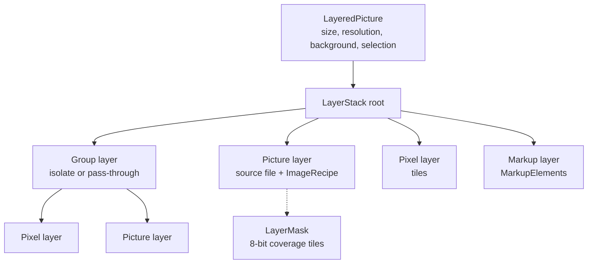

# Images: Layers, Selection and a Blank Canvas — Specification

| | |
|---|---|
| Status | Draft |
| Feature | Images (`product:images`, `Nexaflow.Features.Images`) |
| Size | Small–medium: five phases, each shippable on its own (§12) |

---

## 1. Purpose

The image editor edits one photo through a fixed recipe. This update lets a picture be built from several:

1. **Layers.** Pictures, paint and markup stacked with opacity, blend mode, visibility, lock, masks and groups, kept as
   **OpenRaster** (`.ora`). Nexaflow reads what Krita, GIMP, MyPaint and Pinta write, and writes standard OpenRaster
   they can open; what it writes it reads back exactly.
2. **Selection.** Marquee (rectangle, ellipse), lasso (freehand, polygon), by colour, and the object selection already
   built (SAM 3.1), combined by add / subtract / intersect, and used by every tool that works on part of a picture.
3. **A blank start.** Images opened with no picture shows a start screen: a new canvas at a chosen size, or a picture
   generated to start one.
4. **Print**, for a picture or a canvas.

It is not a painting application. The brush is there to touch up, mask and sketch; the strength stays in the AI tools
and the non-destructive photo edit.

## 2. Guiding principles

1. **A photo edit stays a photo edit.** Until a second layer is added, nothing about editing a photo changes: the recipe,
   its `.nfedit` sidecar and Save in place work as they do. Adding a layer is what makes a document layered.
2. **Non-destructive where it already is.** A picture layer carries its own `ImageRecipe`, so crop, adjust, restore,
   cut out and erase stay editable inside a layered document. Only paint is pixels.
3. **One selection, every tool.** A selection is a coverage mask on the document. Erase, cut out, fill, delete, copy,
   layer masks and crop read it; none has a selection model of its own.
4. **Never pathless.** Every document is backed by a file. A new canvas is a draft (`DraftFile`) in the temp folder,
   saved as it changes, so a crash loses nothing and the first Save asks where — as a generated picture does today.
5. **Pay for what changed.** Pixels live in shared immutable tiles; a brush dab recomposites its dirty rectangle, and an
   undo step costs only the tiles it changed.
6. **Read others, round-trip ourselves.** Nexaflow reads what other applications write, as they write it (§8.3), and
   keeps what it cannot show — an unknown element, attribute or file — when it saves. It promises no round trip through
   another application: Krita, for one, rewrites a file from its own model and drops what it does not know. What Nexaflow
   writes, Nexaflow reads back exactly.

## 3. Today, and the gaps this closes

| Area | Today | Gap |
|---|---|---|
| Document | `ImageEditSession` over one file-backed photo; `ImageRecipe` is a fixed set of sections (`Editing/Recipe/ImageRecipe.cs`), version 4 | no stack of pictures |
| Rendering | `RenderPipeline`: geometry → tone → markup, cached passes; restored picture `SrcOver`, cut-out `DstIn`, erased picture replaces the source | composition is hard-coded |
| Selection | Cut out and Erase take SAM clicks, a box drawn as a SAM box prompt, or a phrase; Erase also brushes. `MarqueeSelect` in `Visuals.Common` selects ListBox rows only; `LassoGeometry` is a decorative locate loop | **no marquee, no lasso**, no pixel selection |
| Markup | vector `MarkupElement`s, editable, always the last pass | no reorder, no place in a stack |
| Codecs | `IImageDecoder` returns one `DecodedImage`; formats hard-coded in `ImageEditingServices` | no multi-layer format |
| Zip packages | the VFS opens `.docx`, `.epub`, `.odt` and the rest through `ZipArchiveHandler`; every write — `CreateArchive`, `Replace`'s rebuild — compresses each entry at one archive-wide level | `.ora` not registered; a package whose `mimetype` must stay stored (OpenRaster, and EPUB and ODF today) has it deflated on any write |
| Opening | `paths` required; empty paths tolerated but shows nothing; `ImageEditSession` needs a path | no start screen |
| Generation | `IAIService.MakePicture(PictureAsked)` saves to `PictureAsked.Path` and opens it; fire-and-forget | a page cannot receive what it asked for |
| Print | PDF (`PdfPaginator`) and Markdown (`MarkdownPaginator`) each own theirs | Images has none |

## 4. The document

`LayeredPicture` is an immutable record: canvas `Width`/`Height`, `Dpi`, a background (transparent, white or a colour;
it is not a layer, but it is drawn beneath them on screen, in Export and in the `.ora`'s `mergedimage.png`, and kept as
`nexaflow:background`), the `LayerStack`, the active layer's id, the `RegionSelection` (§6), and what was read
from the `.ora` and not understood (§8.3). Every edit makes a new `LayeredPicture` sharing everything it did not touch,
so `SnapshotHistory<LayeredPicture>` keeps undo as it keeps the recipe's today.

### 4.1 Layer kinds

Every layer has an `Id`, `Name`, `Visible`, `Opacity` (0–1), `Blend` (§5.2), `Locked` (no edits), `AlphaLocked`
(paint keeps the existing transparency), `ClipsToBelow` (drawn only where the layers beneath it in its group are —
Krita's *inherit alpha*), and an optional `Mask` (§4.2).

| Kind | Holds | Edited by | Saved in `.ora` as |
|---|---|---|---|
| **Picture** | a source picture (file content, by fingerprint), its placement (offset, scale, rotation) and its `ImageRecipe` | the existing tiles: Crop, Adjust, Retouch, Cut out, Resize — on that layer | its rendered pixels, plus the source and recipe as Nexaflow extension files |
| **Pixel** | `TiledPixels`: premultiplied RGBA in 256² tiles, an offset, only the tiles painted | brush, eraser, fill, delete, paste, AI erase applied to its pixels | a PNG of its painted bounds at `x`, `y` |
| **Markup** | `MarkupElement`s, as the recipe holds them today | the Markup tile | its rendered pixels, plus the elements as an extension file |
| **Group** | child layers; `Isolated` (default) or pass-through | the layers panel | a nested `<stack>` with `isolation` |

A picture layer's recipe is the photo editor's own, in its own coordinates; the layer's placement maps it into the
canvas. So everything the photo editor does keeps working on one layer, and a photo opened and given a second layer
becomes a picture layer with its recipe intact. While Crop or Before is out on a picture layer, the canvas shows that
layer alone, as the photo editor shows the photo, so the crop frame and the comparison are in its own pixels.

**Rasterize** turns a picture or markup layer into a pixel layer (what the brush needs); it is a step in the history like
any other.

### 4.2 Layer masks

Any layer, a group included, may carry one `LayerMask`: 8-bit coverage in the same 256² tiles as pixels, in canvas
coordinates, with a value outside its painted tiles (0 or 255), `Enabled`, and `Linked` (moves and transforms with its
layer). White shows the layer, black hides it, grey shows it partly.

- **Made** from the layers panel or the Layer menu: *Reveal all*, *Hide all*, *From selection*, *Hide selection*, *From
  transparency* (the layer's own alpha).
- **Edited** by selecting its thumbnail: the brush, eraser, fill, delete and the selection actions then
  work on the mask in greys, and the colour choice shows black and white only. Alt-click shows the mask alone.
- **Used**: Ctrl-click its thumbnail loads it as the selection; *Invert*, *Disable* (Shift-click), *Apply* (bakes it into
  a pixel layer's alpha) and *Delete*.
- A picture layer's mask is separate from its recipe's cut-out: the cut-out is in the source's pixels and moves with
  the recipe's crop; the mask is in the canvas. *Mask from cut-out* turns one into the other.

The mask is applied after the layer is rendered and before its opacity and blend: the layer's image `DstIn` its
coverage, then composited (§5.1).

### 4.3 From a photo to a layered document

- A photo with only recipe edits is the photo editor as it is.
- **Add layer**, **Paste as layer**, dropping a file on the canvas, or **Generate layer** turns it into a
  `LayeredPicture` whose first layer is a picture layer holding the photo and its recipe.
- The photo is never overwritten by a layered document. The first Save asks where, offering `<photo>.ora` beside it;
  **Export** flattens to any format `ImageExporter.CopyFormats` writes, metadata carried from the bottom picture layer.
- The `.nfedit` sidecar stays with the photo; the `.ora` holds its own copy of the recipe.

### 4.4 Limits

A canvas is at most 16,384 pixels a side. The new-canvas form and Canvas size show the memory a layer takes at that
size (4 bytes a pixel) and warn past a quarter of the machine's memory. History is budgeted in bytes of tiles no longer
in the document (default 1 GB, Options → Images), not in steps; `SnapshotHistory` gains a cost budget beside its count.

## 5. Compositing

### 5.1 The compositor

`LayerCompositor` replaces nothing in `RenderPipeline`: a picture layer is rendered through `RenderPipeline` as today
(geometry, tone, markup, restore, cut-out, erase), and the compositor stacks the results.

- **Per-layer cache.** Each layer's rendered image is cached at the display scale and invalidated by its own changes; a
  picture layer's cache is the pipeline's output, so an Adjust drag redraws one layer's tone pass and the composite.
- **Dirty rectangles.** A paint dab, a fill or a selection delete invalidates its bounds only; the compositor redraws
  that rectangle of each group above it, bottom to top.
- **Groups.** An isolated group composites its children onto a transparent surface (`SKCanvas.SaveLayer` with the
  group's opacity and blend); a pass-through group draws its children onto its parent with its opacity multiplied in,
  as OpenRaster defines `isolation="auto"`. A pass-through group with a mask is drawn as an isolated one, since its mask
  needs a surface of its own to apply to.
- **Masks and clipping.** A masked layer is drawn into its own surface, `DstIn` its mask's coverage, then composited
  with its opacity and blend. A layer that `ClipsToBelow` is composited `SrcATop` onto what its group holds beneath it,
  with its blend applied to the colour — the clip governs coverage, the blend the colour.
- **Display and save.** The display renders at the zoom's scale through the existing `SkiaBitmapPresenter`; Save, Export,
  Print and the `.ora`'s `mergedimage.png` render at full size through the same compositor with caching off, as
  `ImageExporter` does today.
- Banded, parallel drawing (`DrawBanded`) carries over: bands are dirty rectangles too.

### 5.2 Blend modes

OpenRaster's set, so what Nexaflow writes any reader understands. Every one is an `SKBlendMode`:

| OpenRaster `composite-op` | `SKBlendMode` | Shown as |
|---|---|---|
| `svg:src-over` (default) | `SrcOver` | Normal |
| `svg:multiply`, `svg:screen`, `svg:overlay`, `svg:darken`, `svg:lighten` | same names | Multiply, Screen, Overlay, Darken, Lighten |
| `svg:color-dodge`, `svg:color-burn`, `svg:hard-light`, `svg:soft-light`, `svg:difference` | `ColorDodge`, `ColorBurn`, `HardLight`, `SoftLight`, `Difference` | same |
| `svg:hue`, `svg:saturation`, `svg:color`, `svg:luminosity` | same names | same |
| `svg:plus` | `Plus` | Add |
| `svg:dst-in`, `svg:dst-out`, `svg:dst-atop` | `DstIn`, `DstOut`, `DstATop` | Mask, Cut, Behind |

`svg:src-atop` is not a blend in the list: it is read and written as Normal with `ClipsToBelow`, as Krita reads it
(§8.3). An unknown `composite-op` — Krita writes its own as `krita:<op>` — is drawn as the `SKBlendMode` of the same
name where Skia has one (`krita:exclusion`), else as Normal; it is shown under its name and written back as read.

## 6. Selection

### 6.1 The model

`RegionSelection` is the document's selection: an 8-bit coverage mask at canvas size in the same 256² tiles as pixels
(so it shares history the same way), its bounds, and the outline drawn as marching ants (traced from the mask once per
change, at display scale). An empty selection means "everything" to every tool.

Selections are part of the history (Ctrl+Z undoes a selection), are not saved in `.ora`, and are kept per document while
its tab is open.

### 6.2 Tools

| Tool | Key | Makes |
|---|---|---|
| Rectangle marquee | M | a rectangle; Shift for a square, Alt from the centre |
| Ellipse marquee | M again | an ellipse; same modifiers |
| Lasso | L | a freehand outline, closed on release |
| Polygon lasso | L again | straight edges click to click; double-click or click the start to close; Backspace removes the last point |
| By colour | W | pixels within a tolerance of the clicked colour, contiguous or across the layer, on the active layer or the composite |
| Object | O | the existing SAM picking (`PictureCutter`: clicks, a box, a phrase) — its mask becomes the selection |

Every tool takes a mode from its toolbar or a modifier held at the start: **replace**, **add** (Shift), **subtract**
(Alt), **intersect** (Shift+Alt). Shapes are rasterized anti-aliased by Skia (`SKPath` → `Alpha8`) and combined by
`Max` / `Min` / multiply on the coverage.

**Refine**, on the selection toolbar and the context menu: Select all (Ctrl+A), Deselect (Ctrl+D), Invert
(Ctrl+Shift+I), Feather (a Gaussian blur of the mask), Grow / Shrink (morphological, in pixels), Smooth, and Select
subject (SAM with no prompt but the whole picture's most salient object).

The selection is drawn and edited in `EditOverlay`, as the crop frame and erase brush are, mapping display points to
canvas pixels through `EditCanvas.SourceToCanvas`.

### 6.3 What reads the selection

| Action | With a selection |
|---|---|
| Delete / Backspace | clears it on the active pixel layer (to transparent, or to the background colour on a locked-alpha layer) |
| Fill (Shift+F5) | fills it with the colour, on the active pixel layer |
| Copy / Cut / Paste | copies the active layer's or the composite's pixels inside it; Paste makes a new pixel layer at the same place |
| Erase (Retouch tile) | is the erase mask, filled by AI, content-aware fill or the healing brush as today |
| Cut out | becomes the cut-out on a picture layer; on a pixel layer, deletes what lies outside it |
| Mask from selection | the active layer's mask made from it, or hiding it (§4.2) |
| Crop to selection | crops the canvas to its bounds, and lets the selection go, as Canvas size does |
| Brush, eraser | paint only inside it, by its coverage |

### 6.4 In the photo editor (no layers)

Marquee and lasso are offered in Cut out and in Erase as two more ways of marking, beside Pick and Brush
(`EraseMarkWay`, `CutOutMarkWay`), with the refinements beside them, so a photo edit benefits without becoming layered.
Cut out and Erase share one selection: what Pick has picked, with the region drawn over it.

They stay non-destructive: recipe **version 5** adds a `Region` (`RecipeRegion`) to `RecipeCutOut` and `RecipeErase`
— the steps the selection was made by, in order, in oriented-source pixels as every recipe value is: each shape as drawn
(rectangle, ellipse, polygon, each with its mode) and each refinement (invert, feather, grow or shrink, smooth, each with
its radius). A region starts from the SAM finds beside it — on an erasing step grown past their edge as today — and each
step works on what the ones before it left; a shape that replaces the selection starts it again, so drawing one lets the
picks go too. An erasing step's brush strokes are painted over the result. A marquee drawn on a straightened photo is kept
as the outline drawn, a polygon, since a rectangle or ellipse square to the screen is not square to the source. Select all
is a replacing rectangle over the whole photo; Select subject is a SAM box round it. `WrittenVersion` writes version 4
for a recipe that uses no region, and a cut-out with no region is filed under the same kept-mask name as before.

## 7. Painting and moving

Small and deliberate: enough to touch up, mask, sketch and arrange.

- **Brush** (B): round, size, hardness, opacity, flow, spacing; colour from the colour choice markup already has
  (`PullStyleFrom`'s palette and picker). Pen pressure from WPF stylus points drives size and opacity, each switchable.
  Dabs are stamped along the stroke at the spacing into the active pixel layer's tiles; a stroke is one history step.
- **Eraser** (E): the brush with `DstOut`.
- **Eyedropper** (I, or Alt with the brush): the composite's or the active layer's colour.
- **Fill** (G): flood by tolerance, or the selection.
- **Move** (V): moves the active layer, or the selection's contents when there is one (lifted into a floating layer
  until committed — *Drop*, Enter, or leaving the tool lays it back).
- **Transform** (Ctrl+T): scale, rotate and flip with handles, on a layer or the selection's contents; a picture layer
  keeps its source and is resampled from it, so repeated transforms do not soften it. A markup layer has a placement of
  its own, as a picture layer does, so its annotations are transformed as a whole and stay sharp and editable — the Markup
  tool draws on the layer through it. A placement is a full affine (scale, flip, rotation, skew and offset), kept in the
  `.ora` as `nexaflow:placement`'s six terms. Undo during a transform cancels it.
- Painting needs a pixel layer or a mask: on a photo, or with a picture or markup layer active, the Paint panel says so
  and offers *Add layer* (or rasterizing). The colour is markup's ink, one choice for both.

## 8. OpenRaster

### 8.1 The format

OpenRaster 0.0.6 (openraster.org): a ZIP whose first entry is `mimetype`, **stored** uncompressed, holding
`image/openraster`; `stack.xml`; layer PNGs under `data/`; `Thumbnails/thumbnail.png` (at most 256 px a side, aspect
kept, not upscaled, 8-bit); and `mergedimage.png`, the full composite. In `stack.xml`, `<image w h xres yres version>`
holds the root `<stack>`, whose **first child is the uppermost**; `<layer src x y name opacity visibility composite-op>`
and nested `<stack ... isolation>`.

Nexaflow reads and writes the **full baseline**: every layer, group, attribute and blend mode above. It writes version
`0.0.6`, no `x`/`y` on a stack (deprecated there since 0.0.6), and every layer's PNG at its painted bounds.

### 8.2 Through the VFS

An `.ora` is a zip package as a `.docx` is, so it is read and written through the `IVirtualFileSystem` Images is already
given, and the file view can open one as a folder like any other package.

- **Registered** in `ZipArchiveHandler`'s extensions beside `.docx` and `.epub`.
- **Read** by entry: `OpenRasterPackage` opens `stack.xml` and each `data/` PNG by its path inside the package
  (`<file>.ora\stack.xml`), so opening reads only the entries the document needs, and a viewer reads only
  `mergedimage.png`.
- **Written** whole: a save changes `mergedimage.png` and the thumbnail every time, so the package is rewritten, never
  patched, through an atomic write the VFS commits. `IVirtualFileSystem` gains a `CreateArchive` overload taking
  `ArchiveWriteEntry`s with lazy content, so the layers stream from memory to the package without staging files.
- **Stored entries.** `ArchiveWriteEntry` gains a per-entry compression (`Stored`) that `ZipArchiveHandler.Write`
  honours over the archive-wide level, and the order entries are given in is the order written. `RebuildContainer` —
  behind `Replace` and every write into a package — carries each entry's method across from what it read
  (`VirtualEntry.Method`). That keeps OpenRaster's `mimetype` first and stored, and fixes the same for EPUB and ODF,
  whose `mimetype` any write through the VFS deflates today. PNGs are written stored too: they are compressed already.

| Part | Where | Why |
|---|---|---|
| `OpenRasterPackage`: the package's entries, `stack.xml` read into a tree (`OpenRasterStack`, `OpenRasterLayerEntry`) and written back, unknown attributes, elements and files kept | `Nexaflow.IO.Common/OpenRaster/`, over `IVirtualFileSystem` | WPF-free and pixel-free: it hands PNG streams in and out, so a preview elsewhere can read `mergedimage.png` without the Images feature |
| `OpenRasterFormat`: `.ora` ⇄ `LayeredPicture`, PNG decode and encode through Skia | `Features.Images/Editing/Codecs/` | it needs the document model and Skia |
| `OpenRasterDecoder : IImageDecoder`: `mergedimage.png` as one `DecodedImage` | beside it, registered in `ImageEditingServices` | the viewer, carousel, album and previews show an `.ora` as any picture |

### 8.3 Reading what others write

Each application writes the baseline its own way; Nexaflow reads each as it is written. Krita, from its exporter
(`kis_open_raster_stack_save_visitor.cpp`) and importer:

| Krita writes | Nexaflow reads it as |
|---|---|
| `edit-locked="true"` (its user lock) | `Locked` |
| `selected="true"` on its active layers | the first as the active layer |
| `composite-op="svg:src-atop"` (its *inherit alpha* on a Normal layer), or `alpha-preserve="true"` beside another op (inherit alpha with that blend) | `ClipsToBelow`, with the blend |
| `isolation="auto"` (its pass-through group) | a pass-through group |
| `x="0" y="0"` on every stack, layers at their bounds | as written |
| `krita:<op>` for a blend outside OpenRaster's set; `svg:clear` | the blend of that name where Skia has one, else Normal; kept as written |
| `<filter type="applications:krita:<name>">` (an adjustment layer, no pixels) | a layer Nexaflow cannot draw — the file holds the filter's name, not its settings, so no reader can redraw it. Listed, named and kept on save; the document opens showing its saved look (§8.6) |
| masks applied into each layer's pixels (it writes a layer's projection) | the pixels as they are |
| `version="0.0.1"`; no `xres` means 72 dpi by the spec (Krita reads 75) | as written |

GIMP, MyPaint and Pinta write subsets of the same; files saved by each are in the test set (§12.3). `selected`,
`edit-locked` and `alpha-preserve` are also what Nexaflow writes, so a layer locked, active or clipped in Nexaflow opens
the same in Krita.

### 8.4 A layered-format contract

`IImageDecoder` returns one picture, so a layered format gets a contract of its own beside it, in the Images feature:
`ILayeredPictureFormat` — `Reads(container)`, `Extension`, `ReadAsync(path) → LayeredPictureRead` (the picture, and whether
it holds a layer no reader draws), `WriteAsync(LayeredPicture, path, renderer)`. It takes a path in the
`IVirtualFileSystem`, not a stream, so a read opens only the entries it needs (§8.2) and a write is one atomic package
write; the renderer draws each layer's pixels and the merged image at full size.
OpenRaster is the first; PSD (§13) would be the second, with nothing in the editor changed. `ImageContainer` gains
`OpenRaster` (sniffed by the `mimetype` entry), and the editor opens a container that has a layered format as a
`LayeredPicture`, any other as a photo.

### 8.5 What Nexaflow writes

Standard OpenRaster any reader draws correctly, with what only Nexaflow uses beside it under its own namespace
(`xmlns:nexaflow` on `<image>`), so a file Nexaflow wrote reads back exactly:

- **A picture layer** is its rendered pixels (`data/layerN.png`), with
  `nexaflow:source="data/nexaflow/source-<hash>.<ext>"` (the original file, as it was, named by its content so a picture
  two layers show is stored once) and `nexaflow:recipe="data/nexaflow/recipeN.nfedit"`.
- **A markup layer** is its pixels, with `nexaflow:markup="data/nexaflow/markupN.json"` in `ImageRecipeJson`'s markup
  form.
- **A masked layer** is an isolated `<stack nexaflow:role="masked">` carrying the layer's name, opacity, visibility,
  blend and clip, holding two layers: on top the mask (`nexaflow:role="mask"`, `composite-op="svg:dst-in"`, white with
  the mask as its alpha; `visibility="hidden"` when the mask is disabled), beneath it the layer itself at full opacity,
  Normal. Every reader draws that as the masked layer and shows it as a group of two it can edit; Nexaflow reads the
  roles back as one layer with its mask. A stack without the roles — a group another application made of the same
  shape — stays a group.
- **`AlphaLocked`** is `nexaflow:alpha-locked="true"`; it changes how paint lands, not how the picture looks, so a reader
  without it loses nothing it draws.
- **Pixels the extensions no longer describe.** An application that keeps the attributes but edits the PNG leaves the
  two out of step, so each layer PNG's SHA-256 is written as `nexaflow:pixels`; a mismatch on reading means the pixels
  win and the layer is read as a pixel layer. A layer whose extension files are missing is read the same way.

### 8.6 Opening, saving and the file map

- `.ora` joins `ImageFileTypes.Extensions` — what Images opens — and the `/image` and `/image/edit` criteria in
  `default-filemap.json`, so it opens in Images from the file view like any picture. `DecodablePictures` stays what
  Windows' imaging decodes, since the PDF and Scratchpad features decode those files themselves.
- Opening an `.ora` for editing opens the layered document; in the viewer it shows the merged picture.
- **The saved look.** A file holding a layer Nexaflow cannot draw (§8.3) opens in the editor showing its
  `mergedimage.png` — the picture as the application that wrote it drew it — with a bar saying which layers cannot be
  drawn and offering two ways on:
  - **Use the saved look** replaces the stack with one picture layer made from `mergedimage.png`, the effect baked in,
    for editing on without losing it; one history step.
  - **Edit the layers** shows the composite Nexaflow draws, the undrawable layers left out, and keeps them on save.

  Until one is chosen, editing anything chooses *Edit the layers*. A file Nexaflow can draw whole never shows the bar.
- Save writes the whole package through the VFS's atomic write (§8.2), debounced as the recipe sidecar is; a large
  document saves in the background through the existing `ImageSaveTask`.
- **New picker**: *Layered picture (.ora)* (`IFileCreateWithOptions`) creates a blank `.ora` in the folder and opens it
  for editing, its size and background set up in the picker by `CanvasSetup` — the presets, units, dpi, orientation and
  background of the start screen's New picture (§9.1), which uses the same.

## 9. The start screen and generation

### 9.1 Images with no picture

`paths` becomes optional on `ImageTabRegistration`. With none, the page shows **New picture**:

- **Size presets** — Screen (the monitor's size), Square 1024, Full HD, 4K, A4 and Letter at 300 dpi, Social (1080 ×
  1350) — and a custom width × height with units (px, mm, in) and dpi; orientation swap. Screen is chosen to start with,
  once the screen's size is known: someone starting from nothing has a size to answer, and the screen's is the likeliest.
- **Background**: transparent, white, or a colour.
- **Create** makes the canvas as a draft `.ora` (one empty pixel layer) and opens it in edit mode, in the same tab: the
  page takes the canvas's title and parameters, and the draft's Save as — the editor's Save asks it too — turns the tab
  into the file kept, as any draft does.
- **Generate a picture**: the prompt and the model's own choices (`IAIService.MakesPictures` — aspect, resolution,
  detail, seed, negative prompt, LoRA) with the canvas size picking the nearest aspect; the picture arrives as the
  canvas's first picture layer. Hidden when the workspace has no image model, with the reason and a link to its AI
  settings, as Gen Image does today.
- **Paste from clipboard** (when it holds a picture) and **Open picture…**.
- **Recent canvases**: the last `.ora` files and unsaved drafts opened here, kept in the Images settings
  (`ImagesConfig.RecentCanvases`) so every tab and every session shares them.

How it is reached: *New picture* among the pages the ribbon editor adds (the registration is `CanBeContextItem`, its
`paths` optional, as the Font viewer's are), an Images tab opened with no picture, and an Images tab whose last picture is
closed. The New picker's *Layered picture* makes its canvas in the picker itself, with the same `CanvasSetup` (§8.6).

### 9.2 Generating into the canvas

`IAIService.MakePicture` saves and opens; a canvas needs the picture handed back. `MakePicture` returns a
`PictureJob` whose `Made` task completes with the saved path (null when stopped, withheld by the picture check, or
failed), and `PictureAsked` gains `OpensWhenMade` (default true, as today). The canvas asks for a draft path, does not
open it, and adds the picture as a picture layer, fitted to the canvas and centred, when it arrives — on the start screen
beneath the empty layer, as the canvas's first. Until then a row above the layers panel (`CanvasPictures.Pending`)
shows the job's progress (`PictureJob.Progress`, the step its model reports) and Stop; it is not a layer of the picture,
so nothing of it is ever saved. A picture that arrives while its canvas is not shown is added once it is. The job stays
one of the workspace's background jobs, listed and stoppable as now.

- **Generate layer** (layers panel): the same, at the canvas size, into a new layer above the active one.
- **Dropping pictures** on the canvas adds each as a picture layer above the active one, fitted and centred — a photo made
  a layered picture first (§4.3).

Generating into a selection (generative fill) waits for a local model that takes a mask (§13).

## 10. Print

**Print** (Ctrl+P) on the Images toolbar, for a picture (as edited) and a canvas (its composite), through WPF's
`PrintDialog` and a `PicturePaginator : DocumentPaginator` in the Images feature — as PDF and Markdown each own
theirs.

- **Size**: fit to page (default), fill page (cropped), actual size at the picture's dpi (tiled across pages when
  larger), or a set width.
- **Orientation**: automatic from the picture's shape, or as chosen; margins; centre on page.
- Renders at the printer's resolution through the full-size path, never the screen preview: no more pixels than the
  printer lays down at the printed size. A photo's actual size is at 72 dpi, the resolution taken for any picture whose
  file says none; a layered picture's is its own.

The button is enabled only while there is something to print — a picture shown, or a canvas — so on the start screen it
is there and disabled.

## 11. Open questions

None.

## 12. Build phases

| Phase | Delivers | Size | Depends on |
|---|---|---|---|
| 1 | **Selection in the photo editor**: `RegionSelection`, marquee (rectangle, ellipse), lasso (freehand, polygon), modes, refine; Cut out and Erase take it; recipe v5 | S–M | — |
| 2 | **Layered document**: `LayeredPicture`, `TiledPixels`, `LayerCompositor`, layer kinds, clip to below, layer masks made from selections and transparency, layers panel (thumbnails, drag to reorder, visibility, opacity, blend, lock, group, duplicate, merge down, flatten, rasterize, mask actions), Canvas size, Export flattened; selection actions on layers (§6.3) | M | 1 |
| 3 | **OpenRaster**: per-entry stored compression and method-preserving rebuild in the VFS (fixing EPUB and ODF too), `.ora` in `ZipArchiveHandler`, `OpenRasterPackage` in `IO.Common`, `OpenRasterFormat` with masks and Krita's attributes, `ILayeredPictureFormat`, merged-image decoder, file map, New picker entry | S–M | 2 |
| 4 | **Start screen and generation**: optional `paths`, New picture, draft `.ora`, `PictureJob`, Generate layer, paste, drop files as layers | S–M | 2, 3 |
| 5 | **Paint, move, transform, print**: brush, eraser, eyedropper, fill — on pixels and on masks — move, transform; Print and `PicturePaginator` | S–M | 2 (print: none) |

Print has no dependency and can ship with phase 1.

### 12.1 The assistant

On an Images tab with a layered document, beside the tools it has: `list_layers` (names, kinds, visibility, order),
`set_layer` (rename, show / hide, opacity, blend, move up / down), `generate_layer` (a background job, as
`generate_image` is), and `select_in_picture` sets the document's selection rather than only showing a cut-out. They act
only on the document the tab has open.

### 12.2 Product tree

New nodes under `images-edit`, added as each phase is built, with snaplinks in `docs/product/pending/<branch>.json`:
`images-layers` (the document and compositor), `images-layers-panel`, `images-layer-masks`, `images-selection` (with `-marquee`, `-lasso`,
`-colour`, `-refine`), `images-paint`, `images-transform`, `images-ora`, `images-start`, `images-print`.

### 12.3 Tests

- **Leaf units**: every blend mode against a reference composite; isolated and pass-through groups; masks (enabled,
  disabled, on a group) and clip to below; dirty-rectangle recomposite equal to a full one; tile sharing across history
  steps and the byte budget; selection rasterization and each combine mode; feather / grow / shrink; recipe v5 read and
  written, v4 written when no region.
- **VFS**: a stored entry stays stored and first through `CreateArchive` and through `Replace`'s rebuild; an EPUB edited
  through the VFS keeps its `mimetype` stored.
- **OpenRaster**: everything Nexaflow writes reads back equal — every layer kind, attribute, blend, mask, clip and
  extension; `mimetype` first and stored; thumbnail limits; unknown attributes, elements and files kept; a mismatched
  `nexaflow:pixels` read as pixels; a same-shaped stack without the roles read as a group. Files saved by Krita (with
  inherit alpha, pass-through groups, locks, `krita:` blends and a filter layer), GIMP, MyPaint and Pinta open with the
  composite of their `mergedimage.png`; the file with a filter layer opens on its saved look, and *Use the saved look*
    gives one picture layer equal to `mergedimage.png`.
- **Journeys**: start screen → new canvas → add layer → paint → select → delete → save `.ora` → reopen; photo → lasso →
  erase → save in place (no layers); generate into a new canvas. Every new button carries an AutomationId named by a
  journey.

## 13. Forward look

Not in scope, and nothing here should block them: **generative fill** — a selection regenerated from a prompt by a
local model that takes a mask, its result a new layer masked by the selection, so the original stays beneath; adjustment
layers (a layer holding an `ImageRecipe`'s tone section, applied to what is beneath); PSD read and write as a second
`ILayeredPictureFormat`; text layers; 16-bit and wide-gamut layers (OpenRaster allows a 16-bit `mergedimage.png`);
printing several pictures as a contact sheet from the album.

## 14. Out of scope

Brush engines beyond the round brush, vector shapes beyond markup, animation and frames, CMYK, and a node or workflow
editor.

## References

- OpenRaster file layout: https://www.openraster.org/baseline/file-layout-spec.html
- OpenRaster layer stack: https://www.openraster.org/baseline/layer-stack-spec.html
