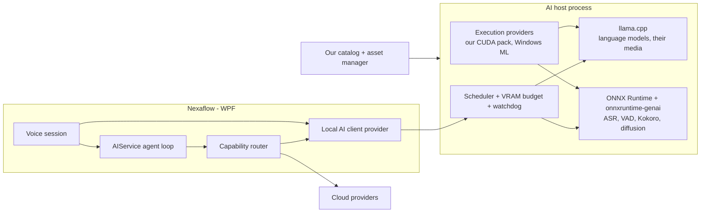
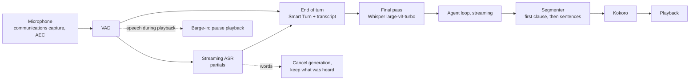

# Local AI — voice conversation, on-device models, media generation

**Status: phases 1, 2 and 3 built; phase 4 under way.** Replies stream through the agent harness; each ability is served by a chain of
models that asks before high-risk context leaves this machine; providers serve speech to text beside language
models, and the mic listens through the grid's Speech In chain (Nexaflow's own Whisper on this machine, OpenAI's
realtime transcription in the cloud); local models' files live in one verified, resumable store; System Info reports what the
machine can run. Nexaflow runs Gemma 4 E4B itself, in its AI host — on llama.cpp, from Google's own 4-bit build, on
CUDA from a pack fetched from where NVIDIA, Microsoft and llama.cpp publish it, or on the CPU — as the provider
"Nexaflow", chosen when a workspace is set up; tools can hand a model recordings to hear; and an AI-path suite runs the
agent loop on it. Every model calls tools in its own protocol, prompted by its own chat template.
A voice conversation runs from the AI bar — listening in the host (Silero, Nemotron, Whisper large-v3-turbo, small or
small.en, Smart Turn), Kokoro speaking English, French and German, barge-in, and actions announced before they are done. The assistant
makes pictures, speech and video clips with the workspace's models (phase 4) — through OpenAI and Gemini, and on this
machine pictures with Z-Image Turbo, and at high quality with HiDream-O1, and clips with Wan2.2-TI2V-5B — distilled to
three steps (FastWan) for clips from a description, and its fifty guided steps for clips from a picture; music on this
machine is still to come. This
records what was measured, the decisions taken, the design that follows, and the order to build it in. Where it names a type, check for collisions before introducing it.

The test beds behind every number here live outside the repository, in `D:\codedev\nexaflow-ai-testbed` (its
`README.md` says how to re-run each measurement), until the implementation is done.

## What we want

1. **Voice conversation.** Press once to start listening; the session stays open until the user (or the
   assistant) ends it. The user speaks, the assistant answers aloud, either side can interrupt, and tools and page
   context work as they do in the input bar.
2. **A local LLM** for machines with a capable GPU — for users with no subscription, who want nothing to leave the
   machine, or who want the cheap, frequent calls kept off the API bill. Weaker than a frontier model; far better
   than nothing.
3. **Generation as agent tools**: images, speech, video clips, sounds and music.

All three run on engines in Nexaflow's own process, and **Nexaflow owns everything around them**: **llama.cpp** for
language models — Gemma 4 and Qwen 3.5 to 3.8, with the pictures and recordings they take in — and **ONNX Runtime**
for the rest: onnxruntime-genai for speech recognition, plain sessions for TTS, voice activity detection, diffusion
and audio generators; our own catalog, downloads, runtime provisioning, chat templates, memory policy and scheduling.

## Decisions

| Question | Decision |
|---|---|
| Whose harness | What a workspace chooses is not where a model runs but **who runs its harness** — the prompt, the chat template, the context cache. **Bridged**: Nexaflow is a client of a harness that is not its own — Claude, OpenAI, Gemini, but also Ollama and Aria, though they run on this machine — and nothing for the AI host is downloaded or loaded. **Owned**: Nexaflow is the whole harness, through the AI host — Gemma 4 E4B by default, or whichever model the user picks. Chosen when a workspace is set up, once an owned model exists to choose; **mixing** both stays possible through the grid's chains. |
| Where data goes | A second, separate property of each provider: whether a request's content **stays on this machine**. Ollama on `localhost` does though it is bridged. A page whose context is high-risk asks before its contents go to a provider whose data leaves this machine. |
| Where voice lives | **The AI input bar**, in a voice mode: the bar becomes a live line both sides speak into, and anything the assistant produces that is not speech — a diagram, a table, code — opens as an overlay on the current page, so the user keeps working while talking. **The conversation page** is the focused alternative: both sides write into the conversation. |
| Activation | **Press to start listening**; it stays live until stopped. The assistant gets a tool to end the session itself ("that's all, thanks"). |
| TTS voice | **Kokoro** — clearly better than Pocket TTS and ZipVoice in listening. |
| Languages | **English, French and German** throughout, in that order of priority: recognition, the model, and a Kokoro voice for each — `ff_siwis` for French, the community German fine-tune's `df_kerstin` for German. Both beat Piper's voices in listening; Kerstin is the weakest of the three and good enough to start (below). |
| GPUs | **A setup per machine**, not a minimum. Each model a workspace uses is placed on a GPU with room for it, a language model given the context the room allows, and a part with no room runs on its CPU build (below). The default model, Gemma 4 E4B, fits beside its voice models on a 16 GB card and runs on two 11 GB cards with the voice models on the other; a larger model is offered where it fits. |
| Catalog and runtime provisioning | **Ours.** Foundry Local was evaluated and not adopted: it would own the runtime version, storage, memory policy and model list that this design needs to control (below). Runtime libraries come from where their makers publish them — nuget.org and NVIDIA's wheels on PyPI — pinned by SHA-256; only what we convert or modify ourselves would be published by us. |
| Image models | **Z-Image Turbo** draws on this machine, and **HiDream-O1** is its high-quality model. Of the models with permissive licences it drew the most accurately — French and German text, labels — at 2.5 s a picture; HiDream-O1 (MIT) draws the most photographic pictures — 94 s in PyTorch, 36 s as our build. Ruled out by licence: Stable Diffusion 3.5 (Stability's community licence), HunyuanImage (not licensed in the EU, UK or South Korea) and Qwen-Image-2.1 (research only); Qwen-Image-2512 misspelt and needs 58 GB, FLUX.2 klein garbled text (below). |
| Video model | **Wan2.2-TI2V-5B** (Apache-2.0) makes clips on this machine, in two builds sharing every part but the denoiser: **FastWan2.2-TI2V-5B** (Hao AI Lab, Apache-2.0), distilled to three steps, makes a five-second 720p clip in seconds and is the fast video job's; the full model's fifty guided steps are the high-quality job's, and make the clips that start from a picture — FastWan, distilled from text alone, cuts away from one. Wan2.2 is the newest Wan with open weights; Wan2.1's 1.3B model makes 480p clips from text alone (below). |
| Language-model runtime | **llama.cpp**, in the host, through its C API — upstream's release builds as they are, pinned by build and SHA-256: its CPU build in the install, its CUDA backend in the CUDA pack. On Gemma 4 E4B against onnxruntime-genai it holds a 16k conversation in 4.3–5 GB rather than 14 GB and writes 155–190 tokens/s rather than ~54: it keeps only the window Gemma's local layers attend to, and has kernels for its 512-wide global heads, where ONNX Runtime's fall back to materialising the scores. It also takes images and audio into a conversation already under way. Forked only if a patch upstream will not take is ever needed; LLamaSharp was not adopted because its bundled natives go stale, as `TreeSitter.DotNet`'s did (below). |
| Chat templates | **Each model's own**, from its GGUF, rendered by a Jinja engine of the host's own (`Nexaflow.AiHost.Jinja`): llama.cpp's C API has no Jinja, and no .NET package renders Gemma 4's template. It runs templates as transformers does, and every shipped family's template is held to Python's renders of it (`tools/ai-models/chat-templates`). **Reasoning is on, and never shown**: with it off, Gemma 4 ends its turn in silence after a tool's result, and what an action came to — which name went into the spreadsheet — is worth saying; it costs the reasoning's tokens before each answer. |
| Tool calls | **Each model's own protocol**: tools are declared to Claude, OpenAI, Gemini and Ollama as their APIs take them, and to an owned model as its chat template does (Gemma 4's `<|tool_call>` syntax and Qwen's `<function=…>` tags, read from their tokens); planning and filling in the input box are tools too. Only a model with no tool calling of its own (Aria) is taught a fenced `client_tool` block. A call that cannot be read is written again in a context of its own and takes the attempt's place (below). |

## What was measured

On an RTX PRO 6000 (96 GB) and a Ryzen 9 9950X3D: onnxruntime-genai 0.17.1, ONNX Runtime 1.30, KokoroSharp 0.8.4,
sherpa-onnx 1.13.8, Foundry Local 2.1.0.

### The model

**Gemma 4 E4B** (text, image and audio in; text out) runs on llama.cpp b11606 from Google's
[QAT Q4_0 GGUF](https://huggingface.co/google/gemma-4-E4B-it-qat-q4_0-gguf) and its multimodal projector, through the
host's own decode loop over llama.cpp's C API and its multimodal library.

| | Measured |
|---|---|
| Gemma 4 E4B QAT Q4_0, CUDA | 6.1 GB download with its projector; 4.1 GB loaded, 6.3 GB with the projector and a 16k cache for eight conversations; 155–220 tok/s; 16k tokens read in 1.1 s |
| Same, by conversation length | 3.7 GB at 1k tokens, 3.9 GB at 16k, 4.7 GB at 64k (without the projector) |
| An image, 20 s of audio | read in 0.21 s and 0.45 s; the projector holds about 1.4 GB |
| The same model on onnxruntime-genai | the onnx-community q4f16 export: 6.4 GB loaded, 9.0 GB at 4k, 14.0 GB at 16k, ~54 tok/s — the working memory of each step grows with the conversation; a 4-bit build of our own (mobius-onnx) was no better, 13–15 GB at 16k |
| The other language models on llama.cpp | in the catalog's table (Models, below) |
| Transcription by Gemma | verbatim on clean speech; **30 s audio window, silently truncated beyond it** |
| ONNX Runtime and llama.cpp in one process | both on CUDA, sharing one cuBLAS 13 |
| VRAM after disposing every model | ~1.8 GB stays with the process until it exits |

llama.cpp's arithmetic depends on how a prompt was split into reads, so a context appended in pieces and the same
context read whole agree in what they say next, not always in its wording.

onnxruntime-genai defects hit along the way, each a reason to keep native inference out of the WPF process: an
access violation when the embedding model runs on CPU and the decoder on CUDA; DirectML failing on quantized
gathers; two images in one prompt failing; CUDA graph capture producing garbage on this export; a process that hung
at exit, unkillable, when it had not held an `OgaHandle` for its lifetime.

### Voice round trip

Simulated microphone, real-time paced: Silero VAD → streaming ASR (Nemotron 0.6B int4) → Gemma 4 E4B → first
clause → Kokoro TTS.

| | Speech models on GPU | Speech models on CPU |
|---|---|---|
| Resident VRAM, all four models | 9.8 GB | 6.6 GB |
| User stops talking → assistant starts talking | **1.3 s** | 1.5–1.6 s |
| of which: end-of-turn silence wait | 600 ms | 600 ms |
| ASR, real-time factor | 15–19× | 8–11× |
| TTS, real-time factor | 19–20× | 11× |
| Barge-in: user speech detected | ≤ 210 ms after they start | same |

Starting speech at the first clause instead of the first sentence took the round trip from 1.9 s to 1.3 s. The
fixed 600 ms silence threshold also **cut an interruption in half** ("Wait, stop. Just tell me a short joke
instead." arrived as "Wait, stop") — turn detection needs more than a silence timer.

TTS compared through sherpa-onnx on CPU (8 threads): Kokoro 267 ms to first audio at 10–12× real time; Pocket TTS
422 ms at 6×; ZipVoice ~1 s at 3–4×. All three read back verbatim through ASR; Kokoro sounded clearly best.

### In a real room

Monitor speakers with a webcam microphone mounted just above them, normal volume; two speakers — native English
with accented French and basic German, and native French with B2 German:

| | Measured |
|---|---|
| Echo, assistant talking for 114 s, nobody else | raw microphone: the ASR transcribed 286 of the assistant's words and the VAD fired 20 times. **Communications capture: 0 words, 0 triggers** — about 50 dB removed from the first second, in all three languages |
| What Windows applies to a communications stream | echo cancellation, noise suppression, gain control (reported through `IAudioEffectsManager`); the echo reference set to the playback endpoint through `IAcousticEchoCancellationControl` |
| Interruptions | 14 of 14 caught, **96–236 ms** after the person started (median ~110 ms, a 96 ms speech rule included); 14–43 ms from the frame to the stop; the speaker 6 dB down ~50 ms later |
| Talking over the assistant | not suppressed — recognised as well as single-talk ("White stop, can you say that more simply", "Attends, arrête, tu peux dire ça plus simplement") |
| Backchannels ("mm-hm… yeah", "mm… oui", "ja… mhm") | the VAD fires on most (a native speaker's natural ones: 6 in French, 9 in German); **the ASR returns no words for any** |
| Typing and clicking while it talks | no triggers |
| Hesitations inside a turn ("um", "euh", "ähm"), 0.26–2.4 s | a 600 ms silence timer ends the turn at the first one; **Smart Turn waited through 21 of 22** |
| Ends of turns | Smart Turn recognised 24 of 28; it missed turns longer than its 8 s window |
| Smart Turn v3.2 on its own test set, in C# | English 95.9 % (human speech), French 93.7 %, German 95.8 %; 8 ms per decision on 4 CPU threads |
| Recognition, native speakers | English: every utterance right; French: 6 of 7 exact |
| **Short utterances** | Nemotron returns **nothing** for an isolated "No.", "Nein." or "Stopp." (clean synthetic speech), and for a B2 speaker's "Nein, nicht das" and "Entschuldigung — kurze Frage". **Whisper large-v3-turbo got every one** — from C# on onnxruntime-genai, 17 ms for a one-word turn, 23 ms for 3 s, 52–59 ms for 8 s, 3.3 GB of VRAM; it is also better on accented French. Gemma 4 E4B, asked to transcribe, got the English but not reliably the German |

### Runtime provisioning

| | Measured |
|---|---|
| onnxruntime-genai CUDA package | 210 MB, **plus ~1.1 GB of NVIDIA libraries it does not carry** (cuBLAS 13, cuDNN 9) — without them the model fails to load |
| Windows ML | 82 MB, no CUDA; Windows downloaded and registered NVIDIA's TensorRT-RTX provider itself in 6.4 s. Today's Gemma exports barely use it (12 tok/s, mostly CPU fallback) — it needs models built for the provider |
| CPU only | 27 MB |
| Two CUDA stacks in one process | **break** — they load clashing cuDNN DLLs. One CUDA stack per process |
| **One process: ONNX Runtime GPU + our CUDA pack + Windows ML** | **works.** Windows ML registered TensorRT-RTX into the GPU build's runtime in 1 s; onnxruntime-genai (Gemma reading an image) and a plain session (Kokoro, 29 ms warm) ran on CUDA with every NVIDIA library loaded from the pack folder and no toolkit on PATH |
| A CUDA pack | cuBLAS 13 (484 MB) + cuDNN 9 for CUDA 13 (407 MB), plus the CUDA provider and onnxruntime-genai's CUDA layer (183 MB) — about 1.1 GB |
| TensorRT-RTX on Kokoro and Silero graphs | both rejected (an unsupported `Squeeze` kernel; an engine build failure) — **identically in a Windows-ML-only process**, so this is the provider's graph support, not the mix |

### Foundry Local — evaluated, not adopted

[Foundry Local](https://www.nuget.org/packages/Microsoft.AI.Foundry.Local) is Microsoft's on-device model runtime:
a C# SDK (MIT) over a native core that manages a model catalog, downloads, per-machine variant selection and
execution-provider provisioning, and runs onnxruntime-genai sessions. It worked: 43 MB of payload; CUDA, TensorRT-RTX
and WebGPU provisioned in 35 s (its 2 GB CUDA pack carries cuBLAS and cuDNN); 49 catalog models with a variant
chosen per machine; Qwen 3.5 9B at ~100 tok/s; our own Gemma 4 E4B registered beside the catalog, running text, image
and audio at 65–75 tok/s; live transcription finishing 26 ms after the audio; and our direct onnxruntime-genai and
ONNX Runtime sessions running on the CUDA provider it downloaded, with no CUDA toolkit installed.

It is not adopted because it would own what this design needs to control:

- **The runtime version.** Its CUDA pack is built for one onnxruntime-genai and ONNX Runtime pair
  (`ort-1.30.0-genai-0.17.1`), and a second CUDA stack cannot share the process. New architectures arrive through
  onnxruntime-genai releases, so Foundry's release cadence would gate the larger models the strongest machines can
  run.
- **The model list.** The catalog is curated for small, broadly-shipped models. Our own models can be registered,
  but only for the model types Foundry's core runs.
- **Memory and storage.** Qwen 3.5 9B held 18–20 GB of VRAM with nothing exposed to bound it; about 19 GB on disk
  held 9 GB of models and 2 GB of providers.
- **Its defects are ours to wait on**: a catalog variant (Qwen 3.5 2B) that fails to start, a failed provider
  download reported as success, a `MAX_PATH` limit on its data directory, ~4 s of provider registration at every
  start, and telemetry on unless switched off.

What it gives — provisioning, a catalog of per-provider variants, sessions with rollback — is small and buildable,
and the design below borrows its shape. Qwen models also reasoned before answering whatever the request asked
(all 300 tokens of a budget), and Qwen 3.5's tool calls came back as text rather than parsed calls — model traits,
not Foundry's.

## Architecture

### One host process on one stack

Local models run in `Nexaflow.AiHost`, a helper executable beside the app, as `Nexaflow.PrivilegeBridge` is. The app's
`AiHostClient` starts it on the first request for a model, speaks to it over a named pipe only the user can open, and
binds it to the process-wide kill-on-close job object (`KillOnCloseJob`, shared with the terminal) so it dies with
the app. Every reason is something the test beds hit:

- **A native crash takes its process down.** Two access violations in onnxruntime-genai during testing; in the
  host that is a restart and a retried request, in the WPF process it is the whole app.
- **VRAM only fully returns when a process exits.** The host can be recycled to reclaim what disposed models leave
  behind.
- **Native stacks cannot be mixed.** Two CUDA stacks in one process loaded clashing cuDNN; sherpa-onnx and Windows ML
  each ship their own `onnxruntime.dll`; the same class of problem the LlamaSharp provider
  ([PR #74](https://github.com/smile-forge/nexaflow/pull/74)) fought with mirrored CUDA binaries. The Whisper
  provider's `Whisper.net.Runtime.Cuda` (149 MB of ggml CUDA natives in every install) leaves the app for the same
  reason once speech runs in the host.
- **One owner for the GPU.** Scheduling and the VRAM budget only work if one process decides.
- **A watchdog.** Neither onnxruntime-genai nor ONNX Runtime has a request timeout; a host that stops answering is
  killed and restarted.

Inside the host there is **one CUDA stack** — NVIDIA's runtime, cuBLAS and cuDNN, loaded once — and three surfaces
over it:

- **llama.cpp** — the language models: one KV cache per model, a sequence in it per conversation, read and sampled by
  the host's own loop a GPU step at a time; its multimodal library reads pictures and recordings into a sequence.
- **onnxruntime-genai** — streaming ASR (`StreamingProcessor`) and Whisper.
- **plain ONNX Runtime sessions** — Silero VAD, Kokoro (KokoroSharp takes the session options) and diffusion
  pipelines, on the same execution providers.

Execution providers come from two places, into **one host build for every machine** — ONNX Runtime's GPU build,
which carries the CUDA provider:

- **The CUDA pack** on NVIDIA (`CudaRuntimePack`): ONNX Runtime and onnxruntime-genai built with their CUDA layers,
  llama.cpp's CUDA backend from the release the install's llama.cpp comes from (which a test holds them to), and
  NVIDIA's CUDA runtime, cuBLAS and cuDNN. ONNX Runtime loads its CUDA provider from the folder `onnxruntime.dll` came from, so
  the pack carries the runtime itself — the same build as the install's, which a test holds them to — and a host
  started on it binds both managed wrappers to the pack's copies and puts the folder first on its `PATH` before
  anything loads. Nothing else NVIDIA is needed, toolkit or not. Without the pack the host runs on the install's CPU
  runtime.
- **Windows ML's provider catalog** for TensorRT-RTX, OpenVINO and NPUs: `EnsureAndRegisterCertifiedAsync`
  registers them into the same runtime, and sessions reach them through `OrtEnv.GetEpDevices`. Only Windows ML's
  bootstrap DLL ships; its own `onnxruntime.dll` must not. **Not wired yet**: it arrives with the first catalog model
  built and checked for one of its providers, so nothing is registered with nothing to run on it.

A provider being present does not mean a model runs on it: TensorRT-RTX rejected the Kokoro and Silero graphs as
exported. The catalog names, per model, the providers its variants were built and checked for.

Speech runs in the same host. sherpa-onnx (wake words, denoise, diarization, 80 ms-chunk ASR) would need a process
of its own because of its runtime, and is not needed for the decisions above.

Layout: `src/Nexaflow.AiHost/` — `Nexaflow.AiHost.Contracts` (the pipe's messages and framing), `Nexaflow.AiHost.Client`
(the app's side, and the CUDA pack's manifest) and `Nexaflow.AiHost` (the executable); the provider is
`Nexaflow.Providers.AiHost`, which takes the client by constructor injection like any app-wide service.

The client watches the host three ways: a heartbeat answered on the host's reading loop, so a frozen process shows
however busy its requests are; a stall limit per request, so a request that stops replying is taken for a hang; and
a grace after a cancellation, so a request that will not stop is one. Any of them kills the host; the next request
starts another, and a host that keeps crashing is not restarted until it has stayed down a while.

A speech model onnxruntime-genai runs is prepared once in its folder by the adapter its catalog names — its export's
own config made provider-neutral, `genai_config.base.json`; the host writes `genai_config.json` for the runtime it is
on before loading, since onnxruntime-genai's API can set only the decoder's providers. A language model needs no
preparing: llama.cpp loads its GGUF and projector as published.

### Capabilities instead of one text contract

`ILlmProvider` stays the text-generation contract. It streams its reply as events (`StreamAsync`), takes **audio
attachments** beside image ones (`LlmAttachment.IsAudio`, `SupportsAudio`) — a recording a tool hands over
(`ToolResult.Audio`) reaches a model that hears as audio and any other as what the Speech In model heard in it — and,
for a provider that `SupportsToolCalls`, takes the tools it may call (`LlmTool`, a JSON Schema each) and streams each
call it makes as an `LlmToolCallRequested`; what came of a call goes back as an `LlmRole.Tool` message that `Answers`
it. A call carries what its provider wants back with it (`Signature`, Gemini's thought signature) and, when its
arguments did not read, the arguments as written (`Unread`). Beside it, in `Providers.Common`:

| Capability | Shape |
|---|---|
| speech to text | streaming: audio frames in, partial and final transcripts out; VAD events |
| text to speech | streaming: text segments in, audio chunks out; cancel; how much was spoken |
| image generation | job: prompt (+ pictures to work from, a mask) in, one picture out; progress on the activity |
| audio generation | job: prompt in, audio file out, progress (sound effects, music) — arrives with music |
| video generation | job: prompt (+ a first frame, where the model carries one on) in, one clip out; progress on the activity |

Every capability has owned and bridged implementations — OpenAI and Gemini serve speech, pictures and video — so a
bridged workspace gets voice and generation without a GPU, and an owned one gets them on the machine. A provider
declares what it offers: input and output kinds, streaming, tools, context window, **whose harness and where its
data goes**, and a cost class.

### Scheduling and the GPUs

The host owns:

- **The GPUs it runs models on**, numbered as CUDA counts them — the order llama.cpp and ONNX Runtime both use — each
  with a budget of its own: what was free on it when the host started, less 1.5 GB the runtime keeps for itself
  (cuBLAS workspaces, ONNX Runtime's arenas, transients past each model's estimate). Every model runs on the one GPU
  its spec names, or on the CPU; a description of the host reports each GPU, its budget, and what is free on it now.
- **A resident set** — the models an owned workspace uses, loaded at warm-up where the machine's setup places them,
  and kept (4–6 s to reload is too slow between turns). A model asked for in another place or at another size is
  loaded again there, the old one going once nothing uses it.
- **Models loaded on demand** — image, music or a second LLM a request names: kept loaded after the request, and the
  first to go, least recently used, when another needs the room.
- **Admission per GPU**: each model sized from its spec against its own GPU's budget; unload what may go, or refuse
  rather than over-commit — and when even that would not make room, nothing is unloaded. Generators always run with
  `chunk_size` set, an explicit `max_length`, and `arena_extend_strategy` = 1 (grow only by what is requested).
- **Room for a picture.** A picture's parts load one at a time, so it needs room for the largest. While a picture is
  drawn, residents nothing is using may make way for its parts on their GPU, after every model loaded on demand; a
  reply in progress keeps its model, and the picture waits for it. Those residents load again once the last picture
  is done, or as soon as a request needs one — that request waiting, if it must, until the part holding the room is
  done. The picture's request says which residents made way for it (`MadeWay`, protocol 8); the app holds them as away
  until the picture is done (`HostModelSetup.MakingWay`), and a provider whose model is away says so
  (`IAiProvider.IsMakingWay`). A voice conversation whose answering model is away pauses: it passes nothing the
  microphone hears to the listener, and the AI bar says "Working…" until the model is back.
- **Priorities, preempted at token boundaries**: live voice, then interactive chat, then background analysis, then
  generation jobs. Concurrent models time-slice a GPU, so each device takes one step at a time — a token, a 512-token
  slice of prompt — and gives the next to the highest-priority request waiting for it; a background analysis yields to
  a reply at every token instead of halving it. A request says how urgent it is (`LlmUrgency`); analysis is background.
- **Each card takes its own turns** (`GpuScheduler`): models on different GPUs never wait for each other, and the CPU
  takes turns of its own.
- **A generation job gives way to people, then runs alongside them.** A job's step is not token-sized — a HiDream
  denoiser pass holds the GPU about 350 ms — and a reply asks for its next token just after the GPU has been handed on,
  so taking turns would give the reply one token a pass. For its first 45 s, when whoever asked for it is most likely to
  change their mind or add to it, a job takes no step on a card where someone is being attended to: a reply being
  written, an utterance being heard and transcribed, speech being made. After that it stops taking turns and runs
  alongside, the card time-slicing the two: a reply at about half speed instead of a token a pass.

### The machine's setup

The app plans where the resident models run (`HostModelSetup`), every workspace's together, from the GPUs the host
reports. Language models are placed first, then the rest from the largest down, each on the GPU it fills most nearly —
so a GPU stays as whole as it can for a picture. A language model gets its catalog's context — all it was trained for,
read from its GGUF header: 256k for most, 128k for Gemma 4 E4B, 16k for Phi-4 — where there is room, and a shorter one
where there is not, in steps of 1,024 tokens down to 8k; its catalog entry gives what it
holds with no context and what each token adds. A model short of room takes it from those contexts before it runs on
its CPU build, and one with no CPU build is left out. When a workspace takes models on, the plan is redone and each
model it moves is loaded again where it now runs; letting models go moves nothing. A picture's parts are placed each
time: on a GPU where they fit beside the residents, else on the one with the most room, where the residents make way.

Before the host has run — in the setup wizard, and for which models a machine is offered — the GPUs are those the
adapters report, each less 1 GB for the desktop and the runtime's share. A language model is offered where it would
run on a GPU; the default, Gemma 4 E4B, on any machine. The wizard says where the default and its voice models would
run, and names the larger models the machine fits.

**System Info's Local AI card** shows where each of the workspace's own models runs — its GPU and what it holds, a
language model's context, whether residents make way for a picture's part — and the other language models that fit.
*Check this machine* loads each where the card says, has each do its work once (a reply, a sentence spoken and heard
back, a picture), reads what the host holds on each GPU throughout, and writes one Markdown report beside the host's
logs, with the picture.

**Cancellation is per step.** A decode step is one token (~5 ms at 190 tok/s); the long steps are an image or audio
read (0.2–0.5 s) and a prompt read 512 tokens at a time. Barge-in does not wait on any of them: playback stops at once,
and cancellation only frees the GPU.

### The context as an append-only log

A model keeps what it has read as a KV cache, and each token's entry depends on every token before it — so a cached
prefix can be reused, but changing anything invalidates everything after it. Re-reading the whole conversation each
turn is what makes a large local model slow to answer: Qwen 3.8 27B takes 1.3–1.9 s to read a 4k-token prompt.

So each conversation keeps one sequence of its model's KV cache, and its context only ever grows: a follow-up reads
only its own turn (the AI host's model tests hold it to under half of the prompt), where re-reading a 16k-token
conversation costs E4B 1.1 s. Appending gives the next token's scores of a single read to rounding; where a reply
drifts from a re-read, it is greedy decoding branching on that rounding.

- **Ordered from most to least stable**: system prompt and tool definitions, then the page context the conversation
  started on, then the turns.
- **Changes are appended, never edited.** Moving to another page appends an event carrying the new page's context;
  tool results and audio are appended like any other turn.
- **Appending is the one mechanism.** A barge-in cancels generation and appends what the user actually heard as a
  note; a conversation cut short is dropped, and the next request reads it afresh.
- **New turns are rendered as deltas against the cache.** The cache holds the prompt the conversation was last given,
  then its reply as generated, up to the token the reply stopped on — which it has not read. The template's rendering
  of the history must begin with that prompt; the delta is the history from that token on, then the new turns and the
  generation prompt. The reply stays as the model wrote it however the template now writes it (Gemma's orders a
  call's arguments, Qwen's trims), and the rule holds for any template: Gemma's turn closer, Gemma waiting on a tool's
  result, Qwen's end of turn.
- **Requests stay stateless.** `ILlmProvider` sends whole conversations; the host matches each to the conversation it
  continues — the turns that conversation has read, its last reply included, begin the request's, and the rest is
  text — and keeps a few, least recently used dropped first. Nothing in the app knows the cache exists.
- **Media joins the conversation where it comes.** The projector reads a picture or a recording into the sequence like
  any other turn, with no re-read of what came before.
- **The window ends in a summary**: when the log reaches the model's budget, older turns are summarised and the
  cache is rebuilt once from the summary.

The cache is allocated once per model, as long as its context, and its conversations share it — eight sequences in
one cache, the oldest kept conversation dropped when a new read needs its room. For E4B a 16k cache is under a gigabyte.

## Routing

The workspace's choice comes first: a bridged workspace never starts the host. Within a workspace, the ability grid
maps roles to models:

- **Each cell is an ordered chain** of models, set by clicking cells in the order they should be tried: owned Gemma,
  then Claude. A chain advances on unavailability — a provider not available (no API key; for the host, model not
  downloaded, host down, budget refused) — not on "try one, retry the next" for every request: a failed attempt has
  cost its whole latency already. A reasoning row holding models of both kinds routes by weight instead (below).
- **High-risk context leaves only with consent.** A request whose context reports a high `GetContextSecurityRisk`
  goes to the chain's model like any other; when that model sends data off this machine, the user is asked first,
  and a refusal cancels the request. A model whose data stays here (marked in the grid's column header) is not asked
  about.
- **Rows are reasoning roles** (Disambiguation, Conversation, ProblemSolving, Analysis, ImageRecognition) and
  **media capabilities** — Speech In, Speech Out, Image Generation and Image Generation (HQ), Video Generation and
  Video Generation (HQ), each taking only models of its kind; an Audio Generation row arrives with its contract.
- **The models on this machine are one Local column**, first in the grid and always there: Nexaflow's own, one
  chosen for each job — conversation and reasoning, speech to text, text to speech, pictures,
  high-quality pictures, fast video, high-quality video — on the workspace's Local page (`LocalColumns`,
  `LocalModelShelf`), where a job can carry a remark from the string table (fast video's: from a description only). Each job's model is
  saved as a column under a reserved id, so a chain names it like any other. The column is on wherever the machine runs
  a model: the first time a workspace loads, each such job gets its first model (one already here before any other) and
  every row of the job uses it. Each time a workspace loads, a job on a model it no longer offers here moves to its first
  (`LocalColumns.Settle`). Its cell in a row is the job's model — marked ⬇ while that is not downloaded — or greyed
  with the reason where the machine runs none. Nothing downloads by itself: warming a model loads it only once it is
  here. The grid offers to download every model it uses that is missing, or says to add a cloud service where the machine
  runs none. The Local page lists every model for a job — downloaded, the download it would take, or why this machine
  cannot run it; choosing one that is not here downloads it with its runtime first, the job keeping its model meanwhile,
  and a job no row used starts on it in every row. Downloads are the app's (`LocalModelDownloads`): one for each model
  however many jobs or workspaces chose it, going on after the page closes and shown again when it opens, with about how
  long is left read from the last few seconds' speed. The setup wizard starts the downloads of what it chose. The
  Downloaded models page lists what is on disk with the workspaces that use it, and deletes only what none uses. They are
  never a provider to add.
- **Resources are visible**: System Info shows where each model runs and what it holds, and a model too large for
  the machine's GPUs is listed greyed, never chosen.

In a mixed workspace the frequent, cheap roles — Disambiguation, tool ranking, Analysis, ImageRecognition — default
to the owned model, which is where API cost actually goes.

### Light work here, heavy work elsewhere

A Conversation, Problem Solving or Analysis row holding both a model on this machine and one elsewhere is not a fallback
chain: each request goes to the model that suits it (`RequestTriage`). A row of one kind — only models here, or only
models elsewhere — always uses its first available model.

**How long a reply may be, and how it ends.** A reply has no fixed limit: it may be as long as the model's context leaves
room for, its reasoning included. What stops one that has stopped going anywhere is the host's `CircleWatch`: the same
stretch of tokens back to back, round three times and filling 256 tokens, ends the reply as going in circles. Reasoning
is not shown, so the host reports it every 64 tokens and the app's watchdog hears the reply is alive. Every reply ends
with why (`LlmReplyEnded`) and how much of the context the conversation now fills. A step with nothing in it is never
taken for an answer: the run is stuck, handed to the larger model where the row has one, and otherwise says why — it
went in circles, or filled the context. The AI bar draws how full the context is as a hairline along the foot of its
line, amber from 80%.

**Each model chooses its tokens as its makers recommend** (`TokenSampling`, built per request into llama.cpp's sampler
chain by `LlamaSampler`). The catalog carries each language model's settings, from its GGUF's `general.sampling` keys or
its model card, for reasoning and for answering straight away: Gemma 4 at temperature 1.0, top-k 64, top-p 0.95 either
way; Qwen 3.5–3.8 at 1.0 / top-k 20 / top-p 0.95 reasoning and 0.7 / 20 / 0.8 answering, with the presence penalty their
cards give; MiMo at 0.6 / 20 / 0.95; Phi-4, whose makers recommend nothing, the likeliest token each time. Taking the
likeliest token each time sent Gemma 4 26B's reasoning round the same thought on an opinion question every time; sampled,
it answered five times in five, after 1.6–3.2k tokens of thought. `NEXAFLOW_AI_SEED` makes a fresh host draw the same
replies for the same requests in the same order — what other conversations hold in its cache moves the arithmetic
slightly, so not one request against the next — and `NEXAFLOW_AI_GREEDY` takes the likeliest token, for tests of the
app's own paths through a real model.

**Thinking, per request.** Reasoning makes a smaller model's answers worth having, and costs time before the first word.
A voice turn is weighed first by the Disambiguation model, without reasoning of its own (`RequestTriage.NeedsThoughtAsync`):
a greeting, a plain fact, or something a tool does — however richly it is described, as a picture to draw usually is —
is answered at once, without reasoning; an opinion, a plan over several steps, code or maths is told "Let me think
about that." straight away and reasoned over. Typed requests always reason.
Every judgement — routing, weighing, a spoken yes or no — is asked without reasoning.

**Long conversations are condensed, not cut.** When the conversation a run continues outgrows half the model's context,
its older part is condensed by the Analysis model into notes (`IAIService.CondenseConversationAsync`, a part at a time
where it is longer than the model reads at once); the newest quarter is kept word for word, the notes before it, and the
AI bar's and the voice conversation's history keep the condensed form. The Conversation page keeps two histories apart:
earlier sessions are the analysis made when they closed, and this session's older messages, once they outgrow half the
context, become notes of their own — the next request waiting for them.

- **The Disambiguation model judges**, in one word, from the request and the reply it follows — never the page's
  contents. Everyday work (a short answer; a few steps with files, folders, pages and apps; short writing; summarising
  or translating something short) goes to the machine's model, which costs nothing. Reasoning over several steps,
  code, long or careful writing, long or technical material, maths, and anything costly to get wrong go to the larger
  one. Gemma 4 E4B judges in about 35 ms. A request whose conversation is too long for the machine's model to read goes
  to the larger one unjudged; with no Disambiguation model, the row's order stands.
- **Stuck, the machine's model hands over.** A run that repeats the same call or runs out of steps goes to the larger
  model with the request and every step taken and what came of it, and the larger model carries it on. The conversation
  keeps what both did.
- **The larger model can hand reading back.** Running in such a row, it is offered `ask_local_model`, a sub-agent on
  the machine's model (`ReadingTool`). It reads the files it is given — text, and PDF, Office and RTF through the
  shell's text extractors — in parts of 60% of its context, notes what the task needs from each, merges the notes while
  they outgrow the context, and does the task from them. It is given no tools, so it reads and nothing else; a long
  document costs the larger model the answer rather than the document. Gemma 4 E4B finds a fact placed 45% of the way
  into a document three times its context in 19 s.

### What the model is handed

The harness hands the model what it needs to act and nothing it has to dig for:

- **The page describes itself** in what it holds: the file browser names its folders, files and selection, so "delete
  the folder called old" is answered from the page. What the app could open is a tool (`get_openable_pages`), not
  context sent with every request; so is which Markdown it draws (`get_markdown_syntaxes`, `get_markdown_syntax`).
- **No approval talk.** Whether a call needs the user's approval is the harness's business: the model is never told,
  and never asked to explain before it acts.
- **The tools follow the work.** A page with more than four tools has the Disambiguation model pick the few the next
  step needs — again whenever an instruction is added or a step's calls are answered, from everything asked and what
  the calls did. Tools the model had listed with `get_client_commands` stay offered.
- **A call that cannot be read is rewound, not argued with.** It is written again by the Conversation model in a small
  context of its own — the call as written, why it did not read, and an example built from the tool's definition — and
  the call written again takes the attempt's place, so the conversation only ever holds calls that read. Only when that
  fails is the model told why. JSON the model reads is written unescaped (`café`, not `caf\u00E9`).
- **A voice turn is remembered as it ran**: the calls made and what came of them, then what of the reply was heard.

`NEXAFLOW_AI_TRANSCRIPTS` names a folder for the app to write each run to: every message the model was sent, the tools
offered and what it wrote — what to read when a run goes wrong.

## Voice conversation

### The pipeline

A cascade. End-to-end speech models are not a fit yet: LFM2.5-Audio speaks but is a 1.5B model weak at tools;
Moshi and Qwen-Omni have no ONNX Runtime path.

- **ASR in two passes.** Nemotron streams partials through onnxruntime-genai's `StreamingProcessor` — what the input
  bar shows as the user speaks, and the words that confirm a barge-in. When the turn ends, **Whisper large-v3-turbo**
  transcribes the whole utterance once, and that text goes to the agent. Nemotron alone loses short utterances — an
  isolated "No", "Nein", "Stopp" — which a conversation that asks for confirmation cannot lose; Whisper got every one
  measured. It is a model type onnxruntime-genai runs natively (exported with its builder, which needs a three-line fix
  for turbo's 4-layer decoder), shares the process with Nemotron (5.4 GB for both), and costs ~11 ms of encoder plus
  ~1 ms per token — 17–59 ms per turn, run while the turn detector decides. Two settings are required: the session's
  language forced in the prompt (`<|startoftranscript|><|de|><|transcribe|><|notimestamps|>` — left to detect, it heard
  "Nein." as "9."), and the CUDA option `sdpa_kernel=1` with one warm-up call at load (otherwise each new output length
  costs ~150 ms the first time).
- **TTS**: Kokoro through KokoroSharp, whose G2P is MisakiSharp — no espeak-ng.
- **Turn detection** is its own stage: [Smart Turn v3](https://huggingface.co/pipecat-ai/smart-turn-v3) (BSD-2,
  8 MB, Whisper-tiny encoder judging the audio of the last 8 s) in C#, on the communications capture, asked after
  200 ms of silence and again every ~300 ms while it answers "not finished", up to a ceiling longer than real thinking
  pauses (2.4 s was measured). The transcript is the second signal — a turn longer than 8 s, a filler at the end, a
  clause still missing its verb ("…die ich gestern"), which the audio alone judged finished. After a barge-in, a
  fragment judged complete ("Wait, stop —") is held ~1 s for the rest of the sentence.
- **The agent loop is the same one**: a voice turn goes through `RunAgentAsync` with page context and tools, in a
  "spoken reply" style. The loop streams each step's prose to its response handler as a draft while it is
  written, without the blocks the agent acts on — what the segmenter reads.
- **Segmenter**: the first segment ends at a clause boundary, later ones at sentences.
- **Barge-in**: VAD onset (96 ms of speech) during playback **pauses** playback at once; the ASR decides. Words →
  generation is cancelled and the history keeps **only what was heard** — the measured run recorded "Garbage
  collectors track which —", not the unspoken rest of the answer. No words within ~500 ms — a backchannel, a cough —
  → playback resumes where it paused. A VAD-only rule would stop the assistant at every "mm-hm".
- **Echo cancellation**: Windows communications capture, with the playback endpoint set as its echo reference
  (`IAcousticEchoCancellationControl`) and the stream's effects checked through `IAudioEffectsManager`. WebRTC APM is
  the fallback for a device that reports no echo cancellation. Without it the assistant interrupts itself.
- **Tool approvals by voice** need a spoken confirm/deny path through `IAIResponseHandler`.
- **Ending the session**: the user's stop button, or a client tool the assistant calls when the conversation is
  over.
- The voice session is one implementation of a contract; a cloud realtime API (OpenAI Realtime, Gemini Live) can be
  another, for bridged workspaces.

Target: under a second from the user stopping to the assistant speaking, local. Measured 1.3 s with a 600 ms silence
wait; replacing that wait with Smart Turn at 200 ms of silence (~10 ms to decide, with Whisper's final pass started
at the same moment) puts a complete turn at about 0.9 s.

### In the shell

- **Input bar, voice mode.** Pressing the microphone turns the AI input bar into a live line: the user's words stream
  in as they are recognised, the assistant's spoken reply streams beside them, and the page underneath stays usable.
- **Anything that is not speech goes to an overlay.** When a reply carries markdown that speech cannot carry — a
  Mermaid diagram, a table, a code block — the segmenter speaks a short reference to it ("here's the diagram") and
  the content opens as an overlay over the current page, rendered by the shared markdown surface. The overlay is
  dismissable and does not take focus from the page.
- **The conversation page** is the focused form: speech and text both land in the conversation as messages, and rich
  content renders inline there instead of as an overlay.

**Speech to text on this machine is a conversation's ears.** The Local page offers Nexaflow's own speech models —
the listening stack above with Whisper large-v3-turbo, small or small.en as its final pass — and every one of them hears
when a turn is over, so choosing any of them gives the mic a conversation. Where a machine runs none of them, the job
is **Dictation only**: whisper.cpp's base on the CPU (`LocalColumns.Dictation`), into which `DictationService` streams the
microphone, re-transcribing the whole buffer every second. It hears words but not when a speaker has finished, so the
mic dictates with it and never starts a conversation (`AIService.CanConverse`); the grid names the job "Dictation only".
whisper.cpp's other sizes are not offered for the job, and a workspace on one moves to the job's first model as it loads.
The small builds are ours too (`tools/ai-models/whisper-onnx-genai`, huggingface.co/smile-forge/whisper-onnx-genai);
an English-only Whisper has one token less in its vocabulary — Whisper's own test — and takes no language or task in its
prompt.

## Languages: English, French, German

Every stage was measured on all three, with real French and German speech from FLEURS:

| Stage | English | French | German |
|---|---|---|---|
| Voice activity (Silero) | language-independent | | |
| Turn detection (Smart Turn v3.2) | 95.9 % on its test set | 93.7 % | 95.8 % |
| Streaming ASR (Nemotron 3.5) | 1.9% WER | 10.1% WER | 18.5% WER — mostly numbers written as words ("zehntausend" for "10.000") |
| Final pass (Whisper large-v3-turbo) | short answers Nemotron lost ("No.") | 1.6% WER; better on accented speech | 5.5% WER; short answers Nemotron lost ("Nein.", "Stopp.", "Nein, nicht das") |
| LLM (Gemma 4 E4B) | ✓ | fluent answers in French; accurate summaries of spoken French | fluent answers in German; accurate summaries of spoken German; answers about images in German |
| TTS | Kokoro (`af_heart` and others), MisakiSharp G2P | **Kokoro `ff_siwis`**: 307 ms to first audio, 12× real time, 5% WER read back | **Kokoro German fine-tune** (`crane-local-ai/Kokoro-82M-v1.0-German-ONNX`, voice `df_kerstin`): 9–10× real time, 0–11% WER read back |

- **Both recognisers take the session's language.** Nemotron's encoder takes a one-hot `lang_id`
  (`Generator.SetRuntimeOption("lang_id", …)`): en-US 0, fr-FR 8, de-DE 9, `auto` 101 — from NVIDIA's
  `processor_config.json`; the ONNX export carries no table. `auto` matched the fixed prompt for English and French
  and was close for German. The model tags sentences with `<xx-XX>` for English and German but not French, so the
  tags are stripped and do not decide the language. Whisper takes the language token in its prompt, and must be
  given it: detecting it alone misreads short German words.
- **The reply's language picks the voice.** Gemma answers in the language it was spoken to; the segmenter detects
  the language of each segment's text and hands it to that language's Kokoro voice.
- **German has one Kokoro voice, from one community fine-tune**, and it is the weakest of the three — good enough to
  start, since English and French come first. Fed misaki-form phonemes it keeps a better rhythm than with plain
  espeak output. A better German voice, or a Swiss or regional one, means fine-tuning Kokoro ourselves with the same
  recipe (kikiri-tts, Apache-2.0). Piper's voices were measured and rejected on listening.

### Phonemes for French and German

Kokoro reads phonemes, not text, and the text it speaks is the model's reply — so text-to-phoneme conversion (G2P)
runs on the user's machine, for every reply. MisakiSharp covers English only. espeak-ng covers French and German
and is the convention both voices were trained on (the German fine-tune's authors say so), but it is GPL, and run
as a process per phrase it cost 65–300 ms on the voice path.

So espeak-ng is a **build-time tool, not a shipped one**, and nothing of it is in the repository:

- **Lexicons, built once and published, CC0.** `tools/ai-models/kokoro-lexicons` runs espeak-ng 1.52.0 over the words
  of Mozilla Common Voice's French and German sentences (CC0, pinned by commit) with `--tie`, and its output goes through
  misaki's post-processing — the form both voices were trained on: language-switch flags removed, affricates and
  diphthongs as single tokens (`t^s`→`ʦ`, `a^ɪ`→`I`), and for German kikiri's `ʏ`→`y`. Plain `--ipa` output is wrong
  input for these voices: `ʏ` is not in Kokoro's vocabulary ("fünf" loses its vowel), and untied pairs arrive as two
  tokens. 148,000 French words (1.4 MB) and 269,000 German (3.1 MB) — every word seen more than once — in about a
  minute, byte for byte the same on a rebuild; hosted on Hugging Face beside the recipe, as the Whisper export is.
  Frequency lists with more words (OpenSubtitles, CC BY-SA; Leipzig, CC BY) were measured too: they cover more of a
  reply's words but are understood no better, since the fallbacks say the rest, and their licences would bind the
  lexicons. Keys whose case changes the
  pronunciation (German `Weg`/`weg`) stay separate, so lookup tries a word as written before lower-casing it.
- **A C# phonemiser at runtime** (`Speech/Phonemes` in the host), in this order: normalisation, lookup, context
  rules, fallback. Lookup costs ~0.15 µs a word; espeak as a process costs ~54 ms a phrase.
- **Measured whole**: 100 real replies in each language, spoken by Kokoro and heard back by Whisper large-v3-turbo.
  French: 3.4% of words wrong, as with espeak-ng reading each sentence whole (3.4%) and with MisakiSharp's espeak-free
  French (3.5%). German: 3.3%, against espeak-ng's 3.5%. Where they differ the differences favour ours: English words
  said in English (`checkout`, `joyful`), the product's name, no optional liaison said wrong (espeak's `êtes en` as
  `ɛtz`), German compounds split where espeak guesses. The read-back is `PhonemizerReadBackTests`; sameness with
  espeak-ng sentence by sentence is `PhonemizerAgainstEspeakTests` (French 128 of 200, German 153 of 200, nearly all
  the rest espeak's liaisons and guesses, and words the fallbacks say a little differently).
- **Normalisation is the larger job** — 6.6–6.9% of the words in measured replies never reach the lexicon: numbers
  with their contextual forms (un/une, ein/eins/einen, ordinals), times (15h30, 14:30 Uhr), dates, versions, IP
  addresses, units (Go → gigaoctets), a spell-or-read list for acronyms (USB, JSON, IA), abbreviations (z. B., etc.),
  slash pairs, and dropping emoji, LaTeX, markdown and code. espeak itself gets much of this wrong in context.
- **Context rules.** Looked up word by word, German loses only phrase stress; French also loses liaison (5% of words,
  more than half of sentences) and number voicing (six, dix). French says the liaisons that are always made — after
  determiners, pronouns, `est`, `très`, `quand` and their like, by the next word's sound and never before an h
  aspiré or across a pause — and not the optional ones espeak-ng makes (and gets wrong); `six`, `dix`, `huit` and
  `tous` are said by what follows. Both say the function words without stress inside a phrase, from the lists measured
  against espeak-ng on real replies; an elided clitic (`l'`, `j'`, `jusqu'`) hangs on the word after it.
- **The fallback** meets 4–7% of a reply's words — mostly English (product names, camelCase brands, tech terms) and
  the second-person and imperative forms an assistant uses more than the sentences the lexicons come from. So it is, in order: the language's fixed words (Nexaflow), camelCase splitting, English from
  MisakiSharp's English lexicon — only words it rates as known, never its guesses — a guarded German compound splitter
  (fewest words of three letters or more, linking sounds between, never ending on a suffix; better than espeak's own
  guess in about 60% of disagreements), and only then letter-to-sound rules: MisakiSharp's espeak-free French
  (Apache-2.0) for French, a port of [Crane](https://github.com/lucasjinreal/Crane)'s German rules (MIT) for German,
  written in espeak-ng's form — stress before the vowel, its `r`, `ɾ` and `ɜ` — and saying a doubled consonant once.

## Generation tools

Each is an `IClientTool`, offered when the workspace has a model for it now: `generate_image` on the Image Generation
and Image Generation (HQ) rows, `generate_speech` on Speech Out, `generate_video` on the Video Generation and Video
Generation (HQ) rows. It saves the
result where the model asked — else under Pictures, Music or Videos, in a `Nexaflow` folder — never over a file already
there, and opens it as a double-click would, in Nexaflow's own image, audio or video viewer. The model is told where it
went, the conversation carries the file, and a picture made while the model waits goes back as a `ContextImage`, so the
model sees what it drew; the existing loop, approvals and context handling apply unchanged.

- **Slow work runs on in the background.** A picture at high quality and a clip take minutes, so the call
  (`IClientTool.RunsInBackground`) is a job among the app's background tasks, named with its workspace, and the model is
  told at once that it has started, and under which id. A voice conversation that announced the call says it has
    started in the background — never that it is done (`ToolResult.InBackground`). The AI bar's pill counts the workspace's running jobs and opens
    their list: what each is doing (the provider's own progress, a picture's step), for how long, and Stop. When a job
    ends the user is notified, and a conversation keeps what came of it, after the turn in progress. A workspace's jobs
    stop when its models go: a switch, a change of providers, its last window closing. Faster calls show their progress
    on the activity ticker.
  - **The model can ask after them.** While its workspace has a job running or among the last ten ended, every run
    offers `get_background_tasks` — each job's id, what it is, and either how long it has run and what it is doing now
    (the only partial result a provider gives) or how it ended and what came of it, a finished picture shown to the model
    once — and `stop_background_task`, for when the user no longer wants one.

- **What a model cannot use is not offered.** Pictures to work from go only to a model that takes them, a mask only
  to one that masks, a first frame only to a video model that starts from one. A parameter of a few values names them
  (`ClientToolParameter.Choices`), declared natively as a JSON Schema `enum`.
- **Two qualities of picture.** Every backend sells a fast image model and a better one — Z-Image Turbo and HiDream-O1
  here, gpt-image-1-mini and gpt-image-1, Gemini 2.5 Flash Image and Gemini 3 Pro Image — so the grid has an Image
  Generation row and an Image Generation (HQ) row of the same kind. With a model in both, `generate_image` takes a
  `quality`, standard unless a finished, polished picture is asked for; a high-quality picture is slow and dearer, so
  that one call is approved first and announced in a voice conversation (`IClientTool.SafetyOf`, safety by call).
- **Speech is read a sentence at a time**, cut by the voice conversation's segmenter, into one WAV.
- **A clip costs minutes and money**, so `generate_video` is approved before it runs and announced in a voice
  conversation, at the length it will run — the one the model has nearest to the length asked for. A first frame is
  cut and scaled to the exact size a model starts from (Sora's 720p, Wan2.2's own size); Veo takes any.
- **Two video rows, chosen by the clip.** A clip from a description is made on the Video Generation row, one from a
  picture on Video Generation (HQ) — where a model distilled from text alone, like FastWan, would cut away from the
  picture within a second, the full model carries it on. Each falls back on the other row where its own has no model;
  `first_frame` is offered only where some model carries a picture on (`IVideoGenerationProvider.StartsFromImages`).

| | Cloud | On this machine | Status |
|---|---|---|---|
| Speech | OpenAI's speech models | Kokoro | built |
| Images | OpenAI gpt-image (one picture to work from, a mask) and dall-e-3; Gemini's image models (up to three pictures) and Imagen | Z-Image Turbo and, for high quality, HiDream-O1 — our ONNX builds, sampled by the host | built |
| Music | neither SDK offers it | ACE-Step 1.5 (community ONNX), custom pipeline | possible, medium effort; brings the audio generation contract |
| Sound effects | — | no maintained ONNX model; Stable Audio Open would need exporting | gap |
| Video | OpenAI Sora (4, 8 or 12 s at 720p), Gemini Veo (4 to 8 s) | Wan2.2-TI2V-5B — FastWan's three steps from a description, the full model's fifty from a description or a picture — our ONNX builds, sampled by the host | built |

### Drawing on this machine

Twelve prompts — portraits, an icon, French and German signs, a poster, counting, hands, a labelled diagram — drawn
by each candidate at 1024×1024 in PyTorch bf16 on an RTX PRO 6000:

| Model (licence) | Steps | Seconds a picture | Peak GPU memory | Drawn |
|---|---|---|---|---|
| Z-Image Turbo (Apache-2.0) | 9 | 2.45 | 21.7 GB | the only one to write "Bahnhofstraße" and the diagram's labels right |
| Qwen-Image-2512 + Lightning (Apache-2.0) | 8 | 2.92 | 58.8 GB | richest pictures; misspelt ("Bahnhofsträbe", "Evapvation"), at 50 steps too |
| FLUX.2 klein 4B (Apache-2.0) | 4 | 0.79 | 17.3 GB | garbled text, a mug with two handles |
| HiDream-O1 Dev / full (MIT) | 28 / 50 | 26 / 94 | 21.7 GB | most photographic; misspelt the street sign |

Every one miscounted the fruit. Z-Image Turbo runs as three ONNX graphs Nexaflow builds and publishes
(`tools/ai-models/z-image-turbo`, huggingface.co/smile-forge/z-image-turbo-onnx), sampled by the host in C#:

- **fp16 needs the denoiser's branches scaled.** Its attention and feed-forward outputs reach 10⁶ and every picture
  came out black; each branch ends in an RMSNorm, so scaling it by a power of two where its values are made is exact.
  Qwen-Image has no such norms, and is black in fp16 too.
- **Attention fused, or the memory goes.** Exported as MatMul → Softmax → MatMul, attention held 9 GB of scores in the
  denoiser and overflowed fp16 in the decoder; ONNX Runtime's `MultiHeadAttention` does neither.
- **The prompt encoder decides the fine text.** In fp16, or with 4-bit weights, it turned "Bonjour" into "Nonjour" and
  "Benjour"; with 8-bit weights and fp32 arithmetic it matches PyTorch. The denoiser takes 8-bit weights without
  change, as far as twelve prompts show.
- **The host lays out the sequences.** Z-Image pads and numbers its tokens in Python integers, which froze the exported
  graph to one prompt length and one size; the denoiser takes them ready-made instead and gives the original's output
  exactly.

Against PyTorch bf16 from the same noise, the build draws at a median of 29 dB PSNR — as close as PyTorch's own fp16
comes — in 2.3 s, its tokenizer (Microsoft.ML.Tokenizers over Qwen3's `tokenizer.json`) giving the same ids as Hugging
Face's. Loaded part by part — encoder 5.1 GB, denoiser 9.4 GB, decoder 5.3 GB at their peaks — a picture needs room
for the denoiser alone, and where the resident models leave less, they make way while it draws. It is built for CUDA
only, and offered where a GPU's budget holds the denoiser.

HiDream-O1 (the full model, MIT) is the high-quality one: one ONNX graph Nexaflow builds and publishes
(`tools/ai-models/hidream-o1`, huggingface.co/smile-forge/hidream-o1-image-onnx), with no VAE — it draws in pixels, a
whole Qwen3-VL language model reading the prompt, a timestep token and one token per 32×32 patch together.

- **The prompt is read once.** The prompt's tokens attend only to the prompt before them, so their keys and values are
  the same at every step; the denoiser takes them as a cache, and after its first call for a prompt reads only the
  timestep and the picture. Against the original in fp32 the cached call gives its prediction to 2×10⁻⁷.
- **An fp32 residual stream.** A few tokens' activations pass 10⁵ from layer 6 on and reach 2.8×10⁶ in the last layer;
  the stream stays fp32 and every branch runs in fp16, the few that would overflow scaled by powers of two where their
  values are made and back as they rejoin it. Unlike Z-Image's, these branches have no norm after them to cancel a scale.
- **Two builds.** With 8-bit weights it fits a 16 GB card (13.2 GB at its peak); with fp16 weights it needs a 24 GB one
  (19.1 GB) and draws 0.1–2.3 dB closer to HiDream's model in fp32 — a difference too small to measure as better, so
  both are offered and the Local page lets the user choose, the 8-bit build first.
- **Its own sampler, in C#.** Fifty steps of HiDream's flow-matching UniPC at shift 3, each asking the denoiser with the
  prompt and without and steering by 5, its noise levels shifted twice and shown to the model as whole timesteps, as
  HiDream's scheduler does (`FlowUniPc.ShiftedTwice`, held to HiDream's own by `HiDreamSamplerTests`).

It draws only at the sizes it was trained on, all about 4–5 megapixels — 2048×2048, 2560×1440, 1440×2560 for the three
shapes — in 35 s on an RTX PRO 6000 (PyTorch: 95 s); twelve prompts drawn with either build and with
HiDream's PyTorch pipeline from the same noise are the same pictures, with the same text in them. Each model's catalog
entry names its drawing method — the parts it has and the sampler that drives them — and its sizes, so the host draws
with whichever a picture asks for; the Local page's high-quality job starts on the model made for it.

### Making clips on this machine

Wan2.2-TI2V-5B (Apache-2.0) makes clips here — Wan2.2 is the newest Wan with open weights; 2.5 and later are served
only. In PyTorch bf16 on an RTX PRO 6000 a five-second 720p clip (121 frames at 24 fps) takes 340 s of denoising — fifty
steps, each asking the model with the prompt and with Wan's negative prompt — and FastWan2.2-TI2V-5B (Hao AI Lab,
Apache-2.0), its transformer distilled to three unguided steps, takes 8.5 s; on four prompts FastWan's clips followed
them as well or better, more saturated. FastWan was distilled from text alone: from a picture it holds the picture as
the first frame, then cuts to another scene, where the full model carries it on. So both ship, sharing every part but the
denoiser, as five ONNX graphs Nexaflow builds and publishes (`tools/ai-models/wan2.2-ti2v-5b`,
huggingface.co/smile-forge/wan2.2-ti2v-5b-onnx), sampled by the host in C# (`WanFilming`, `WanSampler`):

- **The prompt encoder runs fp32 on 8-bit weights.** UMT5-XXL's feed-forward outputs reach 1.6×10⁵, past fp16's range;
  it reads one prompt a clip, so fp32 costs nothing, and its rows agree with UMT5 in fp32 to a cosine of 0.998 — where
  the bf16 encoder the published pipelines run agrees to 0.82 on one prompt. The prompt is cleaned as Wan's pipeline
  cleans it — ftfy's fixes that apply to text arriving as Unicode, HTML unescaped — and tokenised by UMT5's own
  SentencePiece model through Microsoft.ML.Tokenizers, held to Python's ids by `VideoModelTests`.
- **The denoiser is fp16**, its activations never past 900, with the modulation, norms and rotary positions fp32 as
  diffusers keeps them, and a timestep per latent frame — a picture to start from is the first latent frame at timestep
  0 — so the modulation is made once a frame, not once for each of a clip's 27,280 tokens.
- **The decoder keeps its cache outside.** Wan's VAE decodes a latent frame at a time, each causal convolution keeping
  the last two frames it saw; the graphs take and give that cache, 3 GB at 720p, which the host keeps on the GPU in two
  sets of buffers of its own, each call reading one and writing the other (`WanDecoding`) — left to the session, every
  call's new cache landed in a fresh block of its arena and the decoder grew to 30 GB. Its norms accumulate in fp32
  without a full fp32 copy, and its 2× upsampling is a repeat rather than a gather over int64 indices; decoded, a clip
  is 60 dB from diffusers' fp32 VAE.
- **No memory pattern.** Each request's sizes are its own, so ONNX Runtime's planned pattern was never reused and held
  10.8 GB of scratch where 5.5 GB serves (`GraphSessions`).
- **The clip is written as it is decoded**, as H.264 in an MP4 through Windows' own encoder (`Mp4Encoder`, Media
  Foundation, on the GPU's video encoder where there is one) — never held whole as pictures.

FastWan makes a five-second clip in 7–8 s of denoising and 10 s of decoding; the full model's fifty guided steps take
235–240 s. Against the PyTorch pipelines from the same prompts and noise the builds' clips are 14.9–26.1 dB PSNR apart
(FastWan's median 17.9 dB, the full model's 19.6 dB, its clip from a picture 26.1 dB) — the same clips, fine detail
drifting over the steps, where unrelated clips are 5–9.5 dB apart — and the full build is as close to the model in fp32
(14.2 dB) as its own bf16 pipeline is. Loaded part by part — the prompt encoder
8.1 GB, the denoiser 15.4 GB, the decoder 20.8 GB, the frame encoder 1.8 GB at their peaks — a clip needs room for the
decoder, a 24 GB card. On a smaller card neither row is offered, and a workspace makes clips with a cloud provider's
model. Built for CUDA only.

## Models

**No conversion on the user's machine.** Language models come as the GGUF builds their makers or llama.cpp's own
publishers put out, and the rest as ONNX exports — published, or converted by us and hosted on Hugging Face. Every
converter needs an embedded Python with torch (1–2 GB) and tens of GB of RAM for an 8B model.

**Our catalog** is a manifest of models, each naming its parts and their files — each file pinned to a revision of its
Hugging Face repository and checked by SHA-256 — the runtime each part is built for, and any adapter to apply after
download. A language model's part says what it holds on a GPU with no context, its projector at work included, what
each token of context adds, and the context it is given where there is room.

**The language models**, as the host runs them — llama.cpp b11606, eight conversations in one cache, the projector
loaded, sliding-window layers holding their window alone (RTX PRO 6000):

| Model | Build | Download | Holds at 8k / 32k | Writes | Sees | Tool calls | Offered from |
|---|---|---|---|---|---|---|---|
| **Gemma 4 E4B** (default; also hears) | Google's QAT Q4_0 | 6.1 GB | 4.9 / 5.3 GB | ~190 tok/s | yes | yes | any machine |
| Qwen 3.5 9B | unsloth Q4_K_M | 6.6 GB | 7.3 / 8.0 GB | ~170 tok/s | yes | yes | 11 GB |
| MiMo V2.6 9B (distilled from Qwen 3.5) | bartowski Q4_K_M | 6.8 GB | 7.5 / 8.2 GB | ~180 tok/s | yes | yes | 11 GB |
| Phi-4 14B | Microsoft's Q4_K | 9.1 GB | 10.5 / 12.1 GB (16k, its longest) | ~110–130 tok/s | no | not in its template | 16 GB |
| Gemma 4 26B-A4B | Google's QAT Q4_0 | 15.6 GB | 17.3 / 17.9 GB | ~165–195 tok/s | yes | yes | 24 GB |
| Qwen 3.8 27B | ggml-org Q4_K_M | 19.6 GB | 20.4 / 21.8 GB | ~60 tok/s | yes | yes | 24 GB |
| Qwen 3.6 35B-A3B | ggml-org Q4_K_M | 21.0 GB | 21.0 / 21.5 GB | ~210–225 tok/s | yes | yes | 32 GB |
| Gemma 4 31B | Google's QAT Q4_0 | 18.9 GB | 25.5 / 27.7 GB | ~50–60 tok/s | yes | yes | 32 GB |

- Reading a large photo adds 0.3–0.6 GB while it is read; the catalog's figures include it.
- Every one is prompted by the chat template its own GGUF carries, rendered by the host's Jinja engine and held to
  transformers' renders of that template. Qwen 3.6 and 3.8 carry Qwen's own; unsloth's Qwen 3.5 build changes its
  template, to reason only when asked — which the host always does.
- Phi-4's template has no tool calls, so it is given tools as a model without a protocol of its own is.
- Qwen 3.8 reasons at its highest effort unless asked otherwise.

The voice models — Nemotron streaming, Whisper large-v3-turbo and Kokoro — hold about 8 GB on a GPU together (the
recogniser 2.25 GB, the transcriber 3.75 GB, each Kokoro 1 GB); with Whisper small or small.en the transcriber is
budgeted 2.75 GB, the listening stack measuring 1.3–1.4 GB less than with turbo. Silero and Smart Turn run on the CPU. Where a GPU has
no room for one beside the language model, it runs on the CPU: the transcriber on its own CPU build, the others as
they are.

## Delivery

**In the app, not the installer.** Updatum re-runs the whole installer bundle (~225 MB) on every update, Burn caches
every payload a second time under Package Cache, the standard bootstrapper cannot probe a GPU, and models are a
per-machine choice users change later. At most, the bundle's Install page gains an opt-in checkbox — like
`InstallTools` — that the app reads on first run.

- **The host** ships in the base install, in `AiHost\` beside the app: about 26 MB of ONNX Runtime and
  onnxruntime-genai, CPU only, started only when a workspace uses a model Nexaflow runs.
- **Execution providers**: the CUDA pack (about 1.3 GB on disk) for NVIDIA, fetched with the first owned model on a
  machine with an NVIDIA GPU and a CUDA 13 driver — from Microsoft's NuGet packages and NVIDIA's wheels on PyPI, each
  archive checked and only the DLLs kept. Windows ML's providers, for other vendors and NPUs, come with the first
  model built for one of them.
- **Models and voices**: `ModelAssetStore`, under `%LOCALAPPDATA%\Smile\nexaflow\ai\` — a short, real, non-roaming
  path. Each provider ships a catalog manifest naming its models' files with source, size and SHA-256; a download
  resumes from a `.partial` file and a file is handed out only once verified. Whisper models an earlier version kept
  in `%APPDATA%\…\voice\models` are moved in when they are the same file.
- **Hardware probe**: `ComputeHardware` (IO.Common) reads every ML-capable adapter through DXCore — GPUs of every
  vendor with their real memory, and NPUs — and the CUDA driver from `nvcuda.dll`. System Info's Local AI card shows
  it with the local models it suits; the host reads it to decide whether to offer an owned model at all, and on
  which provider.
- **Whisper's CUDA natives** leave the base install once speech runs in the host, cutting the installer and every
  update by about 60%.

## Build order

| Phase | Delivers | Size |
|---|---|---|
| 0. Spikes | done, measured above: echo cancellation and barge-in in a real room; Smart Turn for English, French and German; lexicon coverage on real replies; Qwen 3.8 27B and Gemma 4 26B-A4B; Whisper large-v3-turbo from C#; the append-only context across turns; the language models on llama.cpp, against onnxruntime-genai | small, each |
| 1. Contracts and plumbing | done: streaming through the harness; grid chains, data residency and consent for high-risk context; model kinds and the speech-to-text contract (OpenAI realtime, Whisper on this machine) with dictation on it; the asset store and catalog manifest; the hardware probe and System Info's Local AI card | medium |
| 2. AI host + local LLM | done: the host, its pipe protocol, scheduler, budget and watchdog; the CUDA pack from upstream; Gemma 4 E4B on llama.cpp from Google's own 4-bit GGUF, with the append-only context, and chat templates rendered by the host's own Jinja engine (Gemma 4 and Qwen 3.5–3.8 held to Python's renders); the provider "Nexaflow" — superseding PR #74; the harness property and the workspace's choice of who runs its AI; recordings tools hand a model; the AI-path suite against the owned model. a setup per machine — each model on a card, its context sized to it, room made for a picture — with System Info's check of what a machine does; the larger Gemma 4, the Qwen models, MiMo and Phi-4 in the catalog, each offered where it fits. Open: Windows ML's providers, with a model built for one | large |
| 3. Voice | done: speech in the host; the text-to-speech contract with Kokoro; the voice session with turn detection, barge-in and announced actions; the French and German phonemiser and its CC0 lexicons; the input-bar voice mode and overlay; and in the harness, each model's own tool protocol, tools chosen per step and unreadable calls written again | large |
| 4. Generation tools | under way: the image and video generation contracts with OpenAI and Gemini behind them, and the `generate_image`, `generate_speech` and `generate_video` tools; pictures on this machine with Z-Image Turbo, and at high quality with HiDream-O1, in a high-quality image row; clips on this machine with Wan2.2-TI2V-5B — FastWan for clips from a description, the full model, in a high-quality video row, for clips from a picture. To come: the audio generation contract with music (ACE-Step) | medium per tool |
| 5. Delegation | under way: requests routed by weight between the machine's model and a larger one, with hand-over when the machine's gets stuck; reading handed to the machine's model as a sub-agent; slow tool calls in the background, with the AI bar's pill. To come: OCR, then a web agent on Fara 1.5, each a sub-agent with what it may touch set by what it does | medium |

Phase 1 is useful on its own — streaming improves the cloud path before any local model exists.

## Risks

- **We own the runtime.** Upgrading onnxruntime-genai and ONNX Runtime, assembling the CUDA pack, and tracking
  NVIDIA's library versions are ours to do — the price of choosing when.
- onnxruntime-genai's Engine (paged KV, prefix caching, continuous batching) is in its C API only; C# would need our
  own P/Invoke layer. The `Generator` API works without it.
- onnxruntime-genai defects above; exports per execution provider; architecture support lagging releases. Media on a
  continuing generator is unsupported in 0.17.1 (an image mid-conversation is dropped without an error) — worth an
  upstream issue, with the Whisper builder's turbo fix as an upstream PR.
- Every diffusion and music model needs a hand-written C# pipeline (scheduler, tokenizer, sampler).
- Licences do not block a non-commercial project. espeak-ng (GPL) runs only in our build; whether its generated
  pronunciations may ship as data is worth confirming — Wiktionary's IPA (CC BY-SA, as Crane uses for German) is the
  alternative source. The hermitdave word list is CC BY-SA and Leipzig's CC BY: the lexicon files carry attribution.
- German speech rests on one community Kokoro fine-tune with one voice, the weakest of the three.
- **Recognition rests on two models.** Nemotron for partials, Whisper large-v3-turbo for the final text; native
  German speech is measured only as read speech (FLEURS) and through a B2 speaker.
