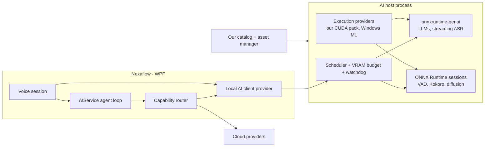
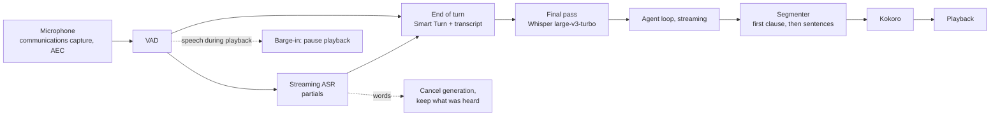

# Local AI — voice conversation, on-device models, media generation

**Status: phases 1 and 2 built.** Replies stream through the agent harness; each ability is served by a chain of
models that asks before high-risk context leaves this machine; providers serve speech to text beside language
models, and dictation runs through the grid's Speech In chain (Whisper on this machine, OpenAI's realtime
transcription in the cloud); local models' files live in one verified, resumable store; System Info reports what the
machine can run. Nexaflow runs Gemma 4 E4B itself, in its AI host — on CUDA from a pack fetched from where NVIDIA and
Microsoft publish it, or on the CPU — as the provider "Nexaflow", chosen when a workspace is set up; tools can hand a
model recordings to hear; and an AI-path suite runs the agent loop on it. Voice (phase 3) and generation tools
(phase 4) are not built yet. This records what was measured, the decisions taken, the design that follows, and the
order to build it in. Where it names a type, check for collisions before introducing it.

The test beds behind every number here live outside the repository, in `D:\codedev\nexaflow-ai-testbed` (its
`README.md` says how to re-run each measurement), until the implementation is done.

## What we want

1. **Voice conversation.** Press once to start listening; the session stays open until the user (or the
   assistant) ends it. The user speaks, the assistant answers aloud, either side can interrupt, and tools and page
   context work as they do in the input bar.
2. **A local LLM** for machines with a capable GPU — for users with no subscription, who want nothing to leave the
   machine, or who want the cheap, frequent calls kept off the API bill. Weaker than a frontier model; far better
   than nothing.
3. **Generation as agent tools**: images, speech, sounds and music; video if it ever becomes practical.

All three are built on **ONNX Runtime as the one engine, and Nexaflow owns everything around it**: onnxruntime-genai
for language, multimodal and speech-recognition models, plain ONNX Runtime sessions for TTS, voice activity
detection, diffusion and audio generators; our own catalog, downloads, execution-provider provisioning, memory
policy and scheduling.

## Decisions

| Question | Decision |
|---|---|
| Whose harness | What a workspace chooses is not where a model runs but **who runs its harness** — the prompt, the chat template, the context cache. **Bridged**: Nexaflow is a client of a harness that is not its own — Claude, OpenAI, Gemini, but also Ollama and Aria, though they run on this machine — and nothing for the AI host is downloaded or loaded. **Owned**: Nexaflow is the whole harness, through the AI host — Gemma 4 E4B by default, or whichever model the user picks. Chosen when a workspace is set up, once an owned model exists to choose; **mixing** both stays possible through the grid's chains. |
| Where data goes | A second, separate property of each provider: whether a request's content **stays on this machine**. Ollama on `localhost` does though it is bridged. A page whose context is high-risk asks before its contents go to a provider whose data leaves this machine. |
| Where voice lives | **The AI input bar**, in a voice mode: the bar becomes a live line both sides speak into, and anything the assistant produces that is not speech — a diagram, a table, code — opens as an overlay on the current page, so the user keeps working while talking. **The conversation page** is the focused alternative: both sides write into the conversation. |
| Activation | **Press to start listening**; it stays live until stopped. The assistant gets a tool to end the session itself ("that's all, thanks"). |
| TTS voice | **Kokoro** — clearly better than Pocket TTS and ZipVoice in listening. |
| Languages | **English, French and German** throughout, in that order of priority: recognition, the model, and a Kokoro voice for each — `ff_siwis` for French, the community German fine-tune's `df_kerstin` for German. Both beat Piper's voices in listening; Kerstin is the weakest of the three and good enough to start (below). |
| GPU minimum | **24 GB** for the default resident model (Gemma 4 E4B) with voice; **32 GB** for the larger models (Qwen 3.8 27B, Gemma 4 26B-A4B) with voice. Bringing the larger models to 24 GB is the longer-term goal: their own exports, and a context that never re-reads what it has already read (below). |
| Catalog and runtime provisioning | **Ours.** Foundry Local was evaluated and not adopted: it would own the runtime version, storage, memory policy and model list that this design needs to control (below). Runtime libraries come from where their makers publish them — nuget.org and NVIDIA's wheels on PyPI — pinned by SHA-256; only what we convert or modify ourselves would be published by us. |
| Tool calls | **Each model's own protocol**: tools are declared to Claude, OpenAI, Gemini and Ollama as their APIs take them, and to an owned model as its chat template does (Gemma 4's `<|tool_call>` syntax, read from its tokens); planning and filling in the input box are tools too. Only a model with no tool calling of its own (Aria) is taught a fenced `client_tool` block. A call that cannot be read is written again in a context of its own and takes the attempt's place (below). |

## What was measured

On an RTX PRO 6000 (96 GB) and a Ryzen 9 9950X3D: onnxruntime-genai 0.17.1, ONNX Runtime 1.30, KokoroSharp 0.8.4,
sherpa-onnx 1.13.8, Foundry Local 2.1.0.

### The model

**Gemma 4 E4B** (text, image and audio in; text out) runs from C# through `Model` + `MultiModalProcessor` +
`Generator`. The [onnx-community export](https://huggingface.co/onnx-community/gemma-4-E4B-it-ONNX) needs a
header-only graph adapter (an image/audio feature merge in the embedding graph, flattened per-layer inputs);
its q4f16 build was the best configuration found.

| | Measured |
|---|---|
| Gemma 4 E4B q4f16, CUDA | 4.9 GB download, 6.6 GB VRAM loaded, ~70 tok/s, 0.1–0.3 s to first token with an image or 20 s of audio |
| Same, CPU only | ~13 tok/s, 2.7 GB RAM, 2.5–3 s to first token with an image or audio |
| Transcription by Gemma | verbatim on clean speech; **30 s audio window, silently truncated beyond it** |
| Two LLMs resident in one process | both work; generating together they **time-slice** the GPU (30 + 30 tok/s against 60 alone) |
| Two requests on one model | 46 + 33 tok/s — batching on one model gains, separate models do not |
| Unload / reload a model (warm disk) | 0.15 s / 4.3 s |
| Cancel generation mid-answer | stops 3–13 ms after the request |
| Prefill a 3,800-token conversation | 150–330 ms |
| VRAM transient on long prompts | 33–37 GB peak — logits are allocated for every prompt position (262k vocabulary). **`chunk_size` 512 brings it to 16 GB** |
| VRAM after disposing every model | ~1.8 GB stays with the process until it exits |

onnxruntime-genai defects hit along the way, each a reason to keep native inference out of the WPF process: an
access violation when the embedding model runs on CPU and the decoder on CUDA; DirectML failing on quantized
gathers; two images in one prompt failing; CUDA graph capture producing garbage on this export; a process that hung
at exit, unkillable, when it had not held an `OgaHandle` for its lifetime.

### Voice round trip

Simulated microphone, real-time paced: Silero VAD → streaming ASR (Nemotron 0.6B int4) → Gemma 4 E4B → first
clause → Kokoro TTS.

| | Speech models on GPU | Speech models on CPU |
|---|---|---|
| Resident VRAM, all four models | 9.8 GB | 6.6 GB |
| User stops talking → assistant starts talking | **1.3 s** | 1.5–1.6 s |
| of which: end-of-turn silence wait | 600 ms | 600 ms |
| ASR, real-time factor | 15–19× | 8–11× |
| TTS, real-time factor | 19–20× | 11× |
| Barge-in: user speech detected | ≤ 210 ms after they start | same |

Starting speech at the first clause instead of the first sentence took the round trip from 1.9 s to 1.3 s. The
fixed 600 ms silence threshold also **cut an interruption in half** ("Wait, stop. Just tell me a short joke
instead." arrived as "Wait, stop") — turn detection needs more than a silence timer.

TTS compared through sherpa-onnx on CPU (8 threads): Kokoro 267 ms to first audio at 10–12× real time; Pocket TTS
422 ms at 6×; ZipVoice ~1 s at 3–4×. All three read back verbatim through ASR; Kokoro sounded clearly best.

### In a real room

Monitor speakers with a webcam microphone mounted just above them, normal volume; two speakers — native English
with accented French and basic German, and native French with B2 German:

| | Measured |
|---|---|
| Echo, assistant talking for 114 s, nobody else | raw microphone: the ASR transcribed 286 of the assistant's words and the VAD fired 20 times. **Communications capture: 0 words, 0 triggers** — about 50 dB removed from the first second, in all three languages |
| What Windows applies to a communications stream | echo cancellation, noise suppression, gain control (reported through `IAudioEffectsManager`); the echo reference set to the playback endpoint through `IAcousticEchoCancellationControl` |
| Interruptions | 14 of 14 caught, **96–236 ms** after the person started (median ~110 ms, a 96 ms speech rule included); 14–43 ms from the frame to the stop; the speaker 6 dB down ~50 ms later |
| Talking over the assistant | not suppressed — recognised as well as single-talk ("White stop, can you say that more simply", "Attends, arrête, tu peux dire ça plus simplement") |
| Backchannels ("mm-hm… yeah", "mm… oui", "ja… mhm") | the VAD fires on most (a native speaker's natural ones: 6 in French, 9 in German); **the ASR returns no words for any** |
| Typing and clicking while it talks | no triggers |
| Hesitations inside a turn ("um", "euh", "ähm"), 0.26–2.4 s | a 600 ms silence timer ends the turn at the first one; **Smart Turn waited through 21 of 22** |
| Ends of turns | Smart Turn recognised 24 of 28; it missed turns longer than its 8 s window |
| Smart Turn v3.2 on its own test set, in C# | English 95.9 % (human speech), French 93.7 %, German 95.8 %; 8 ms per decision on 4 CPU threads |
| Recognition, native speakers | English: every utterance right; French: 6 of 7 exact |
| **Short utterances** | Nemotron returns **nothing** for an isolated "No.", "Nein." or "Stopp." (clean synthetic speech), and for a B2 speaker's "Nein, nicht das" and "Entschuldigung — kurze Frage". **Whisper large-v3-turbo got every one** — from C# on onnxruntime-genai, 17 ms for a one-word turn, 23 ms for 3 s, 52–59 ms for 8 s, 3.3 GB of VRAM; it is also better on accented French. Gemma 4 E4B, asked to transcribe, got the English but not reliably the German |

### Runtime provisioning

| | Measured |
|---|---|
| onnxruntime-genai CUDA package | 210 MB, **plus ~1.1 GB of NVIDIA libraries it does not carry** (cuBLAS 13, cuDNN 9) — without them the model fails to load |
| Windows ML | 82 MB, no CUDA; Windows downloaded and registered NVIDIA's TensorRT-RTX provider itself in 6.4 s. Today's Gemma exports barely use it (12 tok/s, mostly CPU fallback) — it needs models built for the provider |
| CPU only | 27 MB |
| Two CUDA stacks in one process | **break** — they load clashing cuDNN DLLs. One CUDA stack per process |
| **One process: ONNX Runtime GPU + our CUDA pack + Windows ML** | **works.** Windows ML registered TensorRT-RTX into the GPU build's runtime in 1 s; onnxruntime-genai (Gemma reading an image) and a plain session (Kokoro, 29 ms warm) ran on CUDA with every NVIDIA library loaded from the pack folder and no toolkit on PATH |
| A CUDA pack | cuBLAS 13 (484 MB) + cuDNN 9 for CUDA 13 (407 MB), plus the CUDA provider and onnxruntime-genai's CUDA layer (183 MB) — about 1.1 GB |
| TensorRT-RTX on Kokoro and Silero graphs | both rejected (an unsupported `Squeeze` kernel; an engine build failure) — **identically in a Windows-ML-only process**, so this is the provider's graph support, not the mix |

### Foundry Local — evaluated, not adopted

[Foundry Local](https://www.nuget.org/packages/Microsoft.AI.Foundry.Local) is Microsoft's on-device model runtime:
a C# SDK (MIT) over a native core that manages a model catalog, downloads, per-machine variant selection and
execution-provider provisioning, and runs onnxruntime-genai sessions. It worked: 43 MB of payload; CUDA, TensorRT-RTX
and WebGPU provisioned in 35 s (its 2 GB CUDA pack carries cuBLAS and cuDNN); 49 catalog models with a variant
chosen per machine; Qwen 3.5 9B at ~100 tok/s; our own Gemma 4 E4B registered beside the catalog, running text, image
and audio at 65–75 tok/s; live transcription finishing 26 ms after the audio; and our direct onnxruntime-genai and
ONNX Runtime sessions running on the CUDA provider it downloaded, with no CUDA toolkit installed.

It is not adopted because it would own what this design needs to control:

- **The runtime version.** Its CUDA pack is built for one onnxruntime-genai and ONNX Runtime pair
  (`ort-1.30.0-genai-0.17.1`), and a second CUDA stack cannot share the process. New architectures arrive through
  onnxruntime-genai releases, so Foundry's release cadence would gate the larger models the strongest machines can
  run.
- **The model list.** The catalog is curated for small, broadly-shipped models. Our own models can be registered,
  but only for the model types Foundry's core runs.
- **Memory and storage.** Qwen 3.5 9B held 18–20 GB of VRAM with nothing exposed to bound it; about 19 GB on disk
  held 9 GB of models and 2 GB of providers.
- **Its defects are ours to wait on**: a catalog variant (Qwen 3.5 2B) that fails to start, a failed provider
  download reported as success, a `MAX_PATH` limit on its data directory, ~4 s of provider registration at every
  start, and telemetry on unless switched off.

What it gives — provisioning, a catalog of per-provider variants, sessions with rollback — is small and buildable,
and the design below borrows its shape. Qwen models also reasoned before answering whatever the request asked
(all 300 tokens of a budget), and Qwen 3.5's tool calls came back as text rather than parsed calls — model traits,
not Foundry's.

## Architecture

### One host process on one stack

Local models run in `Nexaflow.AiHost`, a helper executable beside the app, as `Nexaflow.PrivilegeBridge` is. The app's
`AiHostClient` starts it on the first request for a model, speaks to it over a named pipe only the user can open, and
binds it to the process-wide kill-on-close job object (`KillOnCloseJob`, shared with the terminal) so it dies with
the app. Every reason is something the test beds hit:

- **A native crash takes its process down.** Two access violations in onnxruntime-genai during testing; in the
  host that is a restart and a retried request, in the WPF process it is the whole app.
- **VRAM only fully returns when a process exits.** The host can be recycled to reclaim what disposed models leave
  behind.
- **Native stacks cannot be mixed.** Two CUDA stacks in one process loaded clashing cuDNN; sherpa-onnx and Windows ML
  each ship their own `onnxruntime.dll`; the same class of problem the LlamaSharp provider
  ([PR #74](https://github.com/smile-forge/nexaflow/pull/74)) fought with mirrored CUDA binaries. The Whisper
  provider's `Whisper.net.Runtime.Cuda` (149 MB of ggml CUDA natives in every install) leaves the app for the same
  reason once speech runs in the host.
- **One owner for the GPU.** Scheduling and the VRAM budget only work if one process decides.
- **A watchdog.** Neither onnxruntime-genai nor ONNX Runtime has a request timeout; a host that stops answering is
  killed and restarted.

Inside the host there is **one ONNX Runtime and one CUDA stack**, and two surfaces over it:

- **onnxruntime-genai** — `Generator` for the LLMs with `chunk_size`, `max_length`, `RewindTo` and token-boundary
  cancellation; `MultiModalProcessor` for images and audio; `StreamingProcessor` for streaming ASR.
- **plain ONNX Runtime sessions** — Silero VAD, Kokoro (KokoroSharp takes the session options) and diffusion
  pipelines, on the same execution providers.

Execution providers come from two places, into **one host build for every machine** — ONNX Runtime's GPU build,
which carries the CUDA provider:

- **The CUDA pack** on NVIDIA (`CudaRuntimePack`): ONNX Runtime and onnxruntime-genai built with their CUDA layers,
  and NVIDIA's cuBLAS and cuDNN. ONNX Runtime loads its CUDA provider from the folder `onnxruntime.dll` came from, so
  the pack carries the runtime itself — the same build as the install's, which a test holds them to — and a host
  started on it binds both managed wrappers to the pack's copies and puts the folder first on its `PATH` before
  anything loads. Nothing else NVIDIA is needed, toolkit or not. Without the pack the host runs on the install's CPU
  runtime.
- **Windows ML's provider catalog** for TensorRT-RTX, OpenVINO and NPUs: `EnsureAndRegisterCertifiedAsync`
  registers them into the same runtime, and sessions reach them through `OrtEnv.GetEpDevices`. Only Windows ML's
  bootstrap DLL ships; its own `onnxruntime.dll` must not. **Not wired yet**: it arrives with the first catalog model
  built and checked for one of its providers, so nothing is registered with nothing to run on it.

A provider being present does not mean a model runs on it: TensorRT-RTX rejected the Kokoro and Silero graphs as
exported. The catalog names, per model, the providers its variants were built and checked for.

Speech runs in the same host. sherpa-onnx (wake words, denoise, diarization, 80 ms-chunk ASR) would need a process
of its own because of its runtime, and is not needed for the decisions above.

Layout: `src/Nexaflow.AiHost/` — `Nexaflow.AiHost.Contracts` (the pipe's messages and framing), `Nexaflow.AiHost.Client`
(the app's side, and the CUDA pack's manifest) and `Nexaflow.AiHost` (the executable); the provider is
`Nexaflow.Providers.AiHost`, which takes the client by constructor injection like any app-wide service.

The client watches the host three ways: a heartbeat answered on the host's reading loop, so a frozen process shows
however busy its requests are; a stall limit per request, so a request that stops replying is taken for a hang; and
a grace after a cancellation, so a request that will not stop is one. Any of them kills the host; the next request
starts another, and a host that keeps crashing is not restarted until it has stayed down a while.

A downloaded model is prepared once in its folder by the adapter its catalog names — Gemma 4 E4B's rewrites the
onnx-community export's graph headers with OnnxSharp, as the testbed's Python adapter did — into a provider-neutral
`genai_config.base.json`; the host writes `genai_config.json` for the runtime it is on before loading, since
onnxruntime-genai's API can set only the decoder's providers.

### Capabilities instead of one text contract

`ILlmProvider` stays the text-generation contract. It streams its reply as events (`StreamAsync`), takes **audio
attachments** beside image ones (`LlmAttachment.IsAudio`, `SupportsAudio`) — a recording a tool hands over
(`ToolResult.Audio`) reaches a model that hears as audio and any other as what the Speech In model heard in it — and,
for a provider that `SupportsToolCalls`, takes the tools it may call (`LlmTool`, a JSON Schema each) and streams each
call it makes as an `LlmToolCallRequested`; what came of a call goes back as an `LlmRole.Tool` message that `Answers`
it. A call carries what its provider wants back with it (`Signature`, Gemini's thought signature) and, when its
arguments did not read, the arguments as written (`Unread`). Beside it, in `Providers.Common`:

| Capability | Shape |
|---|---|
| speech to text | streaming: audio frames in, partial and final transcripts out; VAD events |
| text to speech | streaming: text segments in, audio chunks out; cancel; how much was spoken |
| image generation | job: prompt (+ optional source image, mask) in, image file out, progress |
| audio generation | job: prompt in, audio file out, progress (sound effects, music) |
| video generation | job; cloud only for now |

Every capability has owned and bridged implementations — OpenAI and Gemini already do speech and images — so a
bridged workspace gets voice and generation without a GPU, and an owned one gets them on the machine. A provider
declares what it offers: input and output kinds, streaming, tools, context window, **whose harness and where its
data goes**, and a cost class.

### Scheduling and the VRAM budget

The host owns:

- **A resident set** — the model an owned workspace uses plus the speech models, loaded at warm-up and kept (4–6 s
  to reload is too slow between turns).
- **Models loaded on demand** — image, music or a second LLM a request names: kept loaded after the request, and the
  first to go, least recently used, when another needs the room.
- **Admission against a budget**: the NVIDIA GPU's memory less 3 GB kept back; each model sized from its manifest;
  unload what may go, or refuse rather than over-commit — and when even that would not make room, nothing is
  unloaded. Generators always run with `chunk_size` set, an explicit `max_length`, and `arena_extend_strategy` = 1
  (grow only by what is requested).
- **Priorities, preempted at token boundaries**: live voice, then interactive chat, then background analysis, then
  generation jobs. Concurrent models time-slice the GPU, so the GPU takes one step at a time — a token, a 512-token
  slice of prompt — and gives the next to the highest-priority request waiting; a background analysis yields to a
  reply at every token instead of halving it. A request says how urgent it is (`LlmUrgency`); analysis is background.

**Cancellation is per step.** A decode step is one token (~14 ms at 70 tok/s); the long steps are an image or audio
encode (~100 ms) and a prefill chunk (bounded by `chunk_size`). Barge-in does not wait on any of them: playback stops
at once, and cancellation only frees the GPU.

### The context as an append-only log

A model keeps what it has read as a KV cache, and each token's entry depends on every token before it — so a cached
prefix can be reused, but changing anything invalidates everything after it. Re-reading the whole conversation each
turn is what makes a large local model slow to answer: Qwen 3.8 27B takes 1.3–1.9 s to read a 4k-token prompt.

So each conversation keeps one live `Generator`, and its context only ever grows. Measured over a ten-turn
conversation on a ~3k-token page context, appended against re-read every turn:

| | Appended, per turn | Re-read, per turn | Rewind |
|---|---|---|---|
| Gemma 4 E4B (our adapted export, 6.6 GB) | 24–71 ms; replies identical to the re-read | 225–272 ms | crashes |
| Gemma 4 E4B (native GenAI export, 13.7 GB) | 29–80 ms; identical on all ten turns | 242–495 ms | works |
| Qwen 3.8 27B | ~110 ms; a 1,400-token page change 411 ms | 1.1–1.6 s | **wrong**: the DeltaNet layers' state is not rolled back |
| Gemma 4 26B-A4B | 140–215 ms | 210–370 ms | works |

Appending is exact: the next-token scores after a prompt read in pieces match a single read to rounding (cosine
≥ 0.99997) on every model; where live replies drift from a re-read, it is greedy decoding branching on that rounding.

- **Ordered from most to least stable**: system prompt and tool definitions, then the page context the conversation
  started on, then the turns.
- **Changes are appended, never edited.** Moving to another page appends an event carrying the new page's context;
  tool results and audio are appended like any other turn.
- **Appending is the one mechanism.** `RewindTo` cannot be relied on — it is wrong on hybrid recurrent models and
  crashes on exports whose cache grows by concatenation — so a barge-in cancels generation and appends what the user
  actually heard as a note. Where an export rewinds correctly it may rewind instead, and always appends before
  generating again: a bare rewind skips the next token.
- **New turns are rendered as deltas against the cache.** Templates re-render history differently from what the
  model read (Gemma 4 26B-A4B's adds an empty thought block to the generation prompt and strips it from history), so
  a turn appends the template's whole closing for the last reply — onnxruntime-genai does not keep the end token a
  reply stops on, so the model has not read it — then the new turn and generation prompt. What was read stays as it
  was read.
- **Requests stay stateless.** `ILlmProvider` sends whole conversations; the host matches each to the conversation it
  continues — the turns that conversation has read, its last reply included, begin the request's, and the rest is
  text — and keeps a few, least recently used dropped first. Nothing in the app knows the cache exists.
- **An image rebuilds the context.** onnxruntime-genai 0.17.1 does not take media on a continuing generator: the
  native E4B export silently ignored the image ("I cannot see any failure stages in the screenshot") and the adapted
  one crashed. An image turn re-reads the conversation — E4B in ~0.25–0.5 s, Qwen in ~1–1.6 s.
- **First-use costs are warmed at load.** Each new append length cost Qwen ~750 ms once, gone with the CUDA option
  `sdpa_kernel=1` (as for Whisper); Gemma 4 26B-A4B's MoE kernels cost 1–3.4 s the first time a token count is seen.
- **The window ends in a summary**: when the log reaches the model's budget, older turns are summarised and the
  cache is rebuilt once from the summary.

This saves time, not memory — the cache grows with the context either way (Qwen 3.8 27B: ~0.5 GB at 8k tokens;
Gemma 4 26B-A4B: ~1.8 GB), and with a shared buffer it is allocated for the whole window up front. What it buys
toward 24 GB is a short window: a log that summarises can run at 8k instead of 32k. The weights are the rest of the
way. The default E4B stays on the adapted export: appending works there, and the native export that can rewind costs
twice the VRAM.

## Routing

The workspace's choice comes first: a bridged workspace never starts the host. Within a workspace, the ability grid
maps roles to models:

- **Each cell is an ordered chain** of models, set by clicking cells in the order they should be tried: owned Gemma,
  then Claude. A chain advances on unavailability — a provider not available (no API key; for the host, model not
  downloaded, host down, budget refused) — not on "try one, retry the next" for every request: a failed attempt has
  cost its whole latency already.
- **High-risk context leaves only with consent.** A request whose context reports a high `GetContextSecurityRisk`
  goes to the chain's model like any other; when that model sends data off this machine, the user is asked first,
  and a refusal cancels the request. A model whose data stays here (marked in the grid's column header) is not asked
  about.
- **Rows become reasoning roles** (Disambiguation, Conversation, ProblemSolving, Analysis, ImageRecognition) and
  **media capabilities** (speech in, speech out, image, audio, video) — the media rows arrive with the capability
  contracts they route; today's `ImageGeneration` and `AudioRecognition` rows are read by nothing.
- **Resources become visible**: the resident set and its VRAM shown; assignments that cannot coexist on the card are
  refused at configuration time.

In a mixed workspace the frequent, cheap roles — Disambiguation, tool ranking, Analysis, ImageRecognition — default
to the owned model, which is where API cost actually goes.

### What the model is handed

The harness hands the model what it needs to act and nothing it has to dig for:

- **The page describes itself** in what it holds: the file browser names its folders, files and selection, so "delete
  the folder called old" is answered from the page. What the app could open is a tool (`get_openable_pages`), not
  context sent with every request; so is which Markdown it draws (`get_markdown_syntaxes`, `get_markdown_syntax`).
- **No approval talk.** Whether a call needs the user's approval is the harness's business: the model is never told,
  and never asked to explain before it acts.
- **The tools follow the work.** A page with more than four tools has the Disambiguation model pick the few the next
  step needs — again whenever an instruction is added or a step's calls are answered, from everything asked and what
  the calls did. Tools the model had listed with `get_client_commands` stay offered.
- **A call that cannot be read is rewound, not argued with.** It is written again by the Conversation model in a small
  context of its own — the call as written, why it did not read, and an example built from the tool's definition — and
  the call written again takes the attempt's place, so the conversation only ever holds calls that read. Only when that
  fails is the model told why. JSON the model reads is written unescaped (`café`, not `caf\u00E9`).
- **A voice turn is remembered as it ran**: the calls made and what came of them, then what of the reply was heard.

`NEXAFLOW_AI_TRANSCRIPTS` names a folder for the app to write each run to: every message the model was sent, the tools
offered and what it wrote — what to read when a run goes wrong.

## Voice conversation

### The pipeline

A cascade. End-to-end speech models are not a fit yet: LFM2.5-Audio speaks but is a 1.5B model weak at tools;
Moshi and Qwen-Omni have no ONNX Runtime path.

- **ASR in two passes.** Nemotron streams partials through onnxruntime-genai's `StreamingProcessor` — what the input
  bar shows as the user speaks, and the words that confirm a barge-in. When the turn ends, **Whisper large-v3-turbo**
  transcribes the whole utterance once, and that text goes to the agent. Nemotron alone loses short utterances — an
  isolated "No", "Nein", "Stopp" — which a conversation that asks for confirmation cannot lose; Whisper got every one
  measured. It is a model type onnxruntime-genai runs natively (exported with its builder, which needs a three-line fix
  for turbo's 4-layer decoder), shares the process with Nemotron (5.4 GB for both), and costs ~11 ms of encoder plus
  ~1 ms per token — 17–59 ms per turn, run while the turn detector decides. Two settings are required: the session's
  language forced in the prompt (`<|startoftranscript|><|de|><|transcribe|><|notimestamps|>` — left to detect, it heard
  "Nein." as "9."), and the CUDA option `sdpa_kernel=1` with one warm-up call at load (otherwise each new output length
  costs ~150 ms the first time).
- **TTS**: Kokoro through KokoroSharp, whose G2P is MisakiSharp — no espeak-ng.
- **Turn detection** is its own stage: [Smart Turn v3](https://huggingface.co/pipecat-ai/smart-turn-v3) (BSD-2,
  8 MB, Whisper-tiny encoder judging the audio of the last 8 s) in C#, on the communications capture, asked after
  200 ms of silence and again every ~300 ms while it answers "not finished", up to a ceiling longer than real thinking
  pauses (2.4 s was measured). The transcript is the second signal — a turn longer than 8 s, a filler at the end, a
  clause still missing its verb ("…die ich gestern"), which the audio alone judged finished. After a barge-in, a
  fragment judged complete ("Wait, stop —") is held ~1 s for the rest of the sentence.
- **The agent loop is the same one**: a voice turn goes through `RunAgentAsync` with page context and tools, in a
  "spoken reply" style. The loop streams each step's prose to its response handler as a draft while it is
  written, without the blocks the agent acts on — what the segmenter reads.
- **Segmenter**: the first segment ends at a clause boundary, later ones at sentences.
- **Barge-in**: VAD onset (96 ms of speech) during playback **pauses** playback at once; the ASR decides. Words →
  generation is cancelled and the history keeps **only what was heard** — the measured run recorded "Garbage
  collectors track which —", not the unspoken rest of the answer. No words within ~500 ms — a backchannel, a cough —
  → playback resumes where it paused. A VAD-only rule would stop the assistant at every "mm-hm".
- **Echo cancellation**: Windows communications capture, with the playback endpoint set as its echo reference
  (`IAcousticEchoCancellationControl`) and the stream's effects checked through `IAudioEffectsManager`. WebRTC APM is
  the fallback for a device that reports no echo cancellation. Without it the assistant interrupts itself.
- **Tool approvals by voice** need a spoken confirm/deny path through `IAIResponseHandler`.
- **Ending the session**: the user's stop button, or a client tool the assistant calls when the conversation is
  over.
- The voice session is one implementation of a contract; a cloud realtime API (OpenAI Realtime, Gemini Live) can be
  another, for bridged workspaces.

Target: under a second from the user stopping to the assistant speaking, local. Measured 1.3 s with a 600 ms silence
wait; replacing that wait with Smart Turn at 200 ms of silence (~10 ms to decide, with Whisper's final pass started
at the same moment) puts a complete turn at about 0.9 s.

### In the shell

- **Input bar, voice mode.** Pressing the microphone turns the AI input bar into a live line: the user's words stream
  in as they are recognised, the assistant's spoken reply streams beside them, and the page underneath stays usable.
- **Anything that is not speech goes to an overlay.** When a reply carries markdown that speech cannot carry — a
  Mermaid diagram, a table, a code block — the segmenter speaks a short reference to it ("here's the diagram") and
  the content opens as an overlay over the current page, rendered by the shared markdown surface. The overlay is
  dismissable and does not take focus from the page.
- **The conversation page** is the focused form: speech and text both land in the conversation as messages, and rich
  content renders inline there instead of as an overlay.

Push-to-talk dictation already runs on the speech capability: `DictationService` streams the microphone into the
Speech In chain's model. Whisper on this machine re-transcribes the whole buffer every second; in the host it becomes
the same streaming ASR as the voice loop, without the reply.

## Languages: English, French, German

Every stage was measured on all three, with real French and German speech from FLEURS:

| Stage | English | French | German |
|---|---|---|---|
| Voice activity (Silero) | language-independent | | |
| Turn detection (Smart Turn v3.2) | 95.9 % on its test set | 93.7 % | 95.8 % |
| Streaming ASR (Nemotron 3.5) | 1.9% WER | 10.1% WER | 18.5% WER — mostly numbers written as words ("zehntausend" for "10.000") |
| Final pass (Whisper large-v3-turbo) | short answers Nemotron lost ("No.") | 1.6% WER; better on accented speech | 5.5% WER; short answers Nemotron lost ("Nein.", "Stopp.", "Nein, nicht das") |
| LLM (Gemma 4 E4B) | ✓ | fluent answers in French; accurate summaries of spoken French | fluent answers in German; accurate summaries of spoken German; answers about images in German |
| TTS | Kokoro (`af_heart` and others), MisakiSharp G2P | **Kokoro `ff_siwis`**: 307 ms to first audio, 12× real time, 5% WER read back | **Kokoro German fine-tune** (`crane-local-ai/Kokoro-82M-v1.0-German-ONNX`, voice `df_kerstin`): 9–10× real time, 0–11% WER read back |

- **Both recognisers take the session's language.** Nemotron's encoder takes a one-hot `lang_id`
  (`Generator.SetRuntimeOption("lang_id", …)`): en-US 0, fr-FR 8, de-DE 9, `auto` 101 — from NVIDIA's
  `processor_config.json`; the ONNX export carries no table. `auto` matched the fixed prompt for English and French
  and was close for German. The model tags sentences with `<xx-XX>` for English and German but not French, so the
  tags are stripped and do not decide the language. Whisper takes the language token in its prompt, and must be
  given it: detecting it alone misreads short German words.
- **The reply's language picks the voice.** Gemma answers in the language it was spoken to; the segmenter detects
  the language of each segment's text and hands it to that language's Kokoro voice.
- **German has one Kokoro voice, from one community fine-tune**, and it is the weakest of the three — good enough to
  start, since English and French come first. Fed misaki-form phonemes it keeps a better rhythm than with plain
  espeak output. A better German voice, or a Swiss or regional one, means fine-tuning Kokoro ourselves with the same
  recipe (kikiri-tts, Apache-2.0). Piper's voices were measured and rejected on listening.

### Phonemes for French and German

Kokoro reads phonemes, not text, and the text it speaks is the model's reply — so text-to-phoneme conversion (G2P)
runs on the user's machine, for every reply. MisakiSharp covers English only. espeak-ng covers French and German
and is the convention both voices were trained on (the German fine-tune's authors say so), but it is GPL, and run
as a process per phrase it cost 65–300 ms on the voice path.

So espeak-ng is a **build-time tool, not a shipped one**, and nothing of it is in the repository:

- **Lexicons, built once and published, CC0.** `tools/ai-models/kokoro-lexicons` runs espeak-ng 1.52.0 over the words
  of Mozilla Common Voice's French and German sentences (CC0, pinned by commit) with `--tie`, and its output goes through
  misaki's post-processing — the form both voices were trained on: language-switch flags removed, affricates and
  diphthongs as single tokens (`t^s`→`ʦ`, `a^ɪ`→`I`), and for German kikiri's `ʏ`→`y`. Plain `--ipa` output is wrong
  input for these voices: `ʏ` is not in Kokoro's vocabulary ("fünf" loses its vowel), and untied pairs arrive as two
  tokens. 148,000 French words (1.4 MB) and 269,000 German (3.1 MB) — every word seen more than once — in about a
  minute, byte for byte the same on a rebuild; hosted on Hugging Face beside the recipe, as the Whisper export is.
  Frequency lists with more words (OpenSubtitles, CC BY-SA; Leipzig, CC BY) were measured too: they cover more of a
  reply's words but are understood no better, since the fallbacks say the rest, and their licences would bind the
  lexicons. Keys whose case changes the
  pronunciation (German `Weg`/`weg`) stay separate, so lookup tries a word as written before lower-casing it.
- **A C# phonemiser at runtime** (`Speech/Phonemes` in the host), in this order: normalisation, lookup, context
  rules, fallback. Lookup costs ~0.15 µs a word; espeak as a process costs ~54 ms a phrase.
- **Measured whole**: 100 real replies in each language, spoken by Kokoro and heard back by Whisper large-v3-turbo.
  French: 3.4% of words wrong, as with espeak-ng reading each sentence whole (3.4%) and with MisakiSharp's espeak-free
  French (3.5%). German: 3.3%, against espeak-ng's 3.5%. Where they differ the differences favour ours: English words
  said in English (`checkout`, `joyful`), the product's name, no optional liaison said wrong (espeak's `êtes en` as
  `ɛtz`), German compounds split where espeak guesses. The read-back is `PhonemizerReadBackTests`; sameness with
  espeak-ng sentence by sentence is `PhonemizerAgainstEspeakTests` (French 128 of 200, German 153 of 200, nearly all
  the rest espeak's liaisons and guesses, and words the fallbacks say a little differently).
- **Normalisation is the larger job** — 6.6–6.9% of the words in measured replies never reach the lexicon: numbers
  with their contextual forms (un/une, ein/eins/einen, ordinals), times (15h30, 14:30 Uhr), dates, versions, IP
  addresses, units (Go → gigaoctets), a spell-or-read list for acronyms (USB, JSON, IA), abbreviations (z. B., etc.),
  slash pairs, and dropping emoji, LaTeX, markdown and code. espeak itself gets much of this wrong in context.
- **Context rules.** Looked up word by word, German loses only phrase stress; French also loses liaison (5% of words,
  more than half of sentences) and number voicing (six, dix). French says the liaisons that are always made — after
  determiners, pronouns, `est`, `très`, `quand` and their like, by the next word's sound and never before an h
  aspiré or across a pause — and not the optional ones espeak-ng makes (and gets wrong); `six`, `dix`, `huit` and
  `tous` are said by what follows. Both say the function words without stress inside a phrase, from the lists measured
  against espeak-ng on real replies; an elided clitic (`l'`, `j'`, `jusqu'`) hangs on the word after it.
- **The fallback** meets 4–7% of a reply's words — mostly English (product names, camelCase brands, tech terms) and
  the second-person and imperative forms an assistant uses more than the sentences the lexicons come from. So it is, in order: the language's fixed words (Nexaflow), camelCase splitting, English from
  MisakiSharp's English lexicon — only words it rates as known, never its guesses — a guarded German compound splitter
  (fewest words of three letters or more, linking sounds between, never ending on a suffix; better than espeak's own
  guess in about 60% of disagreements), and only then letter-to-sound rules: MisakiSharp's espeak-free French
  (Apache-2.0) for French, a port of [Crane](https://github.com/lucasjinreal/Crane)'s German rules (MIT) for German,
  written in espeak-ng's form — stress before the vowel, its `r`, `ɾ` and `ɜ` — and saying a doubled consonant once.

## Generation tools

Each is an `IClientTool` the agent calls (`generate_image`, `speak`, `generate_sound`, …) that runs a generation
capability as a job, reports through `IBackgroundActivityManager`, and returns a file plus a `ContextImage` where
there is one — the existing loop, approvals and context handling apply unchanged.

| | Local path | Fit |
|---|---|---|
| Speech | Kokoro | ready |
| Images | SDXL-Turbo (official ONNX) first, FLUX.1-schnell or FLUX.2 klein later; a C# diffusion pipeline (TensorStack has one, Apache-2.0) | ready to build; one generation slot |
| Music | ACE-Step 1.5 (community ONNX), custom pipeline | possible, medium effort |
| Sound effects | no maintained ONNX model; Stable Audio Open would need exporting | gap |
| Video | Wan2.1-1.3B only, minutes per clip | cloud providers only |

## Models

**No conversion on the user's machine.** onnxruntime-genai's builder cannot read quantized GGUF files (it needs the
original fp16 weights), and every converter — the builder, Olive, mobius — needs an embedded Python with torch
(1–2 GB) and tens of GB of RAM for an 8B model. New architectures reach the builder six to eight weeks after release.

**Our catalog** is a manifest of packages, each naming its source (Hugging Face — `onnxruntime/`, `microsoft/`,
`amd/`, `onnx-community/` with an adapter — or built in CI with the model builder), a variant per execution provider,
size, VRAM footprint, hash, and any adapter to apply after download. A user can also point at a folder holding a
`genai_config.json`. Because we pin onnxruntime-genai ourselves, the catalog can carry a new architecture as soon as
the release that supports it ships.

Candidates for a 24 GB card:

| Role | Model | VRAM | Notes |
|---|---|---|---|
| resident, default | Gemma 4 E4B q4f16 | ~7–11 GB with KV and transients | verified; sees and hears |
| resident, user's pick | Qwen 3.8 27B, Gemma 4 26B-A4B | 19–21 GB loaded, 21–23 GB with a 4k prompt | verified (below); neither fits beside the voice stack on 24 GB as published |
| resident, user's pick | gpt-oss-20b, Qwen 3.5 9B | ~10–20 GB | not measured here |

**The larger models, measured** (RTX PRO 6000, onnxruntime-genai 0.17.1 CUDA, uncontended):

| | Qwen 3.8 27B | Gemma 4 26B-A4B |
|---|---|---|
| Source | AMD's int4 export, unchanged but for the provider | the kibitz-coach text decoder with its MoE experts re-packed, AMD's embedding and vision |
| Download / loaded / with a 4k prompt | 16.9 GB / 19.3 GB / 21.3 GB | 19.2 GB / 21.3 GB / 23.3 GB |
| Decode / prefill 4k | 46 tok/s / 1.3–1.9 s | 80–100 tok/s / 0.29 s |
| Tool calls (7 requests, English, French, German) | 7 of 7 | 7 of 7 |
| Thinking | `enable_thinking=false` stops it (prefixed as a template variable; `/no_think` is ignored) | off by default; on, it fixed a task it otherwise got wrong |
| French and German | fluent | fluent |
| Images | read a table and caught its wrong total | none in this form — the text decoder attends causally inside an image |

- **Qwen 3.8 27B is the strongest** and runs from a published export; it is the only Qwen 3.8 size under 360 GB.
- **Gemma 4 26B-A4B is twice as fast**, but every published export is wrong on CUDA until its experts are re-packed
  (ORT's CUDA `QMoE` reads unpacked weights as packed), AMD's export degrades the model (router softmaxed twice, SiLU
  for GELU, int4 router) and its KV cache grows without bound, and the working assembly has no vision. It needs an
  export of our own: a vision-aware decoder, unquantized router, prepacked experts, sliding-window KV.
- **On 24 GB, the voice stack and either model do not fit together** (a ~20 GB budget for the model). The reductions
  that would get there — a quantized embedding table (Qwen's is 2.5 GB at fp16), a text-only build, sliding-window KV
  for Gemma — are untested. Until they are, this tier asks for 32 GB with voice.
- GenAI 0.17.1's Minja chat-template engine needed Gemma's template patched for tools (`['function']` and `upper`);
  the catalog's adapter step covers that.
| speech | Nemotron streaming + Whisper large-v3-turbo + Kokoro + Silero + Smart Turn | ~6–7 GB (the two recognisers 5.4 GB together); Silero and Smart Turn on CPU | verified |

## Delivery

**In the app, not the installer.** Updatum re-runs the whole installer bundle (~225 MB) on every update, Burn caches
every payload a second time under Package Cache, the standard bootstrapper cannot probe a GPU, and models are a
per-machine choice users change later. At most, the bundle's Install page gains an opt-in checkbox — like
`InstallTools` — that the app reads on first run.

- **The host** ships in the base install, in `AiHost\` beside the app: about 26 MB of ONNX Runtime and
  onnxruntime-genai, CPU only, started only when a workspace uses a model Nexaflow runs.
- **Execution providers**: the CUDA pack (about 1.3 GB on disk) for NVIDIA, fetched with the first owned model on a
  machine with an NVIDIA GPU and a CUDA 13 driver — from Microsoft's NuGet packages and NVIDIA's wheels on PyPI, each
  archive checked and only the DLLs kept. Windows ML's providers, for other vendors and NPUs, come with the first
  model built for one of them.
- **Models and voices**: `ModelAssetStore`, under `%LOCALAPPDATA%\Smile\nexaflow\ai\` — a short, real, non-roaming
  path. Each provider ships a catalog manifest naming its models' files with source, size and SHA-256; a download
  resumes from a `.partial` file and a file is handed out only once verified. Whisper models an earlier version kept
  in `%APPDATA%\…\voice\models` are moved in when they are the same file.
- **Hardware probe**: `ComputeHardware` (IO.Common) reads every ML-capable adapter through DXCore — GPUs of every
  vendor with their real memory, and NPUs — and the CUDA driver from `nvcuda.dll`. System Info's Local AI card shows
  it with the local models it suits; the host reads it to decide whether to offer an owned model at all, and on
  which provider.
- **Whisper's CUDA natives** leave the base install once speech runs in the host, cutting the installer and every
  update by about 60%.

## Build order

| Phase | Delivers | Size |
|---|---|---|
| 0. Spikes | done, measured above: echo cancellation and barge-in in a real room; Smart Turn for English, French and German; lexicon coverage on real replies; Qwen 3.8 27B and Gemma 4 26B-A4B; Whisper large-v3-turbo from C#; the append-only context across turns. Open: a 24 GB build of the larger models | small, each |
| 1. Contracts and plumbing | done: streaming through the harness; grid chains, data residency and consent for high-risk context; model kinds and the speech-to-text contract (OpenAI realtime, Whisper on this machine) with dictation on it; the asset store and catalog manifest; the hardware probe and System Info's Local AI card | medium |
| 2. AI host + local LLM | done: the host, its pipe protocol, scheduler, budget and watchdog; the CUDA pack from upstream; Gemma 4 E4B prepared from the onnx-community export, with the append-only context; the provider "Nexaflow" — superseding PR #74; the harness property and the workspace's choice of who runs its AI; recordings tools hand a model; the AI-path suite against the owned model. Open: Windows ML's providers, with a model built for one | large |
| 3. Voice | speech in the host; the text-to-speech contract; voice session with turn detection and barge-in; the French and German phonemiser and lexicons; the input-bar voice mode and overlay | large |
| 4. Generation tools | the image, audio and video generation contracts with their tools: speech and image first; music after; video through cloud providers | medium per tool |

Phase 1 is useful on its own — streaming improves the cloud path before any local model exists.

## Risks

- **We own the runtime.** Upgrading onnxruntime-genai and ONNX Runtime, assembling the CUDA pack, and tracking
  NVIDIA's library versions are ours to do — the price of choosing when.
- onnxruntime-genai's Engine (paged KV, prefix caching, continuous batching) is in its C API only; C# would need our
  own P/Invoke layer. The `Generator` API works without it.
- onnxruntime-genai defects above; exports per execution provider; architecture support lagging releases. Media on a
  continuing generator is unsupported in 0.17.1 (an image mid-conversation is dropped without an error) — worth an
  upstream issue, with the Whisper builder's turbo fix as an upstream PR.
- Every diffusion and music model needs a hand-written C# pipeline (scheduler, tokenizer, sampler).
- Licences do not block a non-commercial project. espeak-ng (GPL) runs only in our build; whether its generated
  pronunciations may ship as data is worth confirming — Wiktionary's IPA (CC BY-SA, as Crane uses for German) is the
  alternative source. The hermitdave word list is CC BY-SA and Leipzig's CC BY: the lexicon files carry attribution.
- German speech rests on one community Kokoro fine-tune with one voice, the weakest of the three.
- **Recognition rests on two models.** Nemotron for partials, Whisper large-v3-turbo for the final text; native
  German speech is measured only as read speech (FLEURS) and through a B2 speaker.
