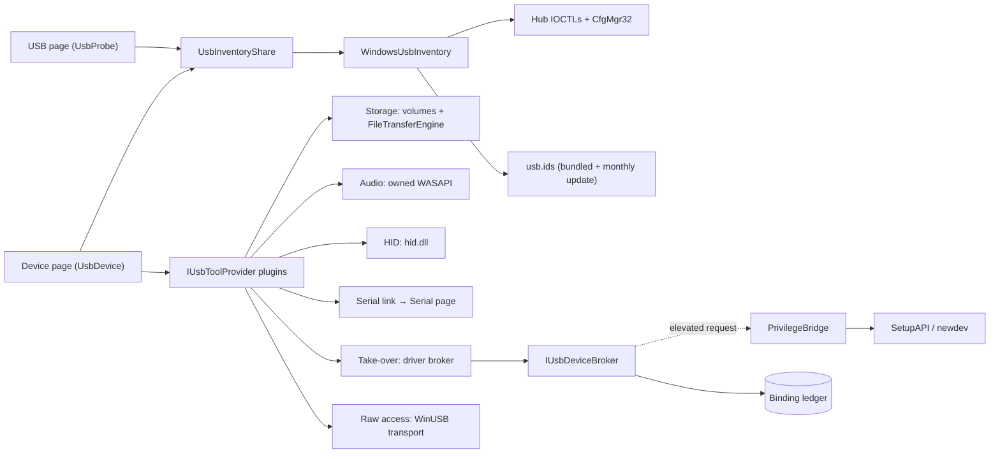
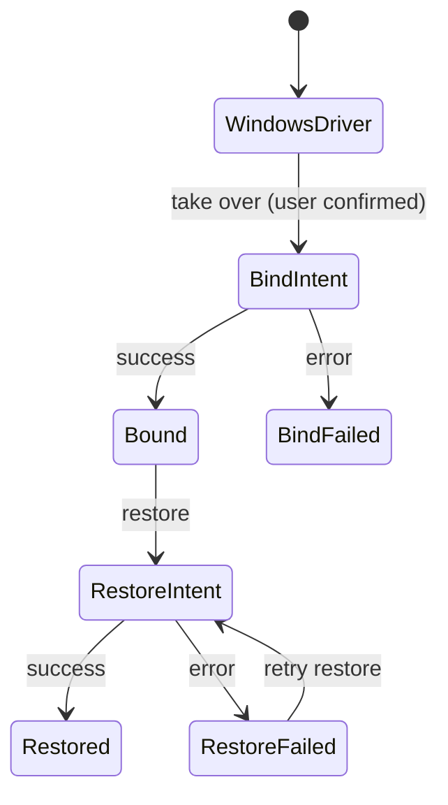

# Nexaflow USB Probe: Specification

| | |
|---|---|
| **Status** | Phases 0–3 built; the take-over runs ADR-001 has not made are open (§12) |
| **Date** | 2026-10-17 |
| **Scope** | Phase 0 (driver access) through Phase 3 (raw access), plus the architecture they leave room for |
| **Decision record** | [ADR-001: Raw USB access on Windows](adr/ADR-001-usb-raw-access.md) |

---

## 1. Purpose

Plug an unknown USB device into the machine and have Nexaflow answer three questions, in order:

1. **What is this thing?** Identify it fully from its own descriptors, without changing anything on the system.
2. **What can I do with it the normal way?** Where Windows has a class driver bound (storage, audio, HID, serial), use
   the standard APIs: browse and copy files, play a tone, watch input, open a terminal.
3. **Can I talk to it directly?** Where it is vendor-specific or driverless, take one interface over with a generic
   driver and talk to it raw: control transfers, endpoint reads and writes, all logged.

The answers live in two pages, not in a report. The **USB page** is an explorer of the machine's USB tree, the way
the file browser is an explorer of its disks; the **device page** is one device and what can be done with it now.
The agent explores the same places through its own tools. Every decision here is meant to hold when the probe grows
into device profiles, protocol scripting, and a native device model.

---

## 2. Guiding principles

1. **Discovery never needs privilege.** Everything the USB page shows runs as the normal user and changes nothing.
2. **Privilege is isolated, narrow and auditable.** Only the elevated bridge changes drivers, through a fixed set of
   verbs, generating its own inputs and recording everything it does.
3. **Every system change is reversible.** Any driver binding Nexaflow makes is in a ledger and can be undone, one at a
   time or all at once.
4. **Reading is free; acting asks.** Anything that writes — a file onto a device, a HID report, a byte down a serial
   line, a vendor request — is confirmed by the user for that action. There is no page-wide "armed" state.
5. **Contracts first.** The driver-binding strategy, the privilege model, the live tools and the raw-transport backend
   each sit behind an interface, so one can change without touching the pages.
6. **Own the foundations where practical.** Small owned code over large, lightly-maintained dependencies: WASAPI,
   `hid.dll` and WinUSB are called directly. Kernel drivers and libusb are not rewritten.
7. **Pages don't push; the agent explores.** Nothing is exported or sent to the AI. The agent reads the page it is on
   through `GetContext` and its read-only tools, and acts through tools the user approves.

---

## 3. The Windows driver problem (background)

On Windows, a user-mode program can only talk to a USB device through whatever driver is bound to it:

| Bound driver | What Nexaflow can do | Raw USB access? |
|---|---|---|
| Class driver (`usbstor`, `usbaudio`/`usbaudio2`, `HidUsb`, `usbser`) | Use the class API (file I/O, WASAPI, HID, COM port) | No |
| `WinUSB` | Raw control/bulk/interrupt/isochronous via WinUSB | Yes |
| `libusbK` / `libusb0` | Raw access via libusb | Yes |
| Vendor driver | Whatever the vendor's API offers | Usually no |
| None (no driver found) | Descriptors only | No, until a driver is bound |

What follows from it:

- **Descriptors are always readable** through the parent hub's IOCTLs (the technique Microsoft's USBView sample uses),
  whichever driver is bound. This is why the USB page needs no privilege.
- **Class access and raw access are mutually exclusive per interface.** Binding WinUSB to an audio interface means
  Windows can no longer play sound through it, so every interface shows which mode it is in.
- **Binding is per interface on composite devices** (hardware IDs with `&MI_xx`). Nexaflow binds only the interface
  the user chose, never the whole device.
- **Binding persists by hardware ID**, so a second identical device plugged in later gets the generic driver too.
- **Changing a driver requires administrator rights.**
- **Devices that declare themselves WinUSB-compatible** (Microsoft OS descriptors, "WCID") get WinUSB automatically,
  with no elevation. Many modern development boards do.

---

## 4. Architecture



### 4.1 Components

| Component | Privilege | Responsibility |
|---|---|---|
| **`Nexaflow.IO.Usb`** (class library, no WPF) | User | Inventory and hot-plug, descriptor parsing and byte-for-byte descriptor maps, the browsing model (locations and facts), usb.ids and its updates, the live-tool contract, USB disks and volumes, HID access, the take-over broker, policy and ledger, and the raw transport over WinUSB with its session log |
| **`Nexaflow.IO.Common`** (shared) | User | Audio endpoints, test signals, playback and metering on owned WASAPI; the COM-port catalog; `FileTransferEngine` with read-back verification |
| **`Nexaflow.PrivilegeBridge`** (existing elevated exe) | Admin | Runs the bind and restore operations, and restore-all for the uninstaller; nothing else USB-specific |
| **`Nexaflow.Features.UsbProbe`** (WPF feature) | User | The USB page and the device page, their agent tools |
| **`Nexaflow.Features.UsbProbe.StorageTools`, `.PortableTools`, `.AudioTools`, `.HidTools`, `.SerialLink`, `.RawTools`** | User | Live-tool plugins, found by `[Subfeature("usbprobe", …)]`; the device page references none of them |
| **`Nexaflow.Visuals.Stores`** + **`Nexaflow.IO.Common` Stores and Portable** | User | The file browser the storage and phone tools share, over a store contract (`IFileStore`) with a disk store, an MTP store over Windows Portable Devices, and verified copies between any two (`StoreTransfer`) |
| **`Nexaflow.Features.Serial`** (WPF feature) | User | A terminal for any COM port |
| **`spikes/UsbDriverBinding`** (console app) | Mixed | The Phase 0 experiments, kept for regression runs on new Windows builds |

### 4.2 The pages

- **USB page** (`UsbProbe`): a tree of the places that hold something (bus › hub › port › device › configuration ›
  association › interface › endpoint, plus BOS), a listing of what the open place holds, and below it everything
  about the selection — its facts, and its descriptor's fields beside the bytes they came from. Breadcrumbs, `>` in
  the AI bar and the agent all move around by the same location paths (`3-10.2/config1/if0.0`). It follows hot-plug
  live and marks a newly arrived device until it is looked at.
- **Device page** (`UsbDevice`): one device, with four tabs — **Overview** (what it is in plain words, its live
  tools, its facts), **Live tools** (one collapsible tile per tool, tiled across the width when there is room),
  **Interfaces** (every association, interface and endpoint with the Windows function that owns it and its driver,
  and each descriptor field by field) and **Diagnostics** (problem codes in words, descriptor problems, strings the
  device would not give, and a log of what the tools did). It follows the device by instance id: unplugged, it says
  so and stops its tools; plugged back in, into any port, it picks the device up again.
- **Serial page** (`Serial`): the line settings and DTR/RTS, connect and disconnect, a transcript of what came and
  went as text or hex with millisecond times, a line to send text or hex from, and the transcript saved to a file.

---

## 5. Phase 0: Driver access (decided)

The spike answered which binding strategy works on current Windows 11 with Secure Boot and Memory Integrity on, and how
privilege is handled. [ADR-001](adr/ADR-001-usb-raw-access.md) holds the decision, the results table and the
"known Windows behaviours". In short:

- **Take-over is Strategy A**: Windows' own `winusb.inf` selected for the one chosen interface and installed with
  `DiInstallDevice` (the device's class set to USBDevice first, and a fresh `DeviceInterfaceGUIDs` written); restore is
  `DiRollbackDriver`. No generated INF, no certificate, nothing added to the driver store.
- **Strategy D is always on**: interfaces already on WinUSB (WCID devices) open with no privilege and no change.
- **Self-signed catalogs (libwdi-style) and UsbDk are not pursued**: both are larger system changes for no gain.
- **Privilege is one UAC prompt per bind or restore**, through the existing `PrivilegeBridge`: a per-call pipe with a
  one-time token and a compiled-in verb allow-list.
- **The raw transport on Windows is WinUSB P/Invoke**; libusb-1.0 is an optional second backend for later.

### 5.1 Exit criteria

A strategy is accepted when, on Secure Boot with Memory Integrity on, both as an administrator and as a standard user
with over-the-shoulder consent:

- it binds a generic driver to one interface of a composite device without affecting its siblings;
- a raw open of that interface completes a GET_DESCRIPTOR control transfer;
- restore returns the original driver and the device works as before;
- restore leaves no residue (no orphaned `oemNN.inf`, certificates or registry values);
- no reboot is needed;
- a crash of client or bridge mid-operation leaves a state the ledger can recover from;
- each user action costs at most one UAC prompt.

ADR-001 records which of these have been run and which are open (§12).

### 5.2 Test matrix

The spike is re-run on new Windows builds against varied devices — a Raspberry Pi Pico running TinyUSB (vendor,
WCID, CDC, HID or composite on demand), an RTL-SDR dongle, a CH340 or FTDI serial adapter, a USB audio dongle, a USB
flash drive, and a composite webcam — on Secure Boot with Memory Integrity off and on, and as an administrator and a
standard user.

---

## 6. Phase 1: "What is this thing?" — the USB page

No privilege; nothing sent to a device beyond standard GET_DESCRIPTOR requests, and those only on "Read device again"
and when debug details are taken (a HID interface's report descriptor).

| ID | Feature | As built |
|---|---|---|
| D1 | Live device tree | Buses (host controller and root hub), hubs, every port empty or not, and devices — each placed in its port by the address its hub gave it, so a device Windows has no driver for is shown as surely as one it has; the tree goes down to devices, and what a device is made of is the listing's and its own page's. Arrival, removal and driver changes from `CM_Register_Notification` — for the devices Windows makes beneath a USB devnode too, so a phone unlocked into file transfer is seen — folded into the open page without losing the user's place; a warm pass completes well inside a second. A device just plugged in opens its branch of the tree and is marked until looked at. A device Windows ejected for safe removal (problem 47) stays in its port, shown as ejected, with no live tools until it is plugged in again. A composite device's functions are found whichever driver split it — usbccgp's `MI_xx` children, or a maker's own composite driver's (Samsung's `dg_ssudbus`), numbered by interface as usbccgp's are. One inventory is shared by every USB page and device page |
| D2 | Identity | VID/PID, manufacturer/product/serial strings, bcdUSB, bcdDevice, negotiated speed, port path and connector, power state, max power, self/bus powered, remote wakeup |
| D3 | Names | Vendor, product and class names from usb.ids, bundled and checked monthly against linux-usb.org (BSD-3 option) when the page opens; Options → USB checks at once. The download is validated before it replaces anything. HID usage names come from the same file |
| D4 | Descriptor tree | Device → configurations → associations → interfaces and alternate settings → endpoints, and BOS capabilities. Class descriptors decoded for HID, CDC (ACM, Union, Ethernet, NCM, MBIM…), Audio (UAC1, UAC2, MIDI), Video (UVC) and DFU; anything else shown as bytes with its header named. Decoders are an ordered, extensible registry |
| D5 | Byte view | Every descriptor's fields — offset, name, size, value, meaning — beside a hex view of the bytes; pointing at a field lights its bytes and pointing at a byte names its field. Malformed and mismatched lengths are shown as they are, with the problem named |
| D6 | Driver view | Per function: service, class, INF and section, driver version, provider, matching id, problem code in words, instance, hardware and compatible IDs, power state, COM port, the devices Windows made from it |
| D7 | Capability summary | A plain-language verdict per function, from rules, not AI ("HID Mouse — watch its input; never taken over while it is a keyboard or pointer"); the device page adds the live tools it has |
| D8 | Microsoft OS descriptors | MS OS 1.0 and 2.0 and WebUSB detected, with "WinUSB-ready: raw access needs no driver change" |
| D9 | Agent access | `GetContext` describes the open place; `usb_list`, `usb_describe` (every decoded field with offsets and bytes), `usb_find`, `usb_open` and `usb_reread` explore the same tree by the same paths |
| D10 | Debug details | For the developers, not the user: a device's right-click on the USB page, and the device page's Diagnostics tab, copy or save one JSON (`UsbDebugDetails`, format 1) so a device nobody here has can be supported from what a tester sends. It holds a summary; every descriptor raw, in the fixtures' hex, so a dump becomes a test; strings, MS OS support, and the devnodes and drivers Windows made of each function; each HID interface's report descriptor read through its hub, or why not; what each live tool sees through `IUsbToolDebugDetails` — a disk's volumes, a phone's WPD facts and storages, a HID collection's decoded layout and the preparsed data it came from, an audio endpoint's mix format — or the error it gave; the functions no tool covers; and the activity log. From the USB page each provider is offered the device afresh through a host that asks nothing of the user, and the tools are let go after. Serials, wherever they appear, become a stable `SERIAL-` hash and volume labels a `NAME-` token; file names are never included |

---

## 7. Phase 2: "What can I do with it?" — the device page

Each live tool is a plugin (§8.2) offered for the functions it applies to, drawn as a tile. A tool runs only while its
tile is open and the Live tools tab is in view; a long job it started (a copy, a recording) carries on with the tile
shut. Anything a tool writes is confirmed first.

| ID | Tool | As built |
|---|---|---|
| H1 | Mass storage (`StorageTools`) | The disks a storage function presents and their volumes (drive letters, label, file system, free space), found through the volume manager with no access rights, in the shared store browser (`StoreBrowser`, `StoreBrowserView` over a `DiskStore`): a folder tree whose roots are the volumes, the open folder's contents with sortable columns, a path bar, right-click menus with Copy path, the file browser's keys, and drag-and-drop in; a file opens in the app's viewer for it. Copies both ways through `FileTransferEngine`, every file always read back from where it landed — past the cache — and checked by SHA-256, a mismatch removed; there is no unverified copy. Add files picks one or several. New folder, rename and delete. Every change to the device asks first |
| H7 | Phone and camera files (`PortableTools`) | The storage a phone or camera shares over MTP (internal storage, an SD card), through Windows Portable Devices (`WpdStore`), in the same store browser. Copies both ways are streamed, hashed as read and read back from where they landed, a mismatch removed; a file on the phone is fetched to this PC, checked, before it opens. A locked phone shares nothing and its USB device does not change on unlocking, so the tool says to unlock it and choose File transfer, and the device's own event brings its storage in when it does |
| H2 | Audio output (`AudioTools`) | Each playback endpoint the device's audio function drives, matched by the devnode behind the endpoint. A tone at any frequency and level, a 20 Hz – 20 kHz log sweep, or a WAV, on every channel or one, generated at the endpoint's own mix format; "Identify channels" sounds each channel in turn and names it |
| H3 | Audio input (`AudioTools`) | Each recording endpoint: per-channel peak and RMS meters twenty times a second, and a recording of 5–30 s saved as a 32-bit float WAV with every channel |
| H4 | HID (`HidTools`) | Each collection's report layout as the HID class driver decoded it (usage pages, usages, report IDs, sizes, ranges), named from usb.ids; a live input monitor, batched off the UI thread; feature reports read; feature and output reports sent after a confirmation. Windows keeps keyboards' and mice's input to itself: for those the layout and feature reports are shown and the monitor is not |
| H5 | Serial (`SerialLink`) | The COM port Windows made of the function — a CDC serial port, or a maker's modem that has one — and the Serial page opened on it, without connecting |
| H6 | Not covered | The last tile names every function no tool covers — a Driver tile (`IUsbDriverTool`) changes how a function is reached and does not count — what it is, and what a tool for it would use (Media Foundation for UVC, PC/SC for smart cards, the Network page for network adapters, raw access for vendor classes) |

The **Serial page** is its own feature, for any COM port: settings fixed while connected, the transcript split into
lines on a newline, at 512 bytes or after a quarter-second's quiet, following new lines unless scrolled back. The
first send on each connection asks.

---

## 8. Phase 3: "Poke the unknown" — raw access

Two live tools (`RawTools`): **Driver** on every function the policy lets go and every one Nexaflow holds a binding
for, and **Raw access** on every function on WinUSB — taken over, or a WCID device that needs no take-over.

| ID | Feature | As built |
|---|---|---|
| R1 | Take over interface | The Driver tile shows the function's driver and what taking it over stops ("Windows will no longer use it as an audio device through usbaudio2 until it is restored"; a function with no driver loses nothing), and that a second device of the model gets WinUSB too. Taking over asks, then runs through the page's driver broker — one UAC prompt — and the function comes back on WinUSB with a Raw access tile |
| R2 | Restore driver | Restore on any function the ledger holds, and Restore all — every binding on the machine, one prompt — wherever another binding is held. Uninstalling restores them all (§9.2) |
| R3 | Control transfer console | bmRequestType from direction, type and recipient, bRequest, wValue, wIndex, wLength, and data for an OUT request, whose wLength is its data's; the standard reads ready-made. Every OUT request asks first; class and vendor requests carry a warning |
| R4 | Endpoint reader | A bulk or interrupt IN endpoint read as data arrives, into the session list with times; pause, clear, save. Shutting the tile stops it |
| R5 | Endpoint writer | Hex, or text as UTF-8 with escapes, to a bulk or interrupt OUT endpoint, once or repeated with a gap; asks once for the run, which carries on with the tile shut |
| R6 | Session log | Every transfer — time, direction, request or endpoint, length, data, result, duration — in the tile, newest first, and saved whole as text; one session spans every time the function was opened. The Diagnostics tab logs each control transfer, each write and each read run |
| R7 | Isochronous | Out of scope; isochronous endpoints are listed, and the transport leaves room for them |

The function is opened on the first transfer and held — WinUSB lets one program in at a time — until "Let go", the
page closes or the device goes. When another program already holds it (a WCID device's own app), opening fails and
the tile says another program has it open.

### 8.1 Binding lifecycle



The ledger writes each intent before the change and its outcome after, so a crash leaves a record of what was
started.

### 8.2 The live-tool contract (built)

```csharp
public interface IUsbToolProvider            // a [Subfeature("usbprobe", …)] plugin
{
    IReadOnlyList<IUsbTool> Offer(UsbDeviceNode device, IUsbToolHost host);
    Uri Templates { get; }                   // its DataTemplates, /Assembly;component/Views/….xaml
}

public interface IUsbTool : INotifyPropertyChanged, IDisposable
{
    string ToolId { get; }  string Key { get; }  string Title { get; }  string? FunctionInstanceId { get; }
    UsbToolSize Size { get; }  string Status { get; }  bool IsBusy { get; }
    Task ActivateAsync(CancellationToken ct);  void Deactivate();
    string Describe();                                    // for the agent
    IReadOnlyList<UsbToolOperation> Operations { get; }   // what the agent may run; ChangesSomething marks writes
}

public interface IUsbToolHost                // what a tool may do outside itself
{
    Task RunOnUiAsync(Action action);  Task<bool> ConfirmAsync(string title, string message, CancellationToken ct);
    // file and folder pickers, OpenPage(kind, parameters), Log(tool, message), usb.ids names
}
```

A tool is a headless view-model; its provider ships the template that draws it. New classes (MTP, printer, video, a
device-specific profile) are new assemblies, never an edit to the device page.

### 8.3 Take-over contracts (built)

```csharp
public interface IUsbDeviceBroker
{
    string? RefusalReason(string interfaceInstanceId);
    Task<UsbBindingOutcome> BindGenericAsync(string interfaceInstanceId, GenericUsbDriverKind kind, CancellationToken ct);
    Task<UsbBindingOutcome> RestoreAsync(string interfaceInstanceId, CancellationToken ct);
    Task<UsbBindingOutcome> RestoreAllAsync(CancellationToken ct);
    IReadOnlyList<UsbBindingRecord> GetBindings();
}
```

`UsbBindingRecord` holds the interface, its hardware id, the original service, INF, section and matching id, the
strategy (`InboxWinUsb`), whether the class was changed, the state, and a log. `BridgeUsbDeviceBroker` runs the bind
and restore through `PrivilegeBridge`; `UsbBindingPolicy` decides what may never be taken over (§9.1).

### 8.4 Raw transport (built)

```csharp
public interface IRawUsbAccess                         // a backend: WinUsbRawAccess
{
    string? UnreachableReason(UsbFunctionNode function);
    IRawUsbTransport Open(UsbFunctionNode function);
}

public interface IRawUsbTransport : IAsyncDisposable
{
    IReadOnlyList<UsbPipe> Pipes { get; }
    Task<byte[]> ControlInAsync(UsbControlSetup setup, CancellationToken ct);
    Task ControlOutAsync(UsbControlSetup setup, ReadOnlyMemory<byte> data, CancellationToken ct);
    IAsyncEnumerable<ReadOnlyMemory<byte>> ReadEndpointAsync(byte endpoint, int packetSize, CancellationToken ct);
    Task WriteEndpointAsync(byte endpoint, ReadOnlyMemory<byte> data, CancellationToken ct);
}
```

`WinUsbRawAccess` opens the device interface WinUSB registered for the function, and its associated interfaces with
it, so an association's endpoints all answer. Every transfer is overlapped, completing on the thread pool through the
handle's completion port; a read or write is cancelled by aborting its pipe. `RawUsbSession.Record` wraps a transport
so every transfer through it lands in the session log. A libusb-1.0 backend for libusbK and libusb0 devices would be a
second `IRawUsbAccess`.

---

## 9. Safety and security

### 9.1 Device safety

- **What is never taken over** (enforced by `UsbBindingPolicy`, not just the UI): hubs and host controllers; a
  composite device as a whole (one interface is taken over, never the device); mass storage; Bluetooth radios; any
  interface Windows made a keyboard, mouse, disk, volume or optical drive of; and anything already on a generic
  driver, which needs no take-over.
- **Every write asks first**: files copied onto a device, HID feature and output reports, serial sends (once per
  connection), OUT control requests and endpoint writes, and every driver take-over and restore. The agent's writes go through the
  same approval: `usb_tool_run` decides its safety per call from the operation it names.
- **No vendor request is ever sent on its own.** Discovery uses only standard GET_DESCRIPTOR requests, and the USB page
  sends those only when asked to read a device again.
- **Plain warnings** that unknown vendor commands can trigger firmware-update or erase modes.

### 9.2 Bridge hardening

- The bridge accepts only its compiled-in verbs. No file paths, INF contents, certificates or command lines come from
  the client; the bridge works everything out itself.
- Inputs are device instance ids that must exist, be present, be USB, and pass the policy.
- Each request has its own pipe and one-time token.
- Every operation is written to the ledger before the change and updated after, so a crash is recoverable.
- Uninstalling Nexaflow runs the bridge's restore-all (`--usb-restore-all`) as SYSTEM before its files go. An upgrade
  skips it, keeping the bindings, and a failed restore never stops the uninstall.
- The debug details take the tools through a broker that refuses every change, so taking them never raises a prompt.

---

## 10. The agent

Pages give the agent context and tools; nothing is exported to it.

- **USB page**: the open place and its rows in `GetContext`; `usb_list`, `usb_describe`, `usb_find`, `usb_open`,
  `usb_reread`.
- **Device page**: the device, each live tool's state and operations, and what no tool covers, in `GetContext`;
  `usb_device_tools` lists every tool and its operations, and `usb_tool_run` runs one — at once when it only reads,
  with the user's approval when it writes. Raw access's standard reads, endpoint reads and session log run at once;
  any control transfer and any endpoint write are approved, and so is every take-over and restore, which Windows then
  asks permission for too.
- **Serial page**: the port, its settings and the end of the transcript; `serial_ports` and `serial_read` run at once,
  `serial_connect` and `serial_send` (which can wait for the reply) with the user's approval.

---

## 11. Dependencies and licensing

Nexaflow is released under the Unlicense.

| Dependency | Use | License | Notes |
|---|---|---|---|
| usb.ids | Names, class names, HID usage names | GPL-2.0+ or BSD-3 (dual) | Used under BSD-3; bundled from the `external/usbids` submodule and updated from linux-usb.org at run time |
| System.IO.Ports | The Serial page's port | MIT | NuGet |
| WinUSB, `hid.dll`, WASAPI, SetupAPI, CfgMgr32 | Raw access, HID, audio, binding, inventory | Windows | Called directly; no wrapper libraries |
| libusb-1.0 (later) | Optional second raw backend | LGPL-2.1 | For libusbK/UsbDk devices and other platforms |

---

## 12. Open questions

1. Strategy A on configuration W3 (standard user with admin consent), on replug, on reboot, and with a crash mid-bind:
   ADR-001 records these as not yet run.
2. Whether Nexaflow, and so the bridge, will be code-signed — which decides how Smart App Control treats the bridge.

---

## 13. Forward look

Not in scope, and nothing here should block them:

- **Device profiles.** A known device's identity, binding and named operations ("read sensor", "set LED") saved as a
  profile, whose operations appear as a live tool the next time it is plugged in.
- **Protocol scripting.** A scripting surface over `IRawUsbTransport`, so a session log becomes a replayable, editable
  script — the step from poking to a user-mode driver.
- **Agent-assisted probing.** The agent already explores the device; with raw access it can propose transfers, each
  shown for approval before it runs.
- **More tools.** Printers, UVC preview through Media Foundation, smart cards through PC/SC, DFU readout — each a new
  `IUsbToolProvider`.
- **Traffic capture.** USBPcap, to watch Windows talk to a device under its own driver.
- **Other buses.** The inventory, tool and broker pattern carries over to Bluetooth LE and network devices; nothing
  genuinely generic carries `Usb` in its name.
- **Cross-platform.** The model, descriptors, browsing and naming hold no Windows types; only the inventory, HID,
  storage and binding implementations under `Windows/` do.
- **Nexaflow OS.** A device as an entity in the graph, its interfaces and endpoints as children, tools and profiles
  as code attached to them.

---

## 14. Out of scope

Firmware flashing, isochronous streaming, USB-C Power Delivery and alt-mode inspection, traffic sniffing, driver
development, and any binding strategy that needs test-signing mode or Secure Boot off.

---

## References

- Microsoft USBView sample (hub IOCTL descriptor reading): https://github.com/microsoft/Windows-driver-samples/tree/main/usb/usbview
- WinUSB installation (Microsoft Learn): https://learn.microsoft.com/windows-hardware/drivers/usbcon/winusb-installation
- WCID devices: https://github.com/pbatard/libwdi/wiki/WCID-Devices
- HID usage tables in usb.ids, and usb.ids itself: http://www.linux-usb.org/usb.ids
- libwdi certification practice statement (the self-signed approach not taken): https://github.com/pbatard/libwdi/wiki/Certification-Practice-Statement
- UsbDk (the filter-driver approach not taken): https://github.com/daynix/UsbDk
