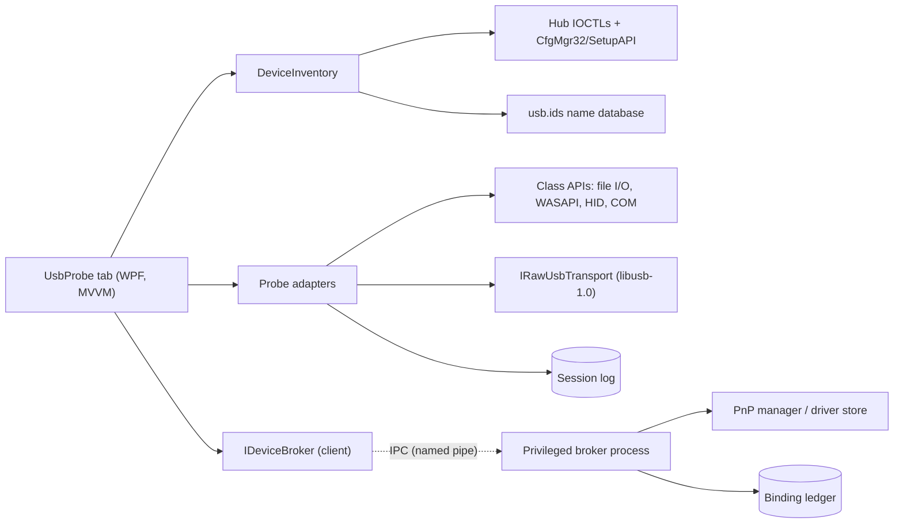
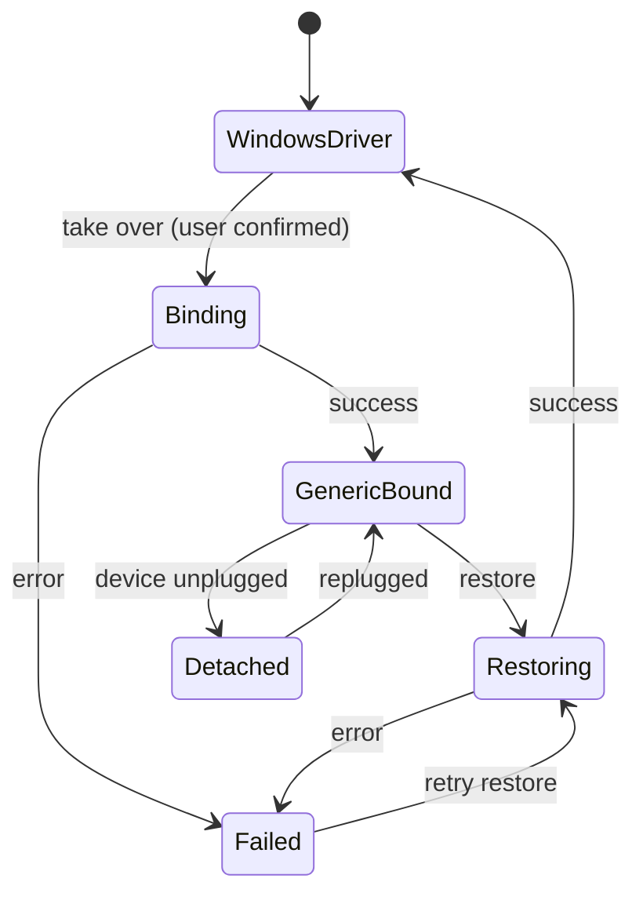

# Nexaflow USB Probe: Prototype Specification

| | |
|---|---|
| **Status** | Draft v0.1 |
| **Date** | 2026-10-14 |
| **Scope** | Phase 0 (driver-access spike) through Phase 3 (raw access), plus forward-looking architecture |
| **Audience** | Adam (architect) and Claude Code (implementation) |

---

## 1. Purpose

Plug an unknown USB device into the machine and have Nexaflow answer three questions, in order:

1. **What is this thing?** Identify it fully from its own descriptors, without changing anything on the system.
2. **Can I talk to it the normal way?** If Windows already has a class driver bound (storage, audio, HID, serial), use the standard APIs to interact: copy a file, play a tone, watch button presses, open a terminal.
3. **Can I talk to it directly?** If it's vendor-specific or driverless, take it over with a generic driver and talk to it raw: control transfers, endpoint reads and writes, all logged.

The prototype should be useful on its own, but it is also the first piece of a longer-term **device layer** for Nexaflow. Every decision in this spec should hold up when the probe later grows into device profiles, protocol scripting, and eventually a native device model in the Nexaflow OS.

---

## 2. Guiding principles

1. **Discovery never needs privilege.** Everything in Phase 1 runs as the normal user and changes nothing.
2. **Privilege is isolated, narrow and auditable.** Only one component may change drivers. It exposes a small set of verbs, generates its own inputs, and records everything it does.
3. **Every system change is reversible.** Any driver binding Nexaflow makes is recorded in a ledger and can be undone, individually or all at once (including on uninstall).
4. **Read-only by default.** Writes to a device (raw OUT transfers, vendor control requests, file writes) require an explicit "armed" state.
5. **Contracts first.** Interfaces are defined before implementations, so the driver-binding strategy, the privilege model and the raw-transport backend can each be swapped without touching the UI.
6. **Own the foundations where practical.** Prefer small amounts of owned code over large, lightly-maintained dependencies, but don't rewrite kernel drivers or libusb.
7. **Structured context out.** Every probe result is a structured object that can be exported as JSON, pasted as text, or handed to Nexaflow's AI chat as context.

---

## 3. The Windows driver problem (background)

On Windows, a user-mode program can only talk to a USB device through whatever driver is bound to it:

| Bound driver | What Nexaflow can do | Raw USB access? |
|---|---|---|
| Class driver (`usbstor`, `usbaudio`/`usbaudio2`, `HidUsb`, `usbser`) | Use the class API (file I/O, WASAPI, HID, COM port) | No |
| `WinUSB` | Raw control/bulk/interrupt/isochronous via WinUSB or libusb | Yes |
| `libusbK` / `libusb0` | Raw access via libusb | Yes |
| Vendor driver | Whatever the vendor's API offers | Usually no |
| None (no driver found) | Descriptors only | No, until a driver is bound |

Key consequences:

- **Descriptors are always readable** through the parent hub's IOCTLs (the technique Microsoft's USBView sample uses), regardless of which driver is bound. This is why Phase 1 needs no privilege.
- **Class access and raw access are mutually exclusive per interface.** Binding WinUSB to an audio interface means Windows can no longer play sound through it. The UI must always show which mode each interface is in.
- **Binding is per interface on composite devices** (hardware IDs with `&MI_xx`). Nexaflow must bind only the interface the user chose, never the whole device by default.
- **Binding persists by hardware ID**, so a second identical device plugged in later will also get the generic driver.
- **Changing a driver requires administrator rights**, and the driver package must pass Windows' signature checks. `winusb.sys` itself is Microsoft-signed, but a custom INF that points at it needs a signed catalog. This is the problem Phase 0 exists to solve.
- **Devices that declare themselves WinUSB-compatible** (via Microsoft OS descriptors, "WCID") get WinUSB automatically, with no elevation. Many modern dev boards do this.

---

## 4. Architecture overview



### 4.1 Components

| Component | Privilege | Responsibility |
|---|---|---|
| **`Nexaflow.Devices.Usb`** (class library, no WPF) | User | Inventory, descriptor parsing, class decoding, usb.ids lookup, adapters, raw transport, session log, report model |
| **`Nexaflow.Devices.Usb.Broker`** (separate executable) | Admin | Bind/restore drivers, maintain the binding ledger. Nothing else. |
| **`Nexaflow.Devices.Usb.Contracts`** (class library) | Shared | IPC message types and the `IDeviceBroker` contract, shared by client and broker |
| **`Nexaflow.Modules.UsbProbe`** (WPF module) | User | The tab: device tree, detail panes, actions, logs |
| **`spikes/UsbDriverBinding`** (console app) | Mixed | Phase 0 throwaway experiments. Not shipped. |

Names are suggestions. Adjust to match existing Nexaflow project conventions.

### 4.2 UI shape

A Nexaflow tab with:

- **Left:** live device tree (controller → hub → port → device → configuration → interface → endpoint). New devices are highlighted briefly on arrival.
- **Right:** tabbed detail pane for the selected node: *Summary*, *Descriptors*, *Driver*, *Actions*, *Log*.
- **Ribbon group "USB Probe":** Refresh, Copy report, Export JSON, Arm writes, Take over interface (raw), Restore driver, Restore all.
- **Status strip:** mode indicator per selected interface (`Windows: usbaudio2` vs `Nexaflow raw: WinUSB`) and the armed/disarmed state.

---

## 5. Phase 0: Driver-access spike

**Goal:** decide, with evidence, how Nexaflow gets raw access to an arbitrary USB interface on current Windows 11, and how privilege is handled. The output is a decision record and a proven `IDeviceBroker` contract, not production code.

**Timebox:** suggest 1 to 2 weeks of evenings. If no approach meets the exit criteria, Phase 3 is deferred and Phases 1 and 2 go ahead regardless, since they don't depend on this.

### 5.1 Questions the spike must answer

1. Which binding strategy reliably installs a generic driver on Windows 11 24H2/25H2 with Secure Boot **and** Memory Integrity (HVCI) on?
2. Can the binding be fully reversed, leaving no driver packages, certificates or registry residue?
3. Does libusb-1.0 (via LibUsbDotNet) open the device after binding, on each strategy?
4. What is the minimum privilege interaction: one UAC prompt per bind, one at install, or none?
5. Does it work from a standard (non-admin) user account with over-the-shoulder admin consent?
6. What happens on replug, on reboot, and if Nexaflow or the broker crashes mid-operation?

### 5.2 Binding strategies to test

**Strategy A: Force-bind the inbox `winusb.inf` (Microsoft-signed, no certificates).**
Windows ships a generic "WinUsb Device" driver package. It's normally only matched by WCID devices, but it can be force-selected for any device (Device Manager's "Let me pick" path does exactly this). Programmatically: SetupAPI driver list for the device, select the inbox WinUSB node, `DiInstallDevice`. Then write a `DeviceInterfaceGUIDs` value into the device's parameters key so user-mode can find it.
- *Pros:* no self-signed certificates, no generated driver packages, nothing added to the driver store.
- *Unknowns:* whether libusb finds and opens a device bound this way without a vendor-specific interface GUID; whether a force-selected driver survives replug.
- *Hypothesis:* best first choice if it works.

**Strategy B: Generated INF + per-bind self-signed catalog (the libwdi/Zadig model).**
Generate an INF for the exact hardware ID, build a catalog, sign it with a freshly generated certificate, add that certificate to the machine's Trusted Root and Trusted Publishers stores, destroy the private key, install with `UpdateDriverForPlugAndPlayDevices`. Works with WinUSB or libusbK.
- *Pros:* proven in the field for over a decade; works for any device.
- *Risks:* Windows 11 trust behaviour around this method has shifted before (pre-release builds blocked it, the release build restored it); there are current user reports of failures on some Windows 11 configurations. Adds a certificate and an `oemNN.inf` per bind, which the ledger must clean up.
- *Implementation choice:* embed libwdi as a native DLL (LGPL-3.0, git submodule with fork discipline) **or** port the INF + catalog + signing steps to C# (cert generation via `CertificateRequest`, catalog via `wintrust.dll` `CryptCAT*`, signing via `mssign32.dll` `SignerSignEx`). The C# port is small and fits "own the foundations"; koush's UniversalAdbDriver is a precedent for doing it in C#.

**Strategy C: UsbDk filter driver (install once, detach on demand).**
UsbDk is a signed hub-class filter driver installed once (at Nexaflow install time). At runtime it temporarily detaches a device from its Windows driver and hands it to user mode; when the handle closes, the device goes back to its normal driver. libusb-1.0 supports UsbDk as a backend.
- *Pros:* no per-device driver changes, automatic restore on crash, possibly no elevation at runtime (to verify).
- *Risks:* system-wide filter on every USB hub, so a bug affects all USB; maintenance cadence is low. Test carefully with Memory Integrity on.

**Strategy D: No binding (baseline, always available).**
WCID devices and devices already on WinUSB/libusbK work with no privilege at all. Phase 3 must work in this mode regardless of which strategy wins.

### 5.3 Privilege models to test

| Model | Description | Prompts | Notes |
|---|---|---|---|
| **P1: On-demand elevated broker** | Client launches `Broker.exe` via `ShellExecute "runas"` per operation; talks over a named pipe created by the client; broker exits when done | 1 UAC per bind/restore | Simplest and safest. Recommended prototype default. |
| **P2: Broker service** | Broker installed as a Windows service (LocalSystem) at install time; client connects over an ACL-restricted named pipe | 1 UAC at install, none afterwards | Smoothest UX, largest attack surface. Requires the hardening in §9.2. |
| **P3: Install-time only** | Only applies to Strategy C: the filter is installed once; runtime detach may need no admin | 1 UAC at install | Depends on UsbDk's runtime permission model; verify. |

The `IDeviceBroker` contract (§8.4) must be identical for P1 and P2, so moving from one to the other later changes nothing in the client.

### 5.4 Test matrix

**Test devices** (cheap, varied, and one fully controllable):

| Device | Why |
|---|---|
| Raspberry Pi Pico (RP2040) running TinyUSB | Controllable "known unknown": can be flashed to present vendor-class, WCID WinUSB, CDC, HID, or composite. The single most useful test target. |
| RTL-SDR dongle | Classic real-world case: vendor device that ships with the wrong Windows driver |
| CH340 or FTDI USB-serial adapter | Vendor driver vs WinUSB swap and restore |
| Cheap USB audio dongle | Class driver; verifies restore returns audio to working order |
| USB flash drive | Must be refused by the deny-list (§9.1) when it holds anything mounted |
| Composite device (webcam with mic, or Pico composite) | Per-interface binding without breaking siblings |

**Windows configurations:**

| Config | Secure Boot | Memory Integrity | Account |
|---|---|---|---|
| W1 | On | Off | Admin |
| W2 | On | On | Admin |
| W3 | On | On | Standard user + admin consent |
| W4 (optional) | On | On, Smart App Control on | Admin |

Run each strategy × privilege model × device × config that applies. For each run record: success/failure, `setupapi.dev.log` excerpt on failure, prompts shown, time taken, whether libusb opens the device, replug behaviour, reboot behaviour, and restore residue (driver store, cert stores, registry).

### 5.5 Exit criteria

A strategy + privilege combination is accepted if, on configs W2 and W3:

- [ ] Binds a generic driver to a single chosen interface of a composite device without affecting siblings
- [ ] libusb-1.0 (LibUsbDotNet) opens the interface and completes a GET_DESCRIPTOR control transfer
- [ ] Restore returns the original driver and the device works as before (audio plays, COM port appears)
- [ ] Restore leaves no residue: no orphaned `oemNN.inf`, no orphaned certificates, no stray registry values
- [ ] No reboot required
- [ ] A crash of client or broker mid-operation leaves the system in a state the ledger can recover from
- [ ] At most one UAC prompt per user action

### 5.6 Deliverables

1. `docs/adr/ADR-00x-usb-raw-access.md`: decision record with the results table, chosen strategy and privilege model, and rejected alternatives with reasons
2. `spikes/UsbDriverBinding/`: the console app used, kept for future regression testing on new Windows builds
3. Final `IDeviceBroker` contract and `BindingRecord` schema, ready for Phase 3
4. A "known Windows behaviours" note covering anything surprising (useful when Windows updates break things later)

---

## 6. Phase 1: "What is this thing?" (Discover)

No privilege, no device writes beyond standard descriptor reads.

| ID | Feature | Acceptance criteria |
|---|---|---|
| D1 | Live device tree | Shows controllers, hubs, ports, devices. Arrival and removal reflected within 1 second. New devices highlighted. Uses `CM_Register_Notification` (or WM_DEVICECHANGE) for hot-plug. |
| D2 | Identity card | VID/PID, manufacturer/product/serial strings, bcdUSB, bcdDevice, negotiated speed, port path, bMaxPower, self/bus powered, remote wakeup |
| D3 | Name lookup | VID:PID resolved via bundled `usb.ids`; class/subclass/protocol names from the same file. Database updatable from the UI. |
| D4 | Descriptor tree | Device → configuration(s) → interface(s) with alternate settings → endpoint(s), plus class-specific descriptors (audio, HID, CDC) shown decoded where known and as hex otherwise |
| D5 | Raw view | Hex dump of every descriptor with field-level highlighting on hover |
| D6 | Driver view | Per interface: bound service, INF, driver version, provider, problem code, device instance ID, hardware and compatible IDs |
| D7 | Capability summary | Plain-English verdict, e.g. "USB audio output + HID buttons. Available actions: play test tone, monitor buttons." Generated from rules, not AI. |
| D8 | Microsoft OS descriptors | Detect WCID / MS OS 2.0 descriptors and report "WinUSB-ready: raw access needs no driver change" |
| D9 | Report export | Copy as text, export as JSON (§10). "Send to AI chat" passes the JSON as structured context. |

---

## 7. Phase 2: "Say hello" (class-aware interaction)

Each action is an **adapter** (§8.3) that appears only when the device supports it and the right Windows driver is bound.

| ID | Adapter | Features | Library |
|---|---|---|---|
| H1 | Mass storage | Drive letter(s), volume label, filesystem, capacity/free; browse; copy files to/from with progress; SHA-256 verification after copy. Writes require the armed state. | `System.IO` |
| H2 | Audio output | Map USB device to its WASAPI endpoint(s); play test tone (sine at chosen frequency/level), sine sweep, or a WAV file; channel identification (left/right/each channel) | NAudio |
| H3 | Audio input | Live level meter; record 5 seconds to WAV | NAudio |
| H4 | HID | Decoded report descriptor (usage pages, usages, report IDs, field layout); live input monitor with raw bytes and decoded fields; feature report read. Output/feature write behind armed state. | HidSharp or own `hid.dll` P/Invoke |
| H5 | CDC serial | Map to COM port; terminal with baud/parity/stop bits, hex/ASCII toggle, send line/hex, timestamped receive, save transcript | `System.IO.Ports` |
| H6 | Unsupported classes | Printer, video, MTP/PTP, wireless, smart card: identified with a "not yet supported" note and a pointer to what a future adapter would use | — |

---

## 8. Phase 3: "Poke the unknown" (raw access)

Depends on the Phase 0 decision. Strategy D (WCID and already-generic devices) works regardless.

| ID | Feature | Acceptance criteria |
|---|---|---|
| R1 | Take over interface | User selects an interface, sees a confirmation that explains what will stop working ("Windows will no longer use this as an audio device until restored"), broker binds, device reappears in raw mode |
| R2 | Restore driver | Per interface and "Restore all". Ledger-driven. Shown on every bound interface. |
| R3 | Control transfer console | Fields for bmRequestType (with direction/type/recipient helpers), bRequest, wValue, wIndex, wLength, data. Standard requests offered from a dropdown. Vendor/class OUT requests require armed state. |
| R4 | Endpoint reader | Open bulk/interrupt IN endpoint; stream to a hex view with timestamps; pause, clear, save to file |
| R5 | Endpoint writer | Send hex or text to an OUT endpoint; requires armed state; optional repeat |
| R6 | Session log | Every transfer recorded: time, direction, endpoint/request, length, data, status, duration. Export as JSON lines and as text. |
| R7 | Isochronous | Out of scope for the prototype; transport interface leaves room for it |

### 8.1 Binding lifecycle

Model this with Nexaflow's hierarchical state machine:



### 8.2 Core contracts (sketches)

```csharp
public sealed record UsbDeviceNode(
    string InstanceId, string? ParentInstanceId, string PortPath,
    ushort VendorId, ushort ProductId, ushort BcdDevice, UsbSpeed Speed,
    DeviceDescriptor Device, IReadOnlyList<ConfigurationDescriptor> Configurations,
    IReadOnlyList<UsbInterfaceNode> Interfaces);

public sealed record UsbInterfaceNode(
    string InstanceId, byte InterfaceNumber, byte Class, byte SubClass, byte Protocol,
    DriverInfo Driver, InterfaceMode Mode); // Mode: WindowsClass | GenericRaw | NoDriver

public interface IUsbDeviceInventory
{
    IReadOnlyList<UsbDeviceNode> Snapshot();
    IObservable<UsbInventoryChange> Changes { get; } // Arrived, Removed, DriverChanged
    Task<UsbDeviceNode> RefreshAsync(string instanceId, CancellationToken ct);
}
```

### 8.3 Adapters

```csharp
public interface IProbeAdapter
{
    string Id { get; }                       // "audio-out", "hid", "cdc", "raw"
    AdapterMatch Match(UsbDeviceNode device, UsbInterfaceNode iface); // None | Possible | Ready
    IReadOnlyList<ProbeAction> GetActions(UsbDeviceNode device, UsbInterfaceNode iface);
}

public sealed record ProbeAction(
    string Id, string Label, bool RequiresArmed, Func<ProbeContext, CancellationToken, Task> Execute);
```

Adapters are discovered by registration, so new classes (MTP, printer, video) and later device-specific profiles plug in without changing the module.

### 8.4 Raw transport and broker

```csharp
public interface IRawUsbTransport : IAsyncDisposable
{
    Task<byte[]> ControlInAsync(ControlSetup setup, CancellationToken ct);
    Task ControlOutAsync(ControlSetup setup, ReadOnlyMemory<byte> data, CancellationToken ct);
    IAsyncEnumerable<ReadOnlyMemory<byte>> ReadEndpointAsync(byte endpoint, int packetSize, CancellationToken ct);
    Task WriteEndpointAsync(byte endpoint, ReadOnlyMemory<byte> data, CancellationToken ct);
}

public interface IDeviceBroker
{
    Task<BindResult> BindGenericAsync(string interfaceInstanceId, GenericDriverKind kind, CancellationToken ct);
    Task<RestoreResult> RestoreAsync(string interfaceInstanceId, CancellationToken ct);
    Task<RestoreResult> RestoreAllAsync(CancellationToken ct);
    Task<IReadOnlyList<BindingRecord>> GetBindingsAsync(CancellationToken ct);
}

public sealed record BindingRecord(
    Guid Id, string InterfaceInstanceId, string HardwareId,
    string OriginalService, string? OriginalInfName,
    string Strategy,                          // "InboxWinUsb" | "SelfSignedCatalog" | "UsbDk"
    string? PublishedInfName,                 // oemNN.inf, if any
    string? CertificateThumbprint,            // if any
    DateTimeOffset BoundAt, BindingState State);
```

`IRawUsbTransport` is implemented first on LibUsbDotNet (libusb-1.0). Keep it thin enough that a direct WinUSB P/Invoke implementation, or a future Nexaflow-native stack, can replace it.

---

## 9. Safety and security

### 9.1 Device safety

- **Deny-list for binding** (broker-enforced, not just UI): USB hubs; host controllers; any mass-storage device with a mounted volume; the interface backing the keyboard or pointing device currently in use if it's the only one; Bluetooth radios; any device whose removal would disconnect Nexaflow's own storage.
- **Armed state** for all writes: device file writes, OUT transfers, class/vendor OUT control requests. Disarms automatically after N minutes or on device change.
- **Never auto-send vendor requests.** Discovery uses only standard GET_DESCRIPTOR and GET_STATUS.
- **Clear warnings** that unknown vendor commands can trigger firmware update or erase modes.

### 9.2 Broker hardening

- The broker accepts **only** the verbs in `IDeviceBroker`. No file paths, INF contents, certificates or command lines come from the client; the broker generates everything itself.
- Inputs are device instance IDs that must exist, be present, be USB, and pass the deny-list.
- Named pipe ACL restricted to the interactive user's SID (P2) or created by the client and inherited (P1).
- Verify the client process: image path inside the Nexaflow install directory; Authenticode check if Nexaflow binaries are signed.
- Every operation written to the ledger **before** the system change (intent) and updated after (outcome), so crashes are recoverable.
- Ledger stored under `%ProgramData%\Nexaflow\Devices\`, writable only by administrators/SYSTEM.
- Uninstalling Nexaflow runs "Restore all" first.
- Strategy B only: each certificate signs exactly one catalog, its private key is never persisted, and restore removes the certificate from both stores.

---

## 10. Device report format (JSON)

```json
{
  "schema": "nexaflow.usb.report/1",
  "capturedAt": "2026-10-14T19:40:00+02:00",
  "device": {
    "vid": "0x0BDA", "pid": "0x2838", "vendorName": "Realtek", "productName": "RTL2838 DVB-T",
    "strings": { "manufacturer": "...", "product": "...", "serial": "..." },
    "usb": "2.00", "speed": "High", "maxPowerMa": 500, "portPath": "1-4.2"
  },
  "configurations": [ { "value": 1, "interfaces": [ {
      "number": 0, "class": "0xFF", "className": "Vendor Specific",
      "driver": { "service": null, "problemCode": 28 },
      "mode": "NoDriver",
      "endpoints": [ { "address": "0x81", "type": "Bulk", "dir": "In", "maxPacket": 512 } ]
  } ] } ],
  "msOsDescriptors": { "present": false },
  "summary": "Vendor-specific device with one bulk IN endpoint; no driver bound. Raw access available after take-over.",
  "rawDescriptorsHex": { "device": "12 01 00 02 ..." }
}
```

The same object is the payload for "Send to AI chat" and the seed for future device profiles.

---

## 11. Dependencies and licensing

Nexaflow is released under the Unlicense. All dependencies below are compatible when dynamically linked and shipped unmodified, but LGPL components carry their own notice obligations in the distribution.

| Dependency | Use | License | Notes |
|---|---|---|---|
| LibUsbDotNet 3.x | Raw transport (libusb-1.0 wrapper) | LGPL | Stable 3.0.x targets .NET 8/10 |
| libusb-1.0 (native) | Raw transport backend | LGPL-2.1 | WinUSB, libusbK and UsbDk backends on Windows |
| NAudio | Audio adapters | MIT | |
| HidSharp | HID adapter | Apache-2.0 | Or own `hid.dll` P/Invoke |
| usb.ids | Name database | GPL-2.0+ or BSD-3 (dual) | Data file; use under BSD-3 |
| libwdi (Strategy B, optional) | INF/catalog/sign/install | LGPL-3.0 | Prefer C# port of the needed steps |
| UsbDk (Strategy C, optional) | Filter driver | Check | Signed binaries; low maintenance cadence |

Follow the existing git submodule + fork convention for any source dependencies.

---

## 12. Forward look (beyond the prototype)

These are not in scope, but the prototype's contracts should not block them:

- **Device profiles.** Save a known device's identity, chosen binding strategy and a set of named operations ("read sensor", "set LED") as a profile entity. The next time it's plugged in, the profile's actions appear directly.
- **Protocol scripting.** A small scripting surface over `IRawUsbTransport` so a session log can be turned into a replayable, editable script. This is the step from "poking" to "driver in user mode".
- **AI-assisted probing.** The structured report and session log become context for Nexaflow's AI chat: "here's what this device exposes, suggest what to try next", with the AI's proposed transfers shown for approval and executed only when armed.
- **More adapters.** MTP/PTP via Windows Portable Devices (phones, cameras), printers (status, raw print), UVC video preview, DFU firmware readout (read only first).
- **Traffic capture.** USBPcap integration to watch Windows talk to a device under its normal driver, which is the main tool for reverse-engineering vendor protocols.
- **Other buses.** The inventory/adapter/broker pattern generalises to Bluetooth LE, serial, and network devices. Keep `Usb` out of the names of anything genuinely generic.
- **Cross-platform.** libusb-1.0 works on Linux and macOS with no driver-binding problem (just udev permissions), so the core library stays portable if it avoids Windows types outside the Windows-specific inventory and broker.
- **Nexaflow OS.** In the long-term hub/endpoint model, a USB device is an endpoint entity in the graph, interfaces and endpoints are child entities, and adapters/profiles are code attached to them. Shaping the prototype's data model as a graph of entities (rather than ad-hoc view models) makes that migration a mapping exercise instead of a rewrite.

---

## 13. Out of scope for the prototype

Firmware flashing, isochronous streaming, USB-C Power Delivery and alt-mode inspection, traffic sniffing, MTP file transfer, driver *development*, and any binding strategy that requires test-signing mode or disabling Secure Boot.

---

## 14. Open questions

1. Strategy A: does libusb enumerate and open a device force-bound to the inbox `winusb.inf`, and what interface GUID does it need?
2. Strategy C: does UsbDk's runtime detach work without elevation, and is it stable with Memory Integrity on?
3. Should the prototype ship P1 only, with P2 as an opt-in setting, or decide P2 is worth it from the start?
4. Is Nexaflow (and therefore the broker) going to be code-signed? This affects both the client-verification check and how Smart App Control treats the broker.
5. Target .NET version for the device libraries, and whether they need to stay netstandard-compatible for reuse elsewhere.

---

## 15. Suggested task order for Claude Code

1. Scaffold the four projects (§4.1) and the contracts (§8.2–8.4) with no implementations.
2. Phase 0 spike console app: Strategy D baseline (enumerate, open a WCID Pico with LibUsbDotNet).
3. Phase 0: Strategy A with P1, then Strategy B with P1, then Strategy C. Fill in the results table as you go.
4. Write the ADR; finalise `IDeviceBroker` and `BindingRecord`.
5. Phase 1: inventory via hub IOCTLs + CfgMgr32, hot-plug, descriptor parsing, usb.ids, tree UI, detail panes, JSON export.
6. Phase 2: adapters H1 → H5 (storage and serial first; they're quickest to validate).
7. Phase 3: broker implementation of the chosen strategy, ledger, take-over/restore UI, control console, endpoint reader/writer, session log.
8. Regression pass on the Phase 0 test matrix with the real broker.

---

## References

- libwdi certification practice statement (per-install certificate, destroyed private key): https://github.com/pbatard/libwdi/wiki/Certification-Practice-Statement
- OSR thread on Windows 11 and libwdi-style signing: https://community.osr.com/t/windows-11-and-alternative-driver-installation-method-in-libwdi/57493
- UsbDk: https://github.com/daynix/UsbDk
- LibUsbDotNet: https://github.com/LibUsbDotNet/LibUsbDotNet
- Microsoft USBView sample (hub IOCTL descriptor reading): https://github.com/microsoft/Windows-driver-samples/tree/main/usb/usbview
- WinUSB installation (Microsoft Learn): https://learn.microsoft.com/windows-hardware/drivers/usbcon/winusb-installation
- WCID devices: https://github.com/pbatard/libwdi/wiki/WCID-Devices
- usb.ids: http://www.linux-usb.org/usb.ids
