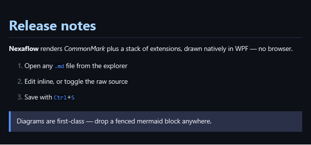
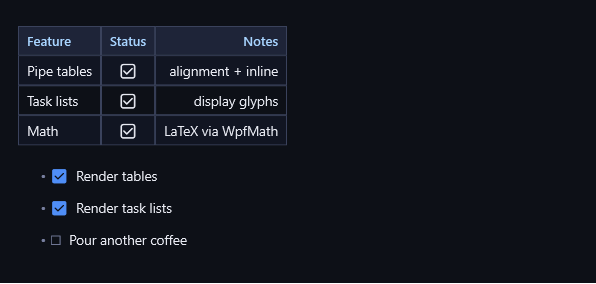
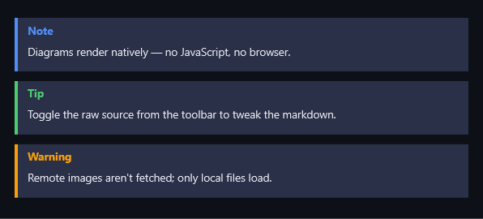
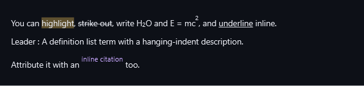
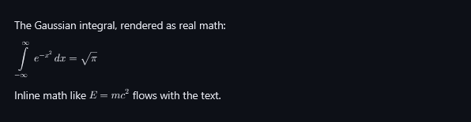

# Markdown

Nexaflow renders Markdown **natively** — no browser, no JavaScript, no round-trip to a web view.
Open a `.md` file and you get a fast, scrollable, fully-styled document: headings, tables, task
lists, callouts, real LaTeX math, and a complete family of diagrams drawn directly on the canvas.

This page covers reading and writing a document. The drawing — diagrams, codes, chemistry and
plots — is large enough to have pages of its own, listed under [More in a document](#more-in-a-document).

---

## Viewing & authoring

Markdown opens in its own tab — there's nothing to configure.

- **Open** — double-click any `.md` file in the file explorer (or open it from a project, a
  search result, or a snaplink). It lands in a Markdown tab.
- **Read & edit inline** — by default the tab shows the *rendered* document and lets you edit it in
  place: type into a heading, a list, or a paragraph and it stays formatted as you go.
- **Toggle the raw source** — flip the toolbar switch to drop to plain Markdown source when you want
  to hand-tune the exact text (front-matter, a fiddly table, a diagram fence), then flip back.
- **Save** — `Ctrl`+`S`. The tab tracks unsaved changes and the title shows when you're dirty.
- **Save as** — `Ctrl`+`Shift`+`S` writes the document to a file you pick, and the tab becomes that file. A
  **Markdown Package** (`*.mdz`), offered first, keeps the document and the pictures and files it links to in one
  file, as a Word document keeps its pictures, so it reads the same wherever it goes. A **Markdown** file (`*.md`)
  has them copied beside it instead. [Show me](locate:Markdown_SaveAs)
- **Markdown Packages** open in the editor like any Markdown file — from a folder, or from inside a zip or a disc
  image — and save back into themselves. One inside a disc image can't be written to: save it as a file elsewhere.
- **Drafts** — a document made for you, such as a page of writing converted to Markdown, opens as a draft. Its first
  save asks where to keep it, starting beside what it was made from.
- **Fold a section** — rest the pointer on a heading and its corner offers **Fold this section**: everything under it,
  sections and all, is put away, and a small **+n** under the heading says how many blocks wait there — press it to open
  the section again. Folding is how you are reading, not what is written: the document is unchanged, and a search or a
  link that lands inside a folded section opens it.

Everything below works in both the rendered view and the preview — it's the same renderer.

---

## Summarise & translate

Two toolbar buttons work through the whole document with the model the workspace gives its **Documents** row — choose
one on the AI page of the workspace's configuration. A model on this machine is enough, however little it reads at once:
the document is worked through a piece at a time, each piece sized to what the model can read.

- **What it is, first.** Before any part is worked on, the document is read for what it is — what kind of writing, what
  about, for whom, in what register, tone and voice, in what language — from its headings and passages spread through it.
  Every part is then worked on knowing that, so the pieces read as the one document they came from.
- **Summarise** — each section is summarised from the deepest up, from what it says and the summaries of the sections
  under it, and the whole document from those. The summary opens beside the document: the abstract on top, then every
  section's heading and summary at its own depth. Fold a section away or open it to go from the whole to the part; each
  heading's **↗** leads back to that section in the document. [Show me](locate:Markdown_Summarize)
- **Translate** — choose the language, named in English, and the document is written again in it a passage at a time,
  keeping to its register, tone and voice, its names and terms given the same way throughout. Its markup, code,
  diagrams, front matter and where its links go stay exactly as they are. A passage no translation keeps the markup of,
  or one the model gives no answer for, stays as the document writes it, with a note before it saying so — the rest
  is translated all the same, and you are told which sections those are. Translating again tries them again. [Show me](locate:Markdown_Translate)
- **In the background.** Either is listed with the workspace's background tasks, saying how far it has got, and can be
  stopped there. While it works, its button shows **⟳** and its tooltip says what it is doing and how far it has got —
  whether you set it going or the assistant did. A second summary of the same document waits for the first; a
  translation into another language can go at the same time. What it makes opens as a draft; its first save starts beside
  the document.
- **Again is quicker.** What was worked out is kept for the workspace, on this machine: summarise or translate an edited
  document again and only the sections that changed are read again — and a stopped translation carries on where it was.
- **The assistant can too** — ask it to summarise or translate a markdown document open in a tab.
- **Ask about the whole document.** Ask the assistant a question about a markdown document too long to read at once —
  *which chapters deal with complex numbers?* It goes down the document's summary to the sections that bear on the
  question, reads only those, and links each section its answer cites back to where it is. A document not yet summarised
  as it stands is summarised first, in the background.
- **A Markdown document.** It works on a Markdown file or a Markdown Package (`.mdz`) as the editor holds it, unsaved edits
  included — a package's pictures come with it, as a Word document's do. A draft is saved first, so what is made leads back
  to where it is. When a button cannot be used, its tooltip says why.

---

## The basics

Standard CommonMark — headings, **bold**, _italic_, `inline code`, ordered and unordered lists,
links, and block quotes — all themed to match the app.

````markdown
# Release notes

**Nexaflow** renders _CommonMark_ plus a stack of extensions, drawn natively in WPF — no browser.

1. Open any `.md` file from the explorer
2. Edit inline, or toggle the raw source
3. Save with `Ctrl`+`S`

> Diagrams are first-class — drop a fenced mermaid block anywhere.
````



---

## Tables & task lists

Pipe tables support per-column alignment and inline formatting; task lists render as tidy
check glyphs.

````markdown
| Feature     | Status | Notes              |
|:------------|:------:|-------------------:|
| Pipe tables |   ✅   | alignment + inline |
| Task lists  |   ✅   | display glyphs     |
| Math        |   ✅   | LaTeX via WpfMath  |

- [x] Render tables
- [x] Render task lists
- [ ] Pour another coffee
````



---

## Callouts

GitHub-style alert blocks (`> [!NOTE]`, `[!TIP]`, `[!IMPORTANT]`, `[!WARNING]`, `[!CAUTION]`) become
coloured, labelled callouts.

````markdown
> [!NOTE]
> Diagrams render natively — no JavaScript, no browser.

> [!TIP]
> Toggle the raw source from the toolbar to tweak the markdown.

> [!WARNING]
> Remote images aren't fetched; only local files load.
````



---

## Rich inline extensions

Beyond CommonMark you also get highlight (`==`), strikethrough (`~~`), subscript (`~`), superscript
(`^`), underline (`++`), definition lists, and citations.

````markdown
You can ==highlight==, ~~strike out~~, write H~2~O and E = mc^2^, and ++underline++ inline.

Leader
: A definition list term with a hanging-indent description.

Attribute it with an ""inline citation"" too.
````



---

## Math

Block (`$$…$$`) and inline (`$…$`) LaTeX are typeset with real math layout.

````markdown
The Gaussian integral, rendered as real math:

$$\int_{-\infty}^{\infty} e^{-x^2}\,dx = \sqrt{\pi}$$

Inline math like $E = mc^2$ flows with the text.
````



---

## More in a document

These are drawn by the same renderer, on your machine, from a fenced block you type.

- **[Diagrams](help:MarkdownDiagrams)** — twenty-four Mermaid diagram types, from flowcharts and
  sequence diagrams to Gantt charts, mindmaps, Sankey diagrams and C4 models.
- **[QR codes & barcodes](help:MarkdownCodes)** — QR, linear barcodes, Data Matrix, PDF417 and Aztec.
- **[Chemistry, word clouds & plots](help:MarkdownScience)** — chemical structures from SMILES,
  shaped word clouds, and correlation plots over your own data.

---

## Good to know

- **It's all local.** Diagrams and math render on your machine — nothing is sent anywhere, and the
  renderer works offline.
- **Local images only.** `` loads local image files; remote `http(s)` and `data:` images are
  not fetched (you'll see the alt text instead).
- **Typography and emoji.** Straight quotes are drawn curled where they pair, `--` and `---` as dashes, `...` as an
  ellipsis, and an emoji's name between colons as the emoji — `:rocket:` is 🚀. What you typed is still there, and
  pressing one shows it; a backslash in front keeps a character as typed (`\"`, `\--`).
- **Picture sizes.** Write a size after a bar at the end of a picture's words, as Obsidian does:
  `` draws it 300 wide in its own proportions, and `` 300 by 200.
  Without one, a picture is drawn its own size, brought down to fit the page and never blown up.
- **Copy or save a picture of a diagram.** Rest the pointer on a pie chart, a Venn diagram, a formula or a
  chemical structure and a small toolbar appears at its top right: **Copy** puts a picture of it on the
  clipboard, and **Save** saves it as a PNG wherever you choose. The picture is the diagram as it reads —
  no caret, selection or placeholder boxes.
- **Front-matter config.** Several diagrams accept a `--- config: … ---` front-matter block to tune
  their look (colours, sizes, orientation) — see the XY, radar, Sankey and Venn examples in
  [Diagrams: charts & analysis](help:DiagramsCharts).
- **What a QR code *does* is the scanner's business, not the code's.** The same Wi-Fi code joins the
  network when scanned from Android's *add a network* screen and runs a web search when scanned from
  a home-screen search widget; a contact card offers to create a contact from inside the phone's
  Contacts app and to merge into an existing one from a general-purpose scanner. If a code seems not
  to work, scan it from the app that owns the thing it describes before suspecting the code.

For the engineering-level breakdown of exactly what's supported, see
[Markdown support](https://github.com/smile-forge/nexaflow/blob/main/docs/MarkdownSupport.md).
